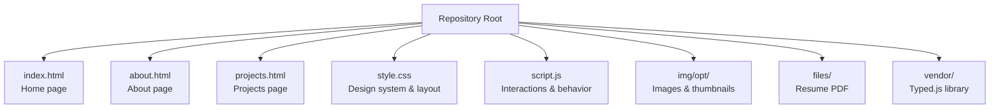
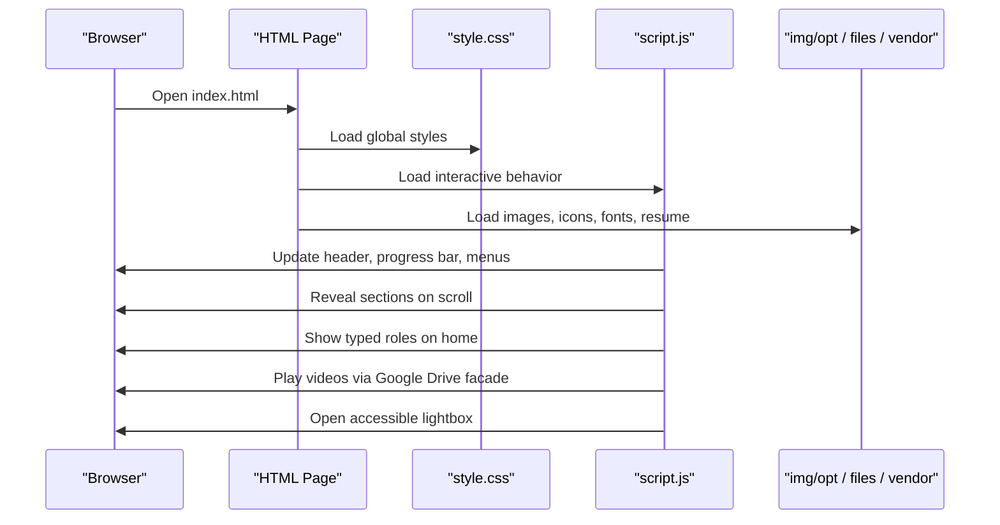
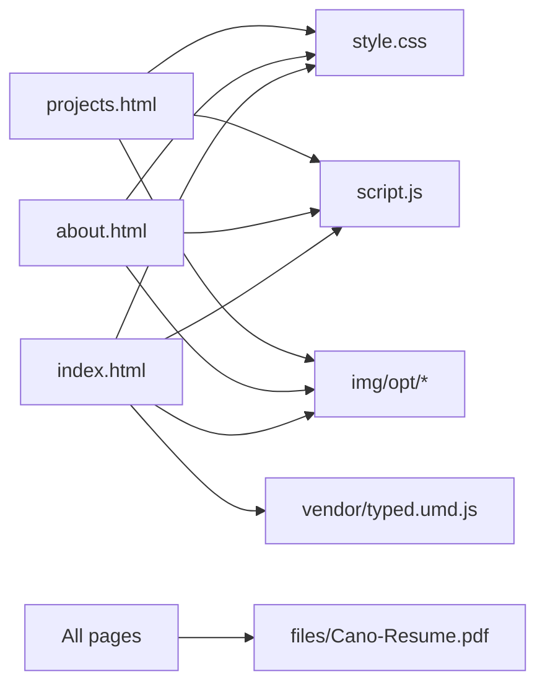
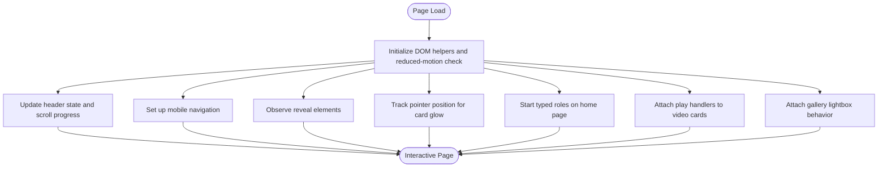
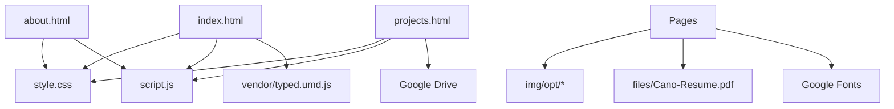

# Getting Started

<cite>
**Referenced Files in This Document**
- [index.html](file://index.html)
- [about.html](file://about.html)
- [projects.html](file://projects.html)
- [style.css](file://style.css)
- [script.js](file://script.js)
</cite>

## Table of Contents
1. [Introduction](#introduction)
2. [Project Structure](#project-structure)
3. [Core Components](#core-components)
4. [Architecture Overview](#architecture-overview)
5. [Detailed Component Analysis](#detailed-component-analysis)
6. [Dependency Analysis](#dependency-analysis)
7. [Performance Considerations](#performance-considerations)
8. [Troubleshooting Guide](#troubleshooting-guide)
9. [Conclusion](#conclusion)

## Introduction
This is the getting started guide for the Jeric Mark Caño portfolio website. The site is a static, responsive portfolio with three pages: Home, About, and Projects. It uses semantic HTML, modern CSS custom properties for theming, and vanilla JavaScript for interactions such as scroll animations, mobile navigation, typed roles, video facades, and an accessible image lightbox.

You can view the site locally by opening `index.html` directly in a web browser. No server or build step is required.

## Project Structure
The repository follows a simple, flat structure optimized for static hosting:

**Diagram sources**
- [index.html:1-50](file://index.html#L1-L50)
- [about.html:1-35](file://about.html#L1-L35)
- [projects.html:1-35](file://projects.html#L1-L35)
- [style.css:1-26](file://style.css#L1-L26)
- [script.js:1-10](file://script.js#L1-L10)

### What each file does
- `index.html`: Home page with hero, skills marquee, services, about preview, selected work, and contact section.
- `about.html`: Personal bio, journey highlights, gallery with lightbox, and contact section.
- `projects.html`: Video editing showcase, photography strip, programming projects, toolbox, and contact section.
- `style.css`: Central design system using CSS custom properties, responsive layout, animations, and component styles.
- `script.js`: Scroll progress, mobile menu, reveal-on-scroll, pointer spotlight, typed roles, Google Drive video facade, and accessible lightbox.
- `img/opt/`: Optimized images used across pages (portraits, gallery photos, story images).
- `files/`: Contains the downloadable resume PDF referenced from all pages.
- `vendor/`: Holds third-party assets like `typed.umd.js`, used on the home page.

**Section sources**
- [index.html:1-50](file://index.html#L1-L50)
- [about.html:1-35](file://about.html#L1-L35)
- [projects.html:1-35](file://projects.html#L1-L35)
- [style.css:1-26](file://style.css#L1-L26)
- [script.js:1-10](file://script.js#L1-L10)

## Core Components
The portfolio is built around three main layers:

- **HTML pages**: Provide content, accessibility attributes, and links to shared resources.
- **CSS design system**: Defines colors, typography, spacing, layout grids, and reusable components through CSS custom properties.
- **JavaScript behaviors**: Adds interactivity without frameworks, keeping the site lightweight and fast.

Key responsibilities:
- Shared header and footer appear across pages.
- Images are loaded from `img/opt/`.
- Resume downloads point to `files/Cano-Resume.pdf`.
- Social links and external references are embedded in the HTML.
- Theme and layout are controlled centrally in `style.css`.
- Interactions are handled in `script.js`.

**Section sources**
- [index.html:152-173](file://index.html#L152-L173)
- [about.html:104-125](file://about.html#L104-L125)
- [projects.html:105-126](file://projects.html#L105-L126)
- [style.css:6-26](file://style.css#L6-L26)
- [script.js:8-49](file://script.js#L8-L49)

## Architecture Overview
At runtime, the browser loads the HTML page, applies the global stylesheet, and executes the script. Each page shares the same visual language and interaction patterns.

**Diagram sources**
- [index.html:24-26](file://index.html#L24-L26)
- [about.html:23-24](file://about.html#L23-L24)
- [projects.html:23-24](file://projects.html#L23-L24)
- [style.css:6-26](file://style.css#L6-L26)
- [script.js:8-49](file://script.js#L8-L49)
- [script.js:98-137](file://script.js#L98-L137)
- [script.js:139-227](file://script.js#L139-L227)

## Detailed Component Analysis

### Viewing the Site Locally
To view the portfolio locally:
1. Open the repository folder.
2. Double-click `index.html` to open it in your default web browser.
3. Navigate between Home, About, and Projects using the header menu.
4. Download the resume by clicking the Résumé link; it points to `files/Cano-Resume.pdf`.

Important local setup notes:
- Keep the original folder structure so relative paths continue to work.
- If you move or rename folders, update the corresponding paths in the HTML files.
- For best results, use a modern browser that supports CSS custom properties, IntersectionObserver, and modern JavaScript features.

**Section sources**
- [index.html:163-167](file://index.html#L163-L167)
- [about.html:115-119](file://about.html#L115-L119)
- [projects.html:116-120](file://projects.html#L116-L120)

### Repository Structure and Relationships
The relationship between pages, styling, and behavior is consistent:

**Diagram sources**
- [index.html:24-26](file://index.html#L24-L26)
- [about.html:23-24](file://about.html#L23-L24)
- [projects.html:23-24](file://projects.html#L23-L24)
- [index.html:15-15](file://index.html#L15-L15)
- [about.html:15-15](file://about.html#L15-L15)
- [projects.html:15-15](file://projects.html#L15-L15)

**Section sources**
- [index.html:15-26](file://index.html#L15-L26)
- [about.html:15-24](file://about.html#L15-L24)
- [projects.html:15-24](file://projects.html#L15-L24)

### Customizing Personal Information
Personal information appears in several places:

- Name and role text: Update headings, paragraphs, and meta tags in each page.
- Location and social links: Update anchor `href` values and `aria-label` attributes.
- Education, certifications, leadership, and experience: Edit the About page content blocks.
- Footer year: The script automatically updates the current year, but you can also edit the initial value if needed.

Where to look:
- Home page personal introduction and social links.
- About page biography, facts, and journey stories.
- Projects page project descriptions and toolbox labels.
- All pages’ header logo text and footer copyright line.

**Section sources**
- [index.html:180-216](file://index.html#L180-L216)
- [about.html:154-194](file://about.html#L154-L194)
- [about.html:210-255](file://about.html#L210-L255)
- [projects.html:321-408](file://projects.html#L321-L408)
- [script.js:229-232](file://script.js#L229-L232)

### Changing Colors Through CSS Custom Properties
The design system is centralized in `style.css` under the root variables. To customize colors:

- Change background colors: Adjust `--bg` and `--bg-elev`.
- Change text colors: Adjust `--text` and `--muted`.
- Change accent colors: Adjust `--teal`, `--cyan`, and `--indigo`.
- Change gradients: Adjust `--grad` to redefine the overall gradient theme.
- Change spacing and radius: Adjust `--radius`, `--radius-sm`, and container width `--container`.
- Change fonts: Adjust `--font-body` and `--font-display`.

Because these variables are used throughout the stylesheet, changing them updates the entire site consistently.

**Section sources**
- [style.css:6-26](file://style.css#L6-L26)
- [style.css:43-53](file://style.css#L43-L53)
- [style.css:201-206](file://style.css#L201-L206)

### Modifying Content Across All Three Pages
Common content areas include:

- Header navigation: Update page titles, active states, and links.
- Contact section: Update social links, resume path, and call-to-action text.
- Meta tags: Update title, description, and Open Graph metadata for SEO and sharing.
- Footer: Update copyright text and year.

Recommended approach:
- Use find-and-replace carefully for repeated phrases.
- Verify that `aria-current="page"` is set only on the active page’s nav link.
- Keep external links secure with `target="_blank"` and `rel="noopener"`.

**Section sources**
- [index.html:152-173](file://index.html#L152-L173)
- [about.html:104-125](file://about.html#L104-L125)
- [projects.html:105-126](file://projects.html#L105-L126)
- [index.html:435-467](file://index.html#L435-L467)
- [about.html:358-390](file://about.html#L358-L390)
- [projects.html:413-445](file://projects.html#L413-L445)

### Adding New Projects
There are two main ways to add new work:

1. Add a video project card in `projects.html`:
   - Copy an existing `.video-card` block.
   - Update `data-video` with the new Google Drive file ID.
   - Update `data-title`, heading, description, and external link.
   - Optionally adjust the color tint variables inline.

2. Add a photography item:
   - Add a new `<figure>` inside the photography strip or the About gallery.
   - Place the image in `img/opt/`.
   - Update `src`, `alt`, dimensions, and captions.
   - For the gallery lightbox, ensure both the thumbnail and full-size image paths are correct.

For the home page “Selected work” cards, update the links and labels to point toward the relevant project or page.

**Section sources**
- [projects.html:154-256](file://projects.html#L154-L256)
- [projects.html:274-305](file://projects.html#L274-L305)
- [about.html:270-354](file://about.html#L270-L354)
- [index.html:395-431](file://index.html#L395-L431)

### Updating Images in img/opt
Images are referenced with relative paths from the root directory. When updating images:

- Replace files in `img/opt/` with the same filenames to avoid breaking links.
- If you rename files, update every `src` attribute in the HTML.
- Keep images optimized for the web to maintain performance.
- Preserve `width` and `height` attributes where present to reduce layout shifts.
- Ensure alt text remains descriptive and meaningful.

Common image locations:
- Home portrait: `img/opt/home.jpg`
- About portrait and story images: `img/opt/jeric2.jpg`, `img/opt/story1.jpg`, `story2.jpg`, `story3.jpg`
- Gallery images: `img/opt/gallery1.jpg` through `gallery6.jpg`, plus additional variants.

**Section sources**
- [index.html:221-222](file://index.html#L221-L222)
- [index.html:343-345](file://index.html#L343-L345)
- [about.html:145-151](file://about.html#L145-L151)
- [about.html:213-254](file://about.html#L213-L254)
- [about.html:270-354](file://about.html#L270-L354)
- [projects.html:274-305](file://projects.html#L274-L305)

### Managing the Resume PDF in files
The resume is linked from multiple places:
- Header Résumé button
- Home page hero action
- Contact sections on all pages

To update the resume:
1. Replace `files/Cano-Resume.pdf` with your updated PDF.
2. If you change the filename, update every link pointing to the resume.
3. Test the download link on all pages.
4. Keep the PDF concise, well-formatted, and up to date.

**Section sources**
- [index.html:163-167](file://index.html#L163-L167)
- [index.html:193-196](file://index.html#L193-L196)
- [index.html:460-463](file://index.html#L460-L463)
- [about.html:115-119](file://about.html#L115-L119)
- [about.html:383-386](file://about.html#L383-L386)
- [projects.html:116-120](file://projects.html#L116-L120)
- [projects.html:438-441](file://projects.html#L438-L441)

### Understanding Key JavaScript Features
The script provides several user-facing features:

- Scroll progress indicator and sticky header state.
- Mobile navigation toggle with keyboard and click-outside support.
- Reveal-on-scroll animations using IntersectionObserver.
- Pointer-based spotlight effect for cards.
- Typed roles animation on the home page.
- Lazy loading of Google Drive video players when users click play.
- Accessible image lightbox with keyboard and touch navigation.

**Diagram sources**
- [script.js:1-10](file://script.js#L1-L10)
- [script.js:8-49](file://script.js#L8-L49)
- [script.js:51-96](file://script.js#L51-L96)
- [script.js:98-137](file://script.js#L98-L137)
- [script.js:139-227](file://script.js#L139-L227)

**Section sources**
- [script.js:8-49](file://script.js#L8-L49)
- [script.js:51-96](file://script.js#L51-L96)
- [script.js:98-137](file://script.js#L98-L137)
- [script.js:139-227](file://script.js#L139-L227)

## Dependency Analysis
The pages depend on shared resources:

- All pages load `style.css`.
- All pages load `script.js`.
- The home page additionally loads `vendor/typed.umd.js`.
- Images are loaded from `img/opt/`.
- Resume downloads reference `files/Cano-Resume.pdf`.
- External resources include Google Fonts and Google Drive video embeds.

**Diagram sources**
- [index.html:21-26](file://index.html#L21-L26)
- [about.html:20-24](file://about.html#L20-L24)
- [projects.html:20-24](file://projects.html#L20-L24)
- [projects.html:154-256](file://projects.html#L154-L256)

**Section sources**
- [index.html:21-26](file://index.html#L21-L26)
- [about.html:20-24](file://about.html#L20-L24)
- [projects.html:20-24](file://projects.html#L20-L24)
- [projects.html:154-256](file://projects.html#L154-L256)

## Performance Considerations
- Keep images optimized and appropriately sized.
- Avoid moving or renaming asset folders without updating paths.
- Prefer replacing files in `img/opt/` rather than adding many large images.
- Use lazy loading for off-screen images where appropriate.
- Respect `prefers-reduced-motion`; the script already disables heavy animations when requested.
- Avoid unnecessary DOM manipulation in custom scripts.
- Keep third-party dependencies minimal; the site currently relies mainly on `typed.umd.js`.

[No sources needed since this section provides general guidance]

## Troubleshooting Guide
Common issues and fixes:

- Blank page or missing styles:
  - Confirm `style.css` is in the same directory as the HTML files.
  - Check the browser console for failed resource loads.

- Images not showing:
  - Verify the image path matches the actual file name in `img/opt/`.
  - Ensure the file extension is correct and the file exists.

- Resume download fails:
  - Confirm `files/Cano-Resume.pdf` exists.
  - If renamed, update every link in the HTML.

- Mobile menu not working:
  - Ensure `script.js` is loaded.
  - Check that the nav toggle button exists and has the expected class.

- Typed roles not appearing:
  - Confirm `vendor/typed.umd.js` is present and loaded before `script.js`.
  - Check the browser console for script errors.

- Lightbox not opening:
  - Ensure gallery items have `data-full` attributes.
  - Verify the referenced full-size images exist.

- Links open incorrectly:
  - Review relative paths for internal pages.
  - Keep external links secure with `target="_blank"` and `rel="noopener"`.

**Section sources**
- [index.html:24-26](file://index.html#L24-L26)
- [about.html:23-24](file://about.html#L23-L24)
- [projects.html:23-24](file://projects.html#L23-L24)
- [script.js:34-49](file://script.js#L34-L49)
- [script.js:98-118](file://script.js#L98-L118)
- [script.js:139-227](file://script.js#L139-L227)

## Conclusion
This portfolio is designed to be easy to view, customize, and extend. Start by opening `index.html` locally, then make changes gradually:
- Update personal information in the HTML.
- Customize colors through CSS custom properties in `style.css`.
- Add projects by copying existing structured blocks.
- Replace images in `img/opt/` and keep paths consistent.
- Manage the resume in `files/` and keep links synchronized.

By maintaining the existing structure and following the guidance above, you can keep the site responsive, accessible, and visually consistent while making it your own.

[No sources needed since this section summarizes without analyzing specific files]