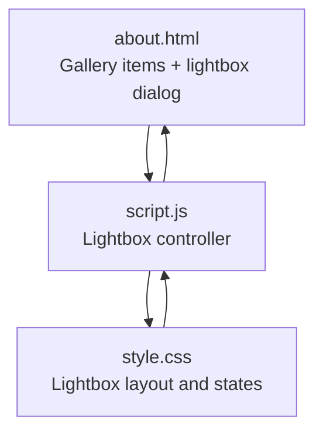
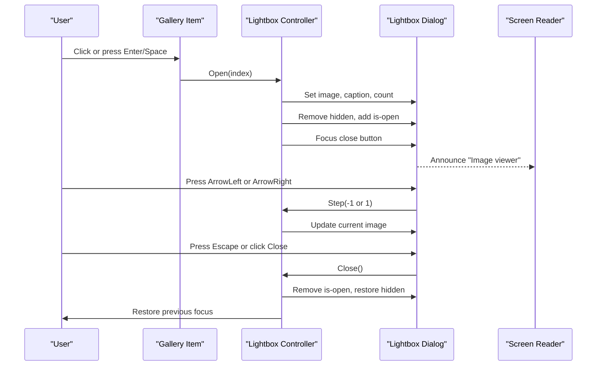
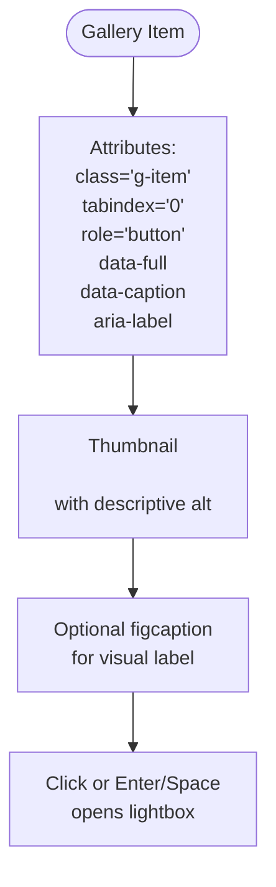
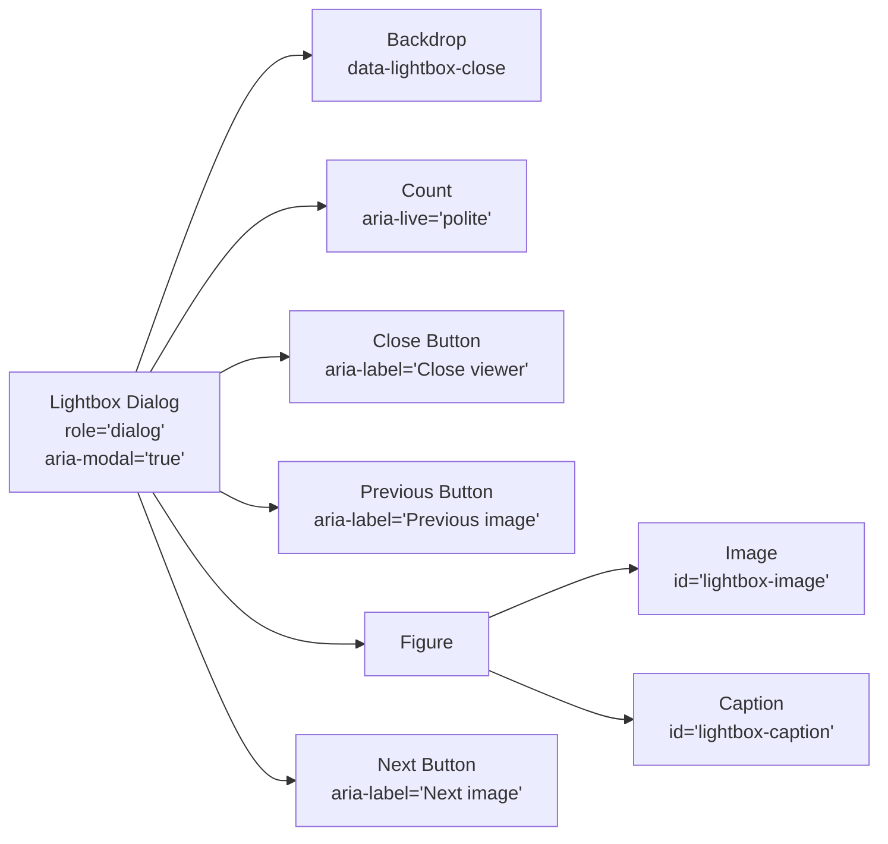
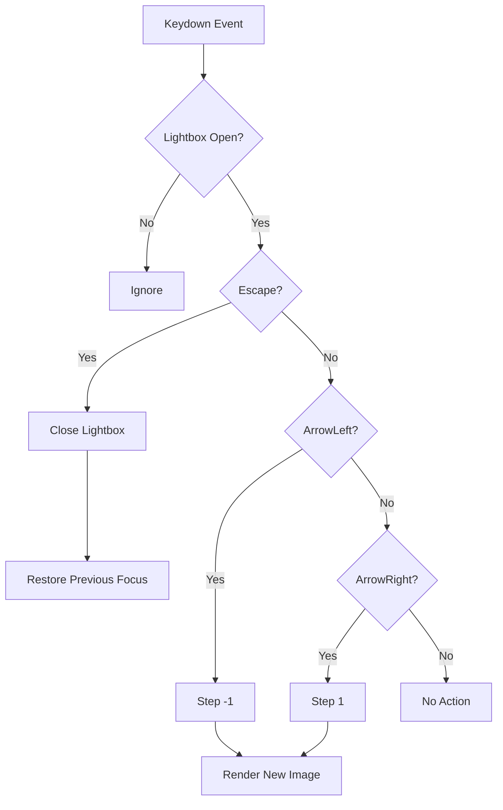
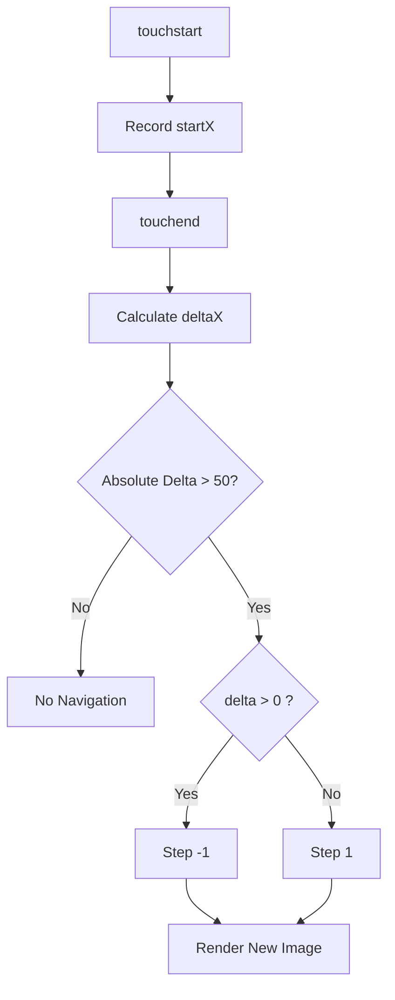
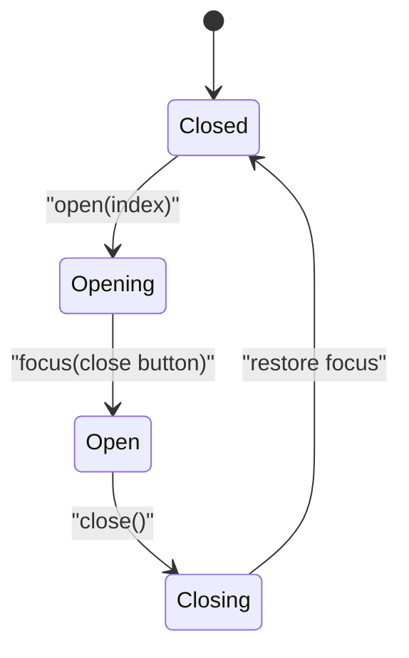
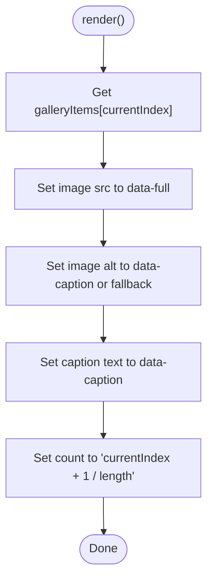
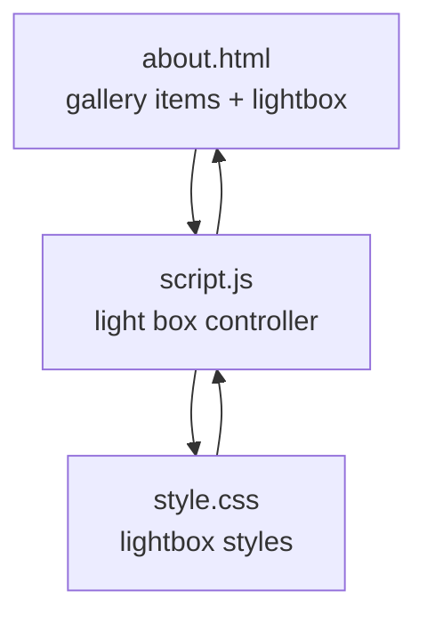

# Accessible Image Lightbox

<cite>
**Referenced Files in This Document**
- [about.html](file://about.html)
- [script.js](file://script.js)
- [style.css](file://style.css)
</cite>

## Table of Contents
1. [Introduction](#introduction)
2. [Project Structure](#project-structure)
3. [Core Components](#core-components)
4. [Architecture Overview](#architecture-overview)
5. [Detailed Component Analysis](#detailed-component-analysis)
6. [Dependency Analysis](#dependency-analysis)
7. [Performance Considerations](#performance-considerations)
8. [Troubleshooting Guide](#troubleshooting-guide)
9. [Conclusion](#conclusion)
10. [Appendices](#appendices)

## Introduction
This document explains the accessible image lightbox system used by the portfolio site. The lightbox provides full-screen image viewing with keyboard navigation, touch gestures, ARIA attributes, focus management, and screen reader compatibility. It is implemented as a lightweight JavaScript module that works with gallery items marked using data attributes.

The implementation is primarily located in:
- Gallery markup and lightbox dialog structure in the about page
- Lightbox behavior, keyboard handling, and touch gesture logic in the main script
- Lightbox layout, transitions, and responsive styles in the stylesheet

## Project Structure
The lightbox spans three files:

- `about.html`
  - Defines the gallery grid of images
  - Defines the lightbox dialog container at the bottom of the page
- `script.js`
  - Initializes the lightbox when gallery items exist
  - Handles opening, closing, navigating, keyboard input, and swipe gestures
- `style.css`
  - Styles the lightbox overlay, figure, buttons, backdrop, and open state
  - Adds scroll lock when the lightbox is open

**Diagram sources**
- [about.html:270-354](file://about.html#L270-L354)
- [about.html:405-423](file://about.html#L405-L423)
- [script.js:139-227](file://script.js#L139-L227)
- [style.css:1475-1601](file://style.css#L1475-L1601)

**Section sources**
- [about.html:270-354](file://about.html#L270-L354)
- [about.html:405-423](file://about.html#L405-L423)
- [script.js:139-227](file://script.js#L139-L227)
- [style.css:1475-1601](file://style.css#L1475-L1601)

## Core Components
The lightbox consists of these core parts:

- Gallery items
  - Each gallery item is a `figure` element with class `g-item`
  - Uses `tabindex="0"` and `role="button"` to be keyboard-focusable and activatable
  - Uses `data-full` for the full-size image URL
  - Uses `data-caption` for the lightbox caption text
  - Uses `aria-label` to describe how to view the image
- Lightbox dialog
  - Container with `id="lightbox"`, `role="dialog"`, `aria-modal="true"`, and `aria-label="Image viewer"`
  - Contains a close button, previous/next buttons, an image element, and a caption
  - Uses a count element with `aria-live="polite"` to announce current position
- Controller logic
  - Finds all gallery items and the lightbox container
  - Opens the lightbox on click or Enter/Space activation
  - Closes the lightbox via Escape key, close button, or backdrop click
  - Navigates with ArrowLeft and ArrowRight keys
  - Supports swipe left/right on mobile devices
  - Manages focus by moving it to the close button when opened and restoring focus when closed

**Section sources**
- [about.html:270-354](file://about.html#L270-L354)
- [about.html:405-423](file://about.html#L405-L423)
- [script.js:139-227](file://script.js#L139-L227)

## Architecture Overview
The lightbox follows a simple event-driven architecture:

- Initialization scans the DOM for gallery items and the lightbox container
- User interactions trigger open, close, or navigation functions
- State includes the current index and the previously focused element
- Rendering updates the image source, alt text, caption, and count
- Styling controls visibility, transitions, and body scroll lock

**Diagram sources**
- [script.js:160-179](file://script.js#L160-L179)
- [script.js:181-207](file://script.js#L181-L207)
- [script.js:209-226](file://script.js#L209-L226)
- [about.html:405-423](file://about.html#L405-L423)

## Detailed Component Analysis

### Gallery Item Structure
Each gallery item is a semantic `figure` element designed for accessibility:

- `class="g-item"` identifies the item for the lightbox controller
- `tabindex="0"` makes the item focusable via keyboard
- `role="button"` indicates interactive behavior
- `data-full` holds the full-resolution image URL
- `data-caption` holds the caption shown in the lightbox
- `aria-label` describes the action for assistive technology
- The inner `` has its own descriptive `alt` text for the thumbnail context

Example paths:
- Gallery item with full image and caption: `[about.html:271-281](file://about.html#L271-L281)`
- Another gallery item example: `[about.html:283-293](file://about.html#L283-L293)`

**Diagram sources**
- [about.html:271-281](file://about.html#L271-L281)
- [about.html:283-293](file://about.html#L283-L293)

**Section sources**
- [about.html:270-354](file://about.html#L270-L354)

### Lightbox Dialog Markup
The lightbox dialog is a modal region with proper ARIA roles and labels:

- Container: `id="lightbox"`, `role="dialog"`, `aria-modal="true"`, `aria-label="Image viewer"`, initially `hidden`
- Backdrop: clickable area to close the lightbox
- Count: `id="lightbox-count"`, `aria-live="polite"` for live announcements
- Close button: `aria-label="Close viewer"`
- Previous button: `aria-label="Previous image"`
- Next button: `aria-label="Next image"`
- Figure: contains the displayed image and caption
- Image: `id="lightbox-image"`, dynamically updated
- Caption: `id="lightbox-caption"`, dynamically updated

Example path:
- Lightbox dialog structure: `[about.html:405-423](file://about.html#L405-L423)`

**Diagram sources**
- [about.html:405-423](file://about.html#L405-L423)

**Section sources**
- [about.html:405-423](file://about.html#L405-L423)

### Keyboard Navigation
Keyboard support ensures the lightbox is usable without a mouse:

- Activation
  - Clicking a gallery item opens the lightbox
  - Pressing Enter or Space while focused on a gallery item opens the lightbox
- Navigation
  - ArrowLeft moves to the previous image
  - ArrowRight moves to the next image
- Closing
  - Escape closes the lightbox
  - Clicking the close button or backdrop closes the lightbox

Implementation references:
- Gallery activation handlers: `[script.js:186-194](file://script.js#L186-L194)`
- Global keyboard handler for Escape and arrows: `[script.js:202-207](file://script.js#L202-L207)`
- Close button and navigation button wiring: `[script.js:196-200](file://script.js#L196-L200)`

**Diagram sources**
- [script.js:202-207](file://script.js#L202-L207)
- [script.js:181-184](file://script.js#L181-L184)
- [script.js:170-179](file://script.js#L170-L179)

**Section sources**
- [script.js:186-207](file://script.js#L186-L207)

### Touch Gesture Support
Touch gestures allow swiping between images on mobile devices:

- On `touchstart`, the starting X coordinate is recorded
- On `touchend`, the delta is calculated
- If the absolute delta exceeds a threshold, the direction determines previous or next
- Events are passive to avoid blocking scrolling

Implementation references:
- Touch start and end listeners: `[script.js:209-226](file://script.js#L209-L226)`
- Swipe threshold: more than 50 pixels triggers navigation

**Diagram sources**
- [script.js:209-226](file://script.js#L209-L226)

**Section sources**
- [script.js:209-226](file://script.js#L209-L226)

### ARIA Attributes and Screen Reader Compatibility
The lightbox uses ARIA to communicate state and actions:

- `role="dialog"` and `aria-modal="true"` identify the lightbox as a modal dialog
- `aria-label="Image viewer"` gives the dialog a descriptive name
- `aria-live="polite"` on the count element announces changes such as “1 / 7”
- Buttons have explicit `aria-label` values for close, previous, and next actions
- Gallery items use `role="button"` and `aria-label` to describe the view action
- The lightbox image’s `alt` attribute is updated from the gallery item’s caption

Implementation references:
- Dialog ARIA setup: `[about.html:405-407](file://about.html#L405-L407)`
- Button labels: `[about.html:408-421](file://about.html#L408-L421)`
- Gallery item ARIA: `[about.html:271-281](file://about.html#L271-L281)`
- Dynamic alt and caption update: `[script.js:152-158](file://script.js#L152-L158)`

**Section sources**
- [about.html:271-281](file://about.html#L271-L281)
- [about.html:405-421](file://about.html#L405-L421)
- [script.js:152-158](file://script.js#L152-L158)

### Focus Management
Focus management keeps keyboard users oriented:

- When opening, the controller stores the previously focused element
- After rendering and showing the lightbox, focus moves to the close button
- When closing, focus returns to the previously focused element
- The body gains a class to prevent background scrolling while the lightbox is open

Implementation references:
- Opening flow and focus transfer: `[script.js:160-168](file://script.js#L160-L168)`
- Closing flow and focus restoration: `[script.js:170-179](file://script.js#L170-L179)`
- Body scroll lock style: `[style.css:1599-1601](file://style.css#L1599-L1601)`

**Diagram sources**
- [script.js:160-179](file://script.js#L160-L179)
- [style.css:1599-1601](file://style.css#L1599-L1601)

**Section sources**
- [script.js:160-179](file://script.js#L160-L179)
- [style.css:1599-1601](file://style.css#L1599-L1601)

### Rendering Logic
Rendering updates the lightbox content based on the current index:

- Sets the image source to the gallery item’s `data-full` value
- Sets the image `alt` to the gallery item’s `data-caption` or a fallback
- Updates the caption element with the same caption text
- Updates the count element with “current / total”

Implementation reference:
- Render function: `[script.js:152-158](file://script.js#L152-L158)`

**Diagram sources**
- [script.js:152-158](file://script.js#L152-L158)

**Section sources**
- [script.js:152-158](file://script.js#L152-L158)

### Styling and Visual States
The stylesheet defines the lightbox appearance and interaction states:

- `.lightbox` positions the overlay and centers content
- `.lightbox[hidden]` hides the dialog when not active
- `.lightbox-backdrop` provides a blurred dark background
- `.lightbox.is-open` fades in the backdrop and reveals the figure
- `.lightbox-figure img` constrains size and applies rounded corners and shadow
- `.lightbox-btn` styles the circular navigation and close buttons
- `.lightbox-count` displays the current position
- `body.lightbox-open` locks page scrolling

Implementation references:
- Lightbox base styles and open state: `[style.css:1479-1522](file://style.css#L1479-L1522)`
- Image and caption styles: `[style.css:1524-1538](file://style.css#L1524-L1538)`
- Button styles and hover effects: `[style.css:1540-1586](file://style.css#L1540-L1586)`
- Count styling: `[style.css:1588-1597](file://style.css#L1588-L1597)`
- Scroll lock: `[style.css:1599-1601](file://style.css#L1599-L1601)`

**Section sources**
- [style.css:1479-1601](file://style.css#L1479-L1601)

## Dependency Analysis
The lightbox depends on:

- DOM elements defined in `about.html`
- Styles defined in `style.css`
- Controller logic in `script.js`

**Diagram sources**
- [about.html:270-354](file://about.html#L270-L354)
- [about.html:405-423](file://about.html#L405-L423)
- [script.js:139-227](file://script.js#L139-L227)
- [style.css:1475-1601](file://style.css#L1475-L1601)

**Section sources**
- [about.html:270-354](file://about.html#L270-L354)
- [about.html:405-423](file://about.html#L405-L423)
- [script.js:139-227](file://script.js#L139-L227)
- [style.css:1475-1601](file://style.css#L1475-L1601)

## Performance Considerations
- Lazy loading thumbnails
  - Gallery thumbnails use `loading="lazy"` to defer offscreen images
  - Reference: `[about.html:274-275](file://about.html#L274-L275)`
- Passive event listeners
  - Touch events are registered as passive to improve scrolling performance
  - Reference: `[script.js:209-226](file://script.js#L209-L226)`
- Minimal DOM manipulation
  - Rendering only updates necessary properties: image source, alt, caption, and count
  - Reference: `[script.js:152-158](file://script.js#L152-L158)`
- Animation and transition safety
  - The rest of the site respects `prefers-reduced-motion`; the lightbox uses short transitions and does not force animations
  - Reference: `[script.js:6](file://script.js#L6)`

[No sources needed since this section provides general guidance beyond the referenced lines above]

## Troubleshooting Guide
Common issues and resolutions:

- Lightbox does not open
  - Ensure gallery items have `class="g-item"`, `tabindex="0"`, `role="button"`, `data-full`, and `data-caption`
  - Verify the lightbox container exists with `id="lightbox"` and is present in the DOM
  - References:
    - Gallery item attributes: `[about.html:271-281](file://about.html#L271-L281)`
    - Lightbox container: `[about.html:405-407](file://about.html#L405-L407)`
- Keyboard navigation not working
  - Confirm global keydown listener is attached and lightbox is not hidden
  - Check that Escape, ArrowLeft, and ArrowRight are handled
  - Reference: `[script.js:202-207](file://script.js#L202-L207)`
- Focus jumps unexpectedly
  - Ensure the close button is focusable and receives focus on open
  - Ensure focus is restored on close
  - References:
    - Open focus transfer: `[script.js:160-168](file://script.js#L160-L168)`
    - Close focus restoration: `[script.js:170-179](file://script.js#L170-L179)`
- Screen reader does not announce image count
  - Verify the count element has `aria-live="polite"` and is updated during render
  - References:
    - Count element: `[about.html:407](file://about.html#L407)`
    - Count update: `[script.js:157](file://script.js#L157)`
- Swipe gestures do not work
  - Confirm touchstart and touchend listeners are attached to the lightbox
  - Ensure the swipe threshold is exceeded
  - Reference: `[script.js:209-226](file://script.js#L209-L226)`

**Section sources**
- [about.html:271-281](file://about.html#L271-L281)
- [about.html:405-407](file://about.html#L405-L407)
- [script.js:157-157](file://script.js#L157-L157)
- [script.js:160-179](file://script.js#L160-L179)
- [script.js:202-226](file://script.js#L202-L226)

## Conclusion
The accessible image lightbox provides a robust, keyboard-friendly, and screen-reader-compatible full-screen image viewer. It relies on semantic gallery items with clear data attributes, a properly labeled modal dialog, and a concise controller that manages state, focus, keyboard input, and touch gestures. By following the documented structure and behaviors, you can add new images and customize the experience while maintaining strong accessibility standards.

[No sources needed since this section summarizes without analyzing specific files]

## Appendices

### How to Add Images to the Gallery
To add a new image to the gallery:

1. Add a new gallery item inside the gallery container in `about.html`
   - Use `class="g-item"`
   - Set `tabindex="0"` and `role="button"`
   - Set `data-full` to the full-size image URL
   - Set `data-caption` to the desired caption
   - Provide a descriptive `aria-label` for the view action
   - Include an inner `` with its own descriptive `alt` text
   - Example path: `[about.html:271-281](file://about.html#L271-L281)`
2. Ensure the lightbox container exists
   - The lightbox should remain at the bottom of the page with `id="lightbox"`
   - Example path: `[about.html:405-423](file://about.html#L405-L423)`
3. No additional JavaScript is required; the controller automatically discovers new gallery items

**Section sources**
- [about.html:271-281](file://about.html#L271-L281)
- [about.html:405-423](file://about.html#L405-L423)

### Customizing Lightbox Behavior While Maintaining Accessibility
- Change navigation keys
  - Modify the global keydown handler to support additional keys if needed
  - Reference: `[script.js:202-207](file://script.js#L202-L207)`
- Adjust swipe sensitivity
  - Change the threshold value in the touchend handler
  - Reference: `[script.js:222](file://script.js#L222)`
- Update captions and descriptions
  - Keep `data-caption` and `aria-label` consistent for clarity
  - References:
    - Gallery item aria-label: `[about.html:271-281](file://about.html#L271-L281)`
    - Caption update: `[script.js:156](file://script.js#L156)`
- Improve visual feedback
  - Extend `.lightbox-btn:hover` or add focus-visible styles
  - Reference: `[style.css:1556-1559](file://style.css#L1556-L1559)`
- Preserve focus management
  - Do not remove the close button focus on open or focus restoration on close
  - References:
    - Open focus: `[script.js:167](file://script.js#L167)`
    - Close focus restoration: `[script.js:178](file://script.js#L178)`

**Section sources**
- [script.js:156-156](file://script.js#L156-L156)
- [script.js:167-167](file://script.js#L167-L167)
- [script.js:178-178](file://script.js#L178-L178)
- [script.js:202-222](file://script.js#L202-L222)
- [style.css:1556-1559](file://style.css#L1556-L1559)
- [about.html:271-281](file://about.html#L271-L281)