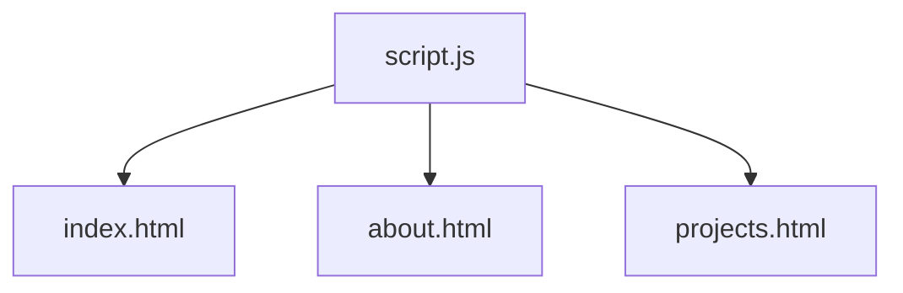
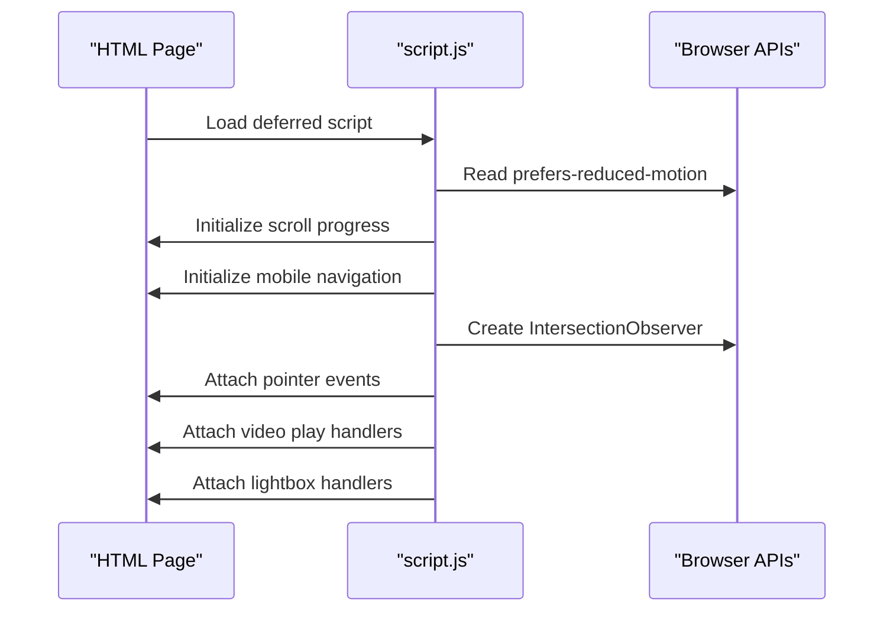
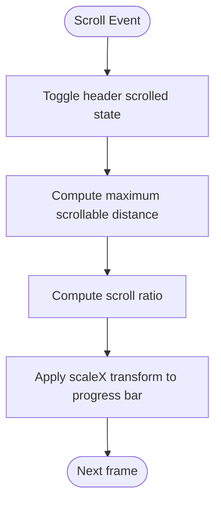
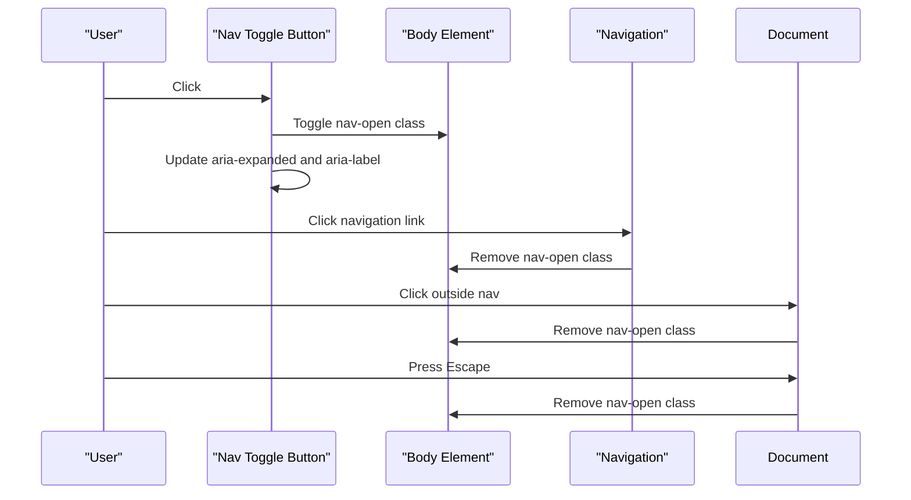
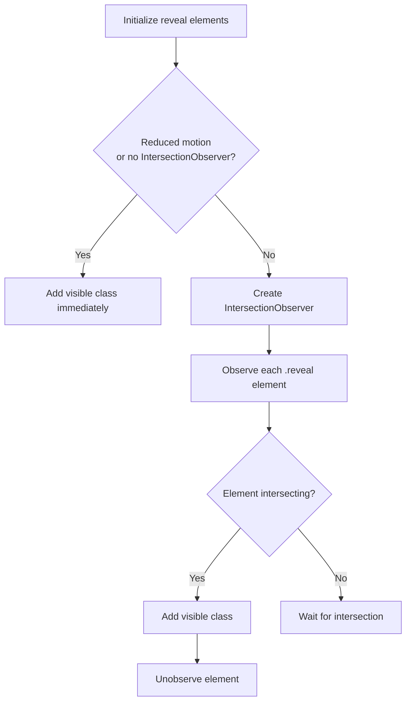
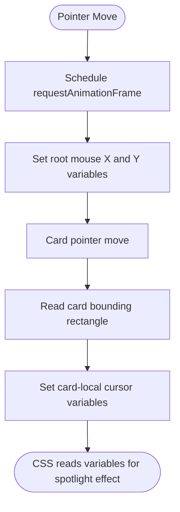
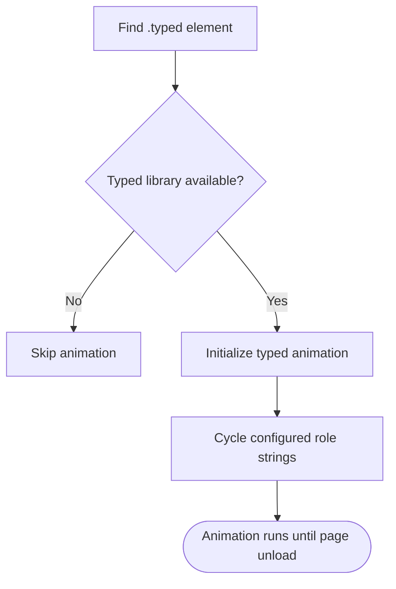
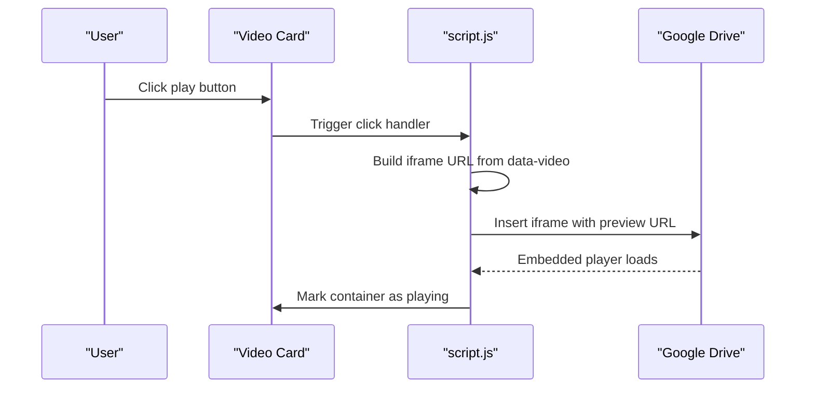
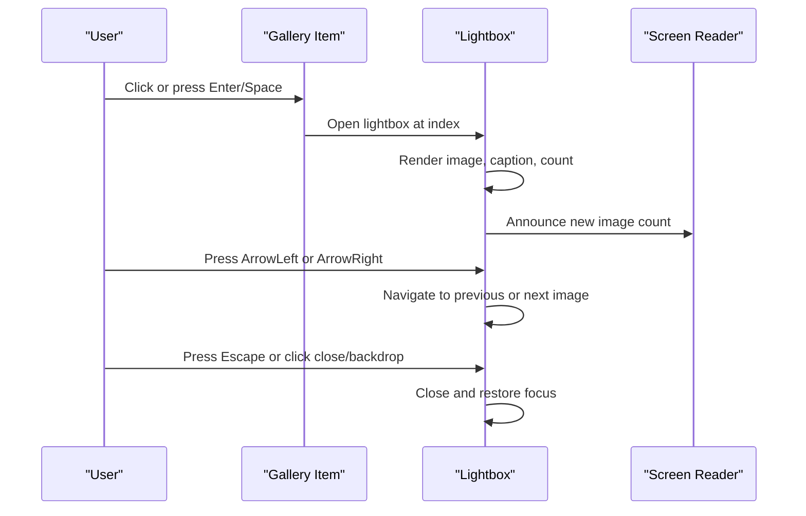
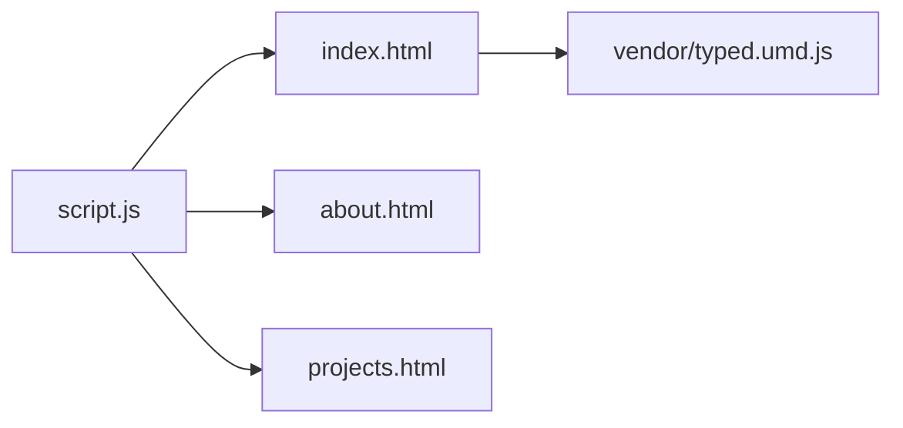

# Interactive Features

<cite>
**Referenced Files in This Document**
- [script.js](file://script.js)
- [index.html](file://index.html)
- [about.html](file://about.html)
- [projects.html](file://projects.html)
</cite>

## Table of Contents
1. [Introduction](#introduction)
2. [Project Structure](#project-structure)
3. [Core Components](#core-components)
4. [Architecture Overview](#architecture-overview)
5. [Detailed Component Analysis](#detailed-component-analysis)
6. [Dependency Analysis](#dependency-analysis)
7. [Performance Considerations](#performance-considerations)
8. [Troubleshooting Guide](#troubleshooting-guide)
9. [Conclusion](#conclusion)

## Introduction
This document explains all interactive JavaScript features implemented in the portfolio website. It covers:
- Scroll progress indicator at the top of the page
- Mobile navigation with hamburger menu and keyboard accessibility
- Scroll-triggered reveal animations using Intersection Observer
- Pointer tracking for spotlight effects on cards and story elements
- Video player integration with Google Drive lazy loading
- Accessible image lightbox with keyboard navigation, touch gestures, and screen reader support

The implementation is intentionally lightweight: it uses vanilla JavaScript, semantic HTML, CSS custom properties, and progressive enhancement through `prefers-reduced-motion` and feature detection.

## Project Structure
The interactive behavior lives primarily in one script file, while each HTML page provides the required DOM structure and data attributes.

**Diagram sources**
- [script.js:1-233](file://script.js#L1-L233)
- [index.html:1-484](file://index.html#L1-L484)
- [about.html:1-428](file://about.html#L1-L428)
- [projects.html:1-462](file://projects.html#L1-L462)

**Section sources**
- [script.js:1-233](file://script.js#L1-L233)
- [index.html:1-484](file://index.html#L1-L484)
- [about.html:1-428](file://about.html#L1-L428)
- [projects.html:1-462](file://projects.html#L1-L462)

## Core Components
The main script initializes several independent features:
- Scroll state and reading progress bar
- Mobile navigation toggle and keyboard handling
- Intersection Observer–based reveal animations
- Pointer-based spotlight variables for card hover effects
- Typed text animation (home page only)
- Lazy video player creation for Google Drive embeds
- Accessible gallery lightbox with keyboard and touch support
- Dynamic footer year update

These components are self-contained and safe to enable or disable based on browser capabilities and user preferences.

**Section sources**
- [script.js:1-233](file://script.js#L1-L233)

## Architecture Overview
The site follows a simple event-driven architecture:
- HTML pages provide structural hooks such as IDs, classes, and data attributes.
- The script runs after the DOM is ready because it is loaded with `defer`.
- Each feature attaches listeners or observers once during initialization.
- Visual changes are mostly driven by CSS classes and CSS custom properties updated from JavaScript.

**Diagram sources**
- [script.js:1-233](file://script.js#L1-L233)
- [index.html:24-26](file://index.html#L24-L26)
- [about.html:23-24](file://about.html#L23-L24)
- [projects.html:23-24](file://projects.html#L23-L24)

## Detailed Component Analysis

### Scroll Progress Indicator
The progress indicator shows how far the user has scrolled through the current page.

Key behaviors:
- Adds an `is-scrolled` class to the header when the user scrolls past a small threshold.
- Updates a horizontal progress bar by scaling its inner span according to scroll position.
- Uses passive scroll listeners to avoid blocking scrolling performance.
- Respects reduced motion by avoiding unnecessary visual updates where possible.

Configuration and markers:
- Header element: `.header`
- Progress container: `.progress`
- Animated bar: `.progress span`
- Threshold for header state: small scroll offset
- Scale calculation uses document scroll height and client height.

**Diagram sources**
- [script.js:8-22](file://script.js#L8-L22)
- [index.html:144-144](file://index.html#L144-L144)
- [about.html:96-96](file://about.html#L96-L96)
- [projects.html:97-97](file://projects.html#L97-L97)

**Section sources**
- [script.js:8-22](file://script.js#L8-L22)
- [index.html:144-144](file://index.html#L144-L144)
- [about.html:96-96](file://about.html#L96-L96)
- [projects.html:97-97](file://projects.html#L97-L97)

### Mobile Navigation System
The mobile navigation toggles a full-screen or overlay-style menu controlled by a hamburger button.

Key behaviors:
- Toggles a `nav-open` class on the body.
- Updates `aria-expanded` and `aria-label` on the toggle button.
- Closes the menu when any navigation link is clicked.
- Closes the menu when clicking outside the nav area.
- Supports Escape key to close the menu.
- Uses `aria-controls="nav"` to associate the toggle with the navigation region.

Accessibility highlights:
- Semantic `<button>` for the toggle.
- ARIA attributes describe open/close state.
- Keyboard users can close the menu with Escape.
- Click-outside behavior prevents accidental persistent menus.

**Diagram sources**
- [script.js:24-49](file://script.js#L24-L49)
- [index.html:158-171](file://index.html#L158-L171)
- [about.html:110-123](file://about.html#L110-L123)
- [projects.html:111-124](file://projects.html#L111-L124)

**Section sources**
- [script.js:24-49](file://script.js#L24-L49)
- [index.html:158-171](file://index.html#L158-L171)
- [about.html:110-123](file://about.html#L110-L123)
- [projects.html:111-124](file://projects.html#L111-L124)

### Scroll-Triggered Reveal Animations
Elements with the `.reveal` class animate into view as the user scrolls.

Key behaviors:
- Detects `prefers-reduced-motion` and missing Intersection Observer support.
- If reduced motion or no observer support is detected, immediately adds the visible state class.
- Otherwise, creates an Intersection Observer that observes each reveal element.
- When an element becomes intersecting, it receives the visible state class and is unobserved to prevent repeated work.
- Uses a threshold and negative bottom margin so elements reveal slightly before fully entering the viewport.

Configuration options:
- Threshold: approximately 0.12
- Root margin: negative bottom margin to trigger earlier
- Visible state class: added by the observer
- Fallback class strategy: immediate visibility without animation

**Diagram sources**
- [script.js:51-69](file://script.js#L51-L69)
- [index.html:42-49](file://index.html#L42-L49)
- [about.html:25-32](file://about.html#L25-L32)
- [projects.html:25-32](file://projects.html#L25-L32)

**Section sources**
- [script.js:51-69](file://script.js#L51-L69)
- [index.html:42-49](file://index.html#L42-L49)
- [about.html:25-32](file://about.html#L25-L32)
- [projects.html:25-32](file://projects.html#L25-L32)

### Pointer Tracking Spotlight Effect
Pointer tracking updates CSS custom properties to create a subtle spotlight or glow effect around interactive cards and story elements.

Key behaviors:
- Only activates when reduced motion is disabled and the device has a fine pointer.
- Listens to `pointermove` on the window and updates root-level X and Y coordinates.
- For each card-like element, listens to local pointer movement and calculates relative coordinates.
- Uses `requestAnimationFrame` to batch coordinate updates and reduce layout thrashing.
- Uses passive event listeners for better scroll performance.

Affected elements:
- Cards
- Video cards
- Repository cards
- Story elements

**Diagram sources**
- [script.js:71-96](file://script.js#L71-L96)

**Section sources**
- [script.js:71-96](file://script.js#L71-L96)

### Typed Roles Animation
On the home page, a typed text animation cycles through roles such as “Work Student,” “Video Editor,” and “Web Developer.”

Key behaviors:
- Requires the external Typed library.
- Targets an element with the `.typed` class.
- Configures typing speed, backspacing speed, delay, looping, and smart backspace behavior.
- Does nothing if the target or library is missing.

Configuration options:
- Strings array defines the rotating roles.
- Speed and delay values control pacing.
- Looping is enabled.
- Smart backspace avoids partial word deletion.

**Diagram sources**
- [script.js:98-118](file://script.js#L98-L118)
- [index.html:25-25](file://index.html#L25-L25)
- [index.html:183-183](file://index.html#L183-L183)

**Section sources**
- [script.js:98-118](file://script.js#L98-L118)
- [index.html:25-25](file://index.html#L25-L25)
- [index.html:183-183](file://index.html#L183-L183)

### Video Player Integration with Google Drive Lazy Loading
Video cards load a Google Drive iframe only when the user clicks the play button.

Key behaviors:
- Iterates over video cards with a `data-video` attribute.
- Finds the media container and play button inside each card.
- On click, creates an iframe pointing to the Google Drive preview URL.
- Sets title, autoplay/fullscreen permissions, and lazy loading.
- Clears previous content and marks the container as playing.

Data requirements:
- `data-video`: Google Drive file ID
- `data-title`: Optional accessible title for the iframe
- Play button selector: `.play`
- Media container selector: `.video-media`

**Diagram sources**
- [script.js:120-137](file://script.js#L120-L137)
- [projects.html:154-175](file://projects.html#L154-L175)
- [projects.html:177-195](file://projects.html#L177-L195)
- [projects.html:197-215](file://projects.html#L197-L215)
- [projects.html:217-235](file://projects.html#L217-L235)
- [projects.html:237-255](file://projects.html#L237-L255)

**Section sources**
- [script.js:120-137](file://script.js#L120-L137)
- [projects.html:154-175](file://projects.html#L154-L175)
- [projects.html:177-195](file://projects.html#L177-L195)
- [projects.html:197-215](file://projects.html#L197-L215)
- [projects.html:217-235](file://projects.html#L217-L235)
- [projects.html:237-255](file://projects.html#L237-L255)

### Accessible Image Lightbox
The lightbox provides full-screen viewing of gallery images with keyboard and touch support.

Key behaviors:
- Opens when a gallery item is clicked or activated via keyboard.
- Displays the full-size image from `data-full`.
- Shows caption text from `data-caption`.
- Announces current image count using an `aria-live` region.
- Supports closing via close buttons, backdrop click, Escape key, and arrow keys.
- Supports swipe gestures on touch devices.
- Restores focus to the previously focused element after closing.

Accessibility highlights:
- Dialog role and modal label.
- `aria-modal="true"`.
- `aria-live="polite"` for dynamic count updates.
- Keyboard navigation with Enter, Space, Escape, Left Arrow, Right Arrow.
- Touch gesture support improves usability on mobile.

**Diagram sources**
- [script.js:139-227](file://script.js#L139-L227)
- [about.html:270-354](file://about.html#L270-L354)
- [about.html:404-423](file://about.html#L404-L423)

**Section sources**
- [script.js:139-227](file://script.js#L139-L227)
- [about.html:270-354](file://about.html#L270-L354)
- [about.html:404-423](file://about.html#L404-L423)

## Dependency Analysis
The interactive features depend on specific DOM structures and optional libraries.

**Diagram sources**
- [script.js:1-233](file://script.js#L1-L233)
- [index.html:25-26](file://index.html#L25-L26)
- [about.html:23-24](file://about.html#L23-L24)
- [projects.html:23-24](file://projects.html#L23-L24)

**Section sources**
- [script.js:1-233](file://script.js#L1-L233)
- [index.html:25-26](file://index.html#L25-L26)
- [about.html:23-24](file://about.html#L23-L24)
- [projects.html:23-24](file://projects.html#L23-L24)

## Performance Considerations
- Passive event listeners are used for scroll and pointer/touch events to keep scrolling smooth.
- Pointer updates are batched with `requestAnimationFrame`.
- Intersection Observer is used instead of scroll-based calculations for reveal animations.
- Elements are unobserved after they become visible to stop unnecessary callbacks.
- Reduced motion preference disables pointer spotlight effects and forces reveal elements to be visible immediately.
- Video players are created lazily only when requested, reducing initial page weight.
- Images use lazy loading where appropriate.
- External fonts and scripts are preconnected or deferred.

[No sources needed since this section provides general guidance]

## Troubleshooting Guide

### Progress Bar Not Updating
- Verify the progress container exists with the expected structure.
- Ensure the script is loaded and not blocked.
- Check that the page has enough scrollable content.

**Section sources**
- [script.js:8-22](file://script.js#L8-L22)
- [index.html:144-144](file://index.html#L144-L144)
- [about.html:96-96](file://about.html#L96-L96)
- [projects.html:97-97](file://projects.html#L97-L97)

### Mobile Menu Not Closing
- Confirm the toggle button has the correct classes and ARIA attributes.
- Check that the navigation element has the expected ID.
- Test Escape key behavior and click-outside behavior.

**Section sources**
- [script.js:24-49](file://script.js#L24-L49)
- [index.html:158-171](file://index.html#L158-L171)
- [about.html:110-123](file://about.html#L110-L123)
- [projects.html:111-124](file://projects.html#L111-L124)

### Reveal Animations Not Working
- Check whether `prefers-reduced-motion` is enabled.
- Verify that elements have the `.reveal` class.
- Confirm Intersection Observer is supported in the browser.
- Inspect CSS classes that control visibility.

**Section sources**
- [script.js:51-69](file://script.js#L51-L69)
- [index.html:42-49](file://index.html#L42-L49)
- [about.html:25-32](file://about.html#L25-L32)
- [projects.html:25-32](file://projects.html#L25-L32)

### Spotlight Effect Not Appearing
- Confirm the device has a fine pointer.
- Ensure reduced motion is not forcing the feature off.
- Verify that interactive elements include the expected classes.

**Section sources**
- [script.js:71-96](file://script.js#L71-L96)

### Typed Text Not Showing
- Confirm the `.typed` element exists on the page.
- Ensure the Typed library is loaded before the script runs.
- Check for console errors related to the library.

**Section sources**
- [script.js:98-118](file://script.js#L98-L118)
- [index.html:25-26](file://index.html#L25-L26)
- [index.html:183-183](file://index.html#L183-L183)

### Google Drive Video Not Playing
- Verify the `data-video` attribute contains a valid Google Drive file ID.
- Check that the play button and media container exist inside the card.
- Confirm Google Drive sharing settings allow embedding.
- Inspect network requests for the iframe preview URL.

**Section sources**
- [script.js:120-137](file://script.js#L120-L137)
- [projects.html:154-175](file://projects.html#L154-L175)
- [projects.html:177-195](file://projects.html#L177-L195)
- [projects.html:197-215](file://projects.html#L197-L215)
- [projects.html:217-235](file://projects.html#L217-L235)
- [projects.html:237-255](file://projects.html#L237-L255)

### Lightbox Not Opening or Navigating
- Confirm gallery items have `data-full` and optional `data-caption`.
- Ensure the lightbox dialog markup exists.
- Test keyboard navigation: Enter, Space, Escape, Left Arrow, Right Arrow.
- Test touch swipe gestures on mobile devices.
- Verify `aria-live` announcements are present.

**Section sources**
- [script.js:139-227](file://script.js#L139-L227)
- [about.html:270-354](file://about.html#L270-L354)
- [about.html:404-423](file://about.html#L404-L423)

## Conclusion
The portfolio’s interactive layer is designed for clarity, performance, and accessibility. It avoids heavy dependencies, respects user preferences, and progressively enhances the experience. Each feature can be understood independently, making maintenance straightforward and future extensions safe.

[No sources needed since this section summarizes without analyzing specific files]