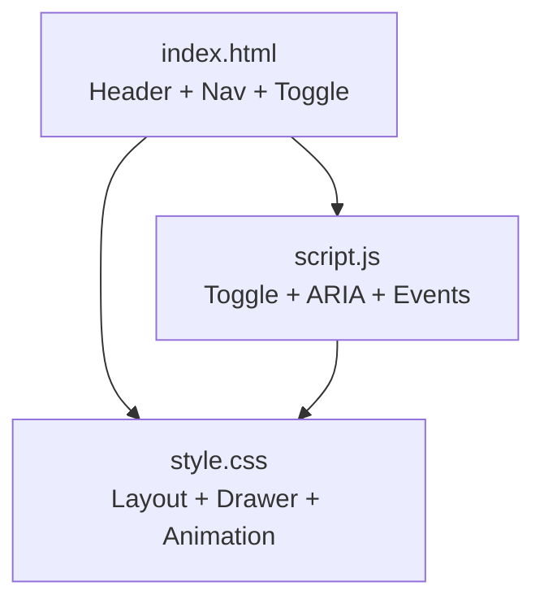
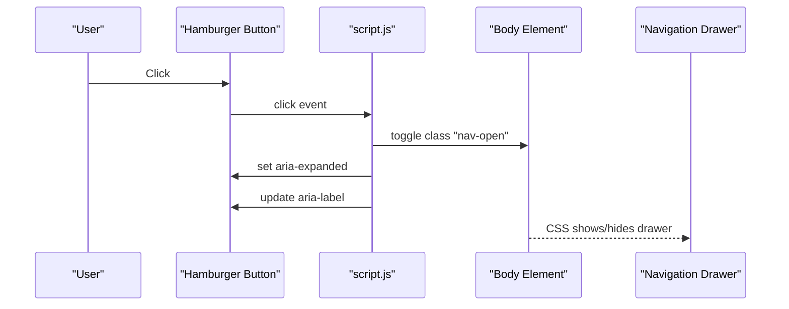
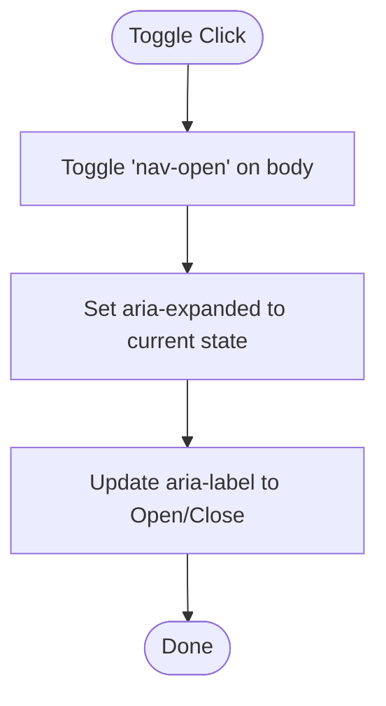
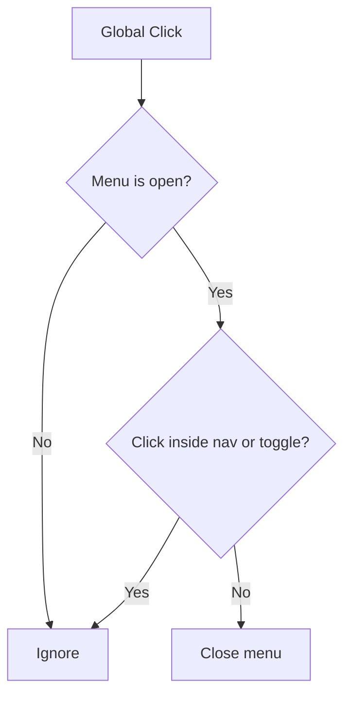
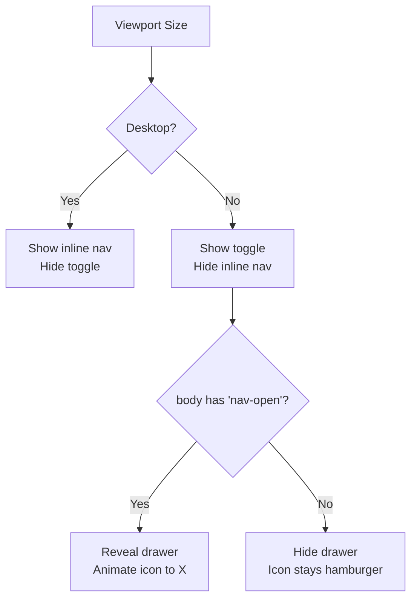
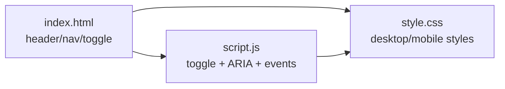

# Mobile Navigation System

<cite>
**Referenced Files in This Document**
- [script.js](file://script.js)
- [index.html](file://index.html)
- [style.css](file://style.css)
</cite>

## Table of Contents
1. [Introduction](#introduction)
2. [Project Structure](#project-structure)
3. [Core Components](#core-components)
4. [Architecture Overview](#architecture-overview)
5. [Detailed Component Analysis](#detailed-component-analysis)
6. [Dependency Analysis](#dependency-analysis)
7. [Performance Considerations](#performance-considerations)
8. [Troubleshooting Guide](#troubleshooting-guide)
9. [Conclusion](#conclusion)

## Introduction
This document explains the mobile navigation system used across the site, focusing on the hamburger menu toggle, accessibility attributes for screen readers, keyboard navigation, click-outside-to-close behavior, and responsive layout integration. It also provides guidance for customizing the navigation behavior without breaking accessibility or responsiveness.

The implementation is lightweight:
- HTML defines the header, primary navigation, and a hamburger button with ARIA attributes.
- JavaScript toggles state, manages ARIA, closes the menu when users navigate or click outside, and supports Escape to close.
- CSS handles desktop layout, mobile drawer presentation, and animated icon transitions.

## Project Structure
The navigation spans three files:
- `index.html` contains the semantic structure and ARIA attributes for the header, nav, and toggle button.
- `script.js` implements interaction logic: toggle, ARIA updates, link-based closing, click-outside-to-close, and Escape key handling.
- `style.css` styles the header, desktop navigation, mobile drawer, and hamburger icon animation.

**Diagram sources**
- [index.html:152-173](file://index.html#L152-L173)
- [script.js:24-49](file://script.js#L24-L49)
- [style.css:272-421](file://style.css#L272-L421)

**Section sources**
- [index.html:152-173](file://index.html#L152-L173)
- [script.js:24-49](file://script.js#L24-L49)
- [style.css:272-421](file://style.css#L272-L421)

## Core Components
- Header and primary navigation container
- Hamburger toggle button
- Body class-driven state (`nav-open`)
- ARIA attributes for assistive technology
- Event listeners for click, keydown, and global click-outside detection

Key responsibilities:
- Toggle visibility and state via body class
- Keep ARIA attributes synchronized
- Close menu on link click
- Close menu on Escape
- Close menu when clicking outside the nav or toggle

**Section sources**
- [index.html:152-173](file://index.html#L152-L173)
- [script.js:24-49](file://script.js#L24-L49)
- [style.css:336-421](file://style.css#L336-L421)

## Architecture Overview
The navigation uses a simple state model:
- State is represented by the presence of `nav-open` on `<body>`.
- The toggle button’s `aria-expanded` reflects whether the menu is open.
- The mobile drawer is shown/hidden using CSS based on `body.nav-open`.

**Diagram sources**
- [script.js:34-38](file://script.js#L34-L38)
- [style.css:2167-2171](file://style.css#L2167-L2171)

## Detailed Component Analysis

### Toggle Mechanism and State Management
- The script selects the body, nav, and toggle elements.
- On toggle click:
  - It toggles `nav-open` on the body.
  - It sets `aria-expanded` to match the new state.
  - It updates `aria-label` to reflect “Open menu” or “Close menu”.
- A helper function centralizes closing behavior for reuse.

**Diagram sources**
- [script.js:29-38](file://script.js#L29-L38)

**Section sources**
- [script.js:24-38](file://script.js#L24-L38)

### ARIA Attribute Management
- The toggle button includes:
  - `aria-label="Open menu"` initially
  - `aria-expanded="false"` initially
  - `aria-controls="nav"` to associate it with the navigation region
- On open/close, `aria-expanded` and `aria-label` are updated dynamically.
- Screen readers announce the current state and purpose of the control.

Accessibility considerations:
- Always keep `aria-expanded` in sync with visual state.
- Provide meaningful `aria-label` text that changes with state.
- Use `aria-controls` to bind the control to its target region.

**Section sources**
- [index.html:169-171](file://index.html#L169-L171)
- [script.js:34-38](file://script.js#L34-L38)

### Keyboard Navigation Support
- Global keydown listener closes the menu when the user presses Escape.
- This ensures keyboard users can dismiss the drawer without a mouse.

Behavior summary:
- Pressing Escape while the menu is open triggers the close routine.
- No additional focus trapping is implemented; focus remains where it was.

**Section sources**
- [script.js:47-49](file://script.js#L47-L49)

### Click-Outside-to-Close Behavior
- A global click listener checks if the menu is open.
- If the click target is neither inside the nav nor the toggle, the menu closes.
- This prevents the drawer from remaining open after tapping elsewhere.

Flow:

**Diagram sources**
- [script.js:42-45](file://script.js#L42-L45)

**Section sources**
- [script.js:42-45](file://script.js#L42-L45)

### Link-Based Closing
- All links inside the navigation automatically close the menu when clicked.
- This improves usability on mobile by returning users to content after selection.

Implementation approach:
- Attach a click handler to each nav link that calls the close function.

**Section sources**
- [script.js:40-40](file://script.js#L40-L40)

### Responsive Design Patterns
- Desktop:
  - Navigation links are visible inline in the header.
  - Hamburger button is hidden.
- Mobile (smaller screens):
  - Hamburger button becomes visible.
  - Navigation transforms into a floating drawer with backdrop blur and shadow.
  - Drawer is hidden by default and revealed when `body.nav-open` is present.
  - Links become larger and easier to tap.

CSS highlights:
- `.nav-toggle` is hidden on desktop and shown on mobile breakpoints.
- `body.nav-open .nav` reveals the drawer with opacity, visibility, and transform transitions.
- Icon animation morphs the hamburger lines into an X when open.

Responsive behavior flow:

**Diagram sources**
- [style.css:378-421](file://style.css#L378-L421)
- [style.css:2167-2171](file://style.css#L2167-L2171)

**Section sources**
- [style.css:336-421](file://style.css#L336-L421)
- [style.css:2167-2171](file://style.css#L2167-L2171)

### Integration With Site Layout
- The header is fixed at the top with a scroll-aware background and border.
- The main content area starts below the header height.
- When the mobile drawer opens, it overlays content with a blurred backdrop and shadow.
- The skip-to-content link and focus styles support keyboard and assistive technology users.

Layout notes:
- Fixed header does not interfere with drawer positioning because the drawer is positioned relative to the viewport within the mobile breakpoint.
- Scroll behavior and padding ensure anchor links land below the header.

**Section sources**
- [style.css:272-299](file://style.css#L272-L299)
- [style.css:233-249](file://style.css#L233-L249)
- [index.html:143-144](file://index.html#L143-L144)

## Dependency Analysis
The navigation depends on:
- DOM elements defined in `index.html`
- CSS classes and media queries in `style.css`
- Event handlers and state management in `script.js`

**Diagram sources**
- [index.html:152-173](file://index.html#L152-L173)
- [script.js:24-49](file://script.js#L24-L49)
- [style.css:336-421](file://style.css#L336-L421)

**Section sources**
- [index.html:152-173](file://index.html#L152-L173)
- [script.js:24-49](file://script.js#L24-L49)
- [style.css:336-421](file://style.css#L336-L421)

## Performance Considerations
- Passive scroll listeners are used for performance-sensitive events like scrolling.
- The reveal-on-scroll feature respects `prefers-reduced-motion` and falls back gracefully when IntersectionObserver is unavailable.
- Pointer effects are disabled for reduced motion preferences and non-fine pointers.

Recommendations:
- Avoid heavy computations inside frequent event handlers.
- Keep CSS transitions short and hardware-accelerated where possible.
- Prefer passive listeners for scroll and pointer events.

[No sources needed since this section provides general guidance]

## Troubleshooting Guide
Common issues and resolutions:
- Menu does not open:
  - Verify the toggle element exists and has the expected ID/class.
  - Ensure `script.js` runs after the DOM is ready.
  - Confirm CSS hides the toggle on desktop and shows it on mobile.
- ARIA state mismatch:
  - Check that `aria-expanded` and `aria-label` are updated on every toggle action.
  - Validate that `aria-controls` points to the correct nav element.
- Menu does not close on Escape:
  - Ensure the global keydown listener is attached and Escape key is handled.
- Click-outside does not close:
  - Confirm the global click listener checks both nav and toggle containment.
- Drawer not visible on mobile:
  - Inspect whether `body.nav-open` is applied and CSS rules for `body.nav-open .nav` are active.

**Section sources**
- [script.js:34-49](file://script.js#L34-L49)
- [style.css:378-421](file://style.css#L378-L421)
- [style.css:2167-2171](file://style.css#L2167-L2171)

## Conclusion
The mobile navigation system is a compact, accessible, and responsive component:
- It toggles state through a single body class.
- It keeps ARIA attributes synchronized for screen readers.
- It supports keyboard navigation with Escape.
- It closes automatically on link clicks and clicks outside the drawer.
- It integrates cleanly with the site layout and adapts to different screen sizes.

To customize:
- Adjust CSS breakpoints and drawer styling to match your design.
- Extend keyboard behavior if you need focus trapping or additional shortcuts.
- Add analytics or tracking to navigation interactions without altering accessibility semantics.

[No sources needed since this section summarizes without analyzing specific files]