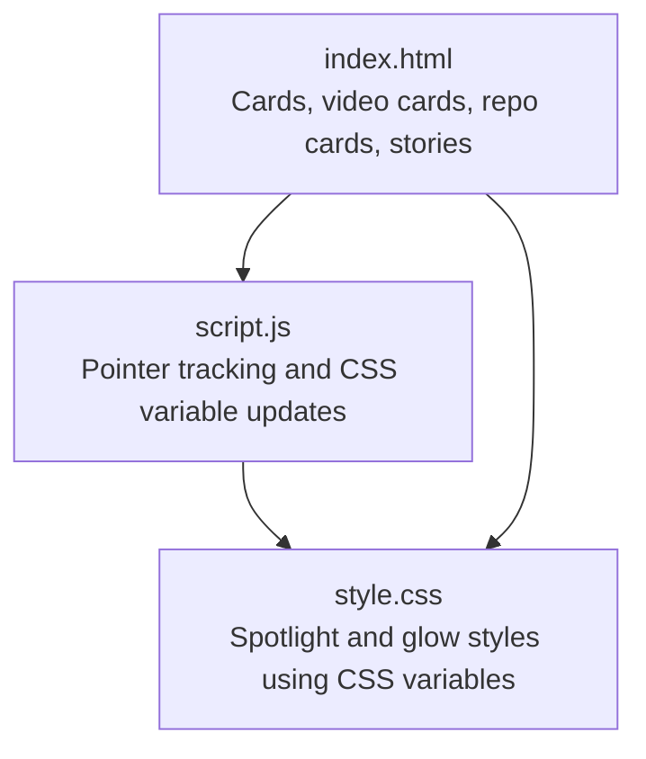
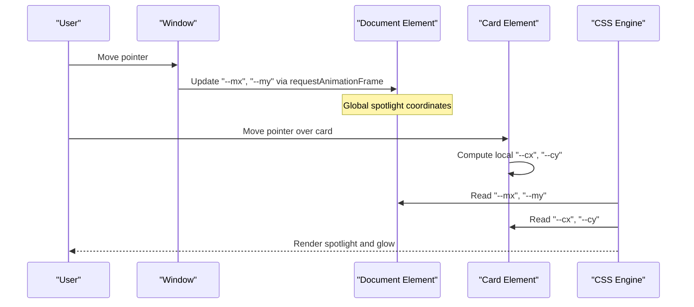
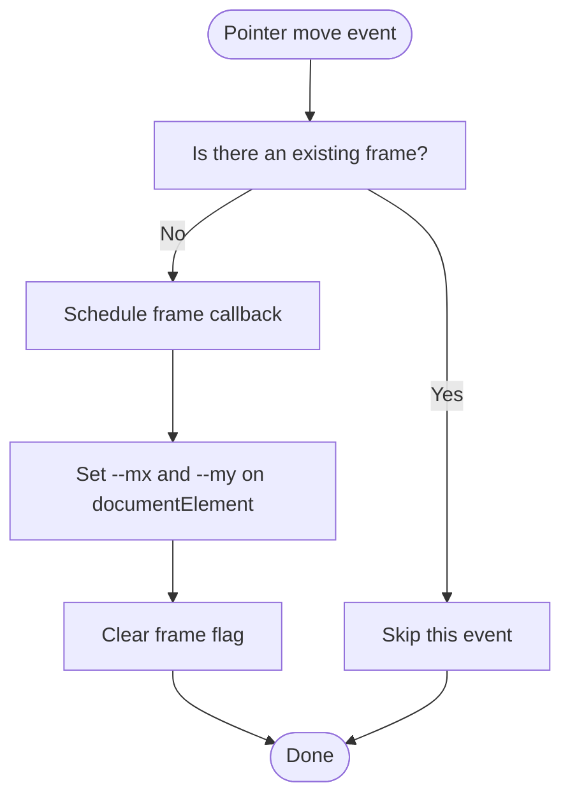
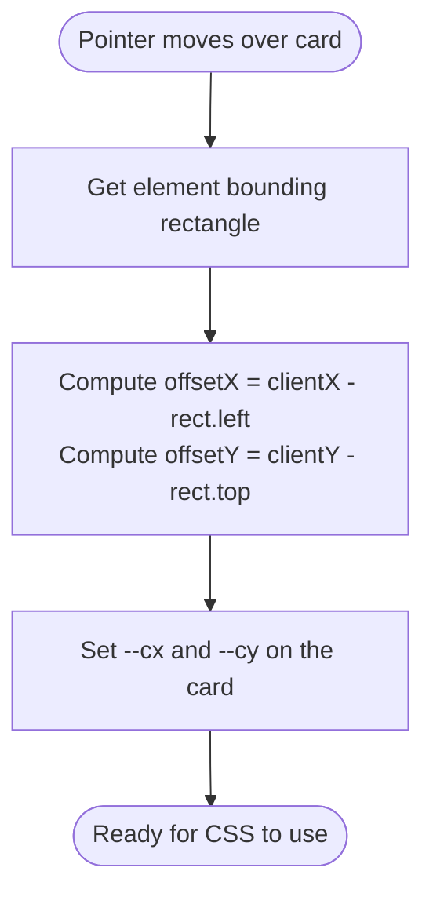
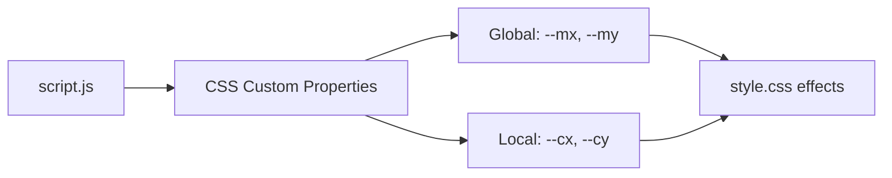
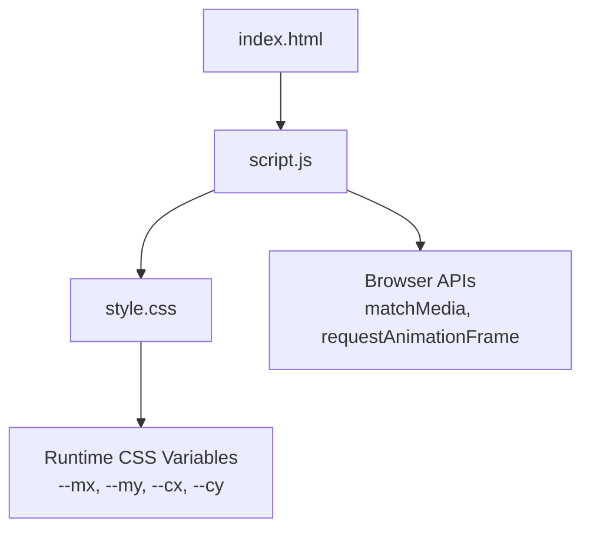

# Pointer Spotlight Effects

<cite>
**Referenced Files in This Document**
- [script.js](file://script.js)
- [style.css](file://style.css)
- [index.html](file://index.html)
</cite>

## Table of Contents
1. [Introduction](#introduction)
2. [Project Structure](#project-structure)
3. [Core Components](#core-components)
4. [Architecture Overview](#architecture-overview)
5. [Detailed Component Analysis](#detailed-component-analysis)
6. [Dependency Analysis](#dependency-analysis)
7. [Performance Considerations](#performance-considerations)
8. [Troubleshooting Guide](#troubleshooting-guide)
9. [Conclusion](#conclusion)

## Introduction
This document explains the pointer spotlight and glow effects used across interactive elements such as cards, video cards, repository cards, and story sections. The feature tracks mouse or pointer movement, converts coordinates into CSS custom properties, and lets styles render a moving light source and localized glow. It also documents device capability detection for fine pointers and reduced motion preferences, along with performance optimizations using requestAnimationFrame and passive event listeners.

## Project Structure
The spotlight effect is implemented through a small JavaScript module that updates CSS custom properties from pointer events, while CSS consumes those variables to paint gradients, glows, and shadows. The HTML provides the target elements that receive these effects.

**Diagram sources**
- [script.js:71-96](file://script.js#L71-L96)
- [style.css:6-26](file://style.css#L6-L26)
- [index.html:283-310](file://index.html#L283-L310)

**Section sources**
- [script.js:1-10](file://script.js#L1-L10)
- [style.css:1-26](file://style.css#L1-L26)
- [index.html:1-30](file://index.html#L1-L30)

## Core Components
- Global pointer tracking: Updates root-level CSS custom properties for the current pointer position so any element can reference them.
- Card-local tracking: For each card-like element, updates local CSS custom properties representing the pointer position relative to that element’s bounding rectangle.
- Device capability checks: Only enables the effect when reduced motion is not preferred and the device has a fine pointer.
- Performance safeguards: Uses requestAnimationFrame to throttle updates and passive event listeners to avoid layout thrashing.

Key responsibilities:
- script.js: Event handling, coordinate math, CSS variable assignment, capability detection.
- style.css: Consumes CSS variables to paint spotlights, glows, and shadows on interactive elements.
- index.html: Provides the DOM nodes (cards, video cards, repo cards, stories) that consume the variables.

**Section sources**
- [script.js:71-96](file://script.js#L71-L96)
- [style.css:6-26](file://style.css#L6-L26)

## Architecture Overview
The spotlight system follows a simple data flow: pointer events update CSS variables; CSS reads those variables to compute visual effects.

**Diagram sources**
- [script.js:71-96](file://script.js#L71-L96)
- [style.css:6-26](file://style.css#L6-L26)

## Detailed Component Analysis

### Global Spotlight Tracking
- What it does: Listens for pointermove on the window and sets two CSS custom properties on the document root:
  - --mx: horizontal pointer position
  - --my: vertical pointer position
- How it works:
  - Debounces updates with requestAnimationFrame to ensure one style write per frame.
  - Uses a passive listener to avoid blocking scrolling and improve responsiveness.
  - Skips initialization if reduced motion is preferred or the pointer is not fine.

**Diagram sources**
- [script.js:71-87](file://script.js#L71-L87)

**Section sources**
- [script.js:71-87](file://script.js#L71-L87)

### Card-Specific Glow Tracking
- What it does: For each card-like element, listens for pointermove and computes the pointer position relative to the element’s bounding box, then writes:
  - --cx: horizontal offset inside the card
  - --cy: vertical offset inside the card
- Why it matters: Allows each card to render its own glow centered at the cursor’s local position, independent of the global spotlight.

**Diagram sources**
- [script.js:89-95](file://script.js#L89-L95)

**Section sources**
- [script.js:89-95](file://script.js#L89-L95)

### Device Capability Detection
- Reduced motion preference: If prefers-reduced-motion is set to reduce, the entire spotlight system is disabled.
- Fine pointer detection: The effect only activates when the device reports a fine pointer, typically a mouse or trackpad rather than a coarse touch input.

Implementation notes:
- Reduced motion check uses matchMedia("(prefers-reduced-motion: reduce)").matches.
- Fine pointer check uses matchMedia("(pointer: fine)").matches.
- Both checks gate the initialization of pointer listeners and CSS variable updates.

**Section sources**
- [script.js:6](file://script.js#L6)
- [script.js:72](file://script.js#L72)

### CSS Variable Consumption
- Global variables:
  - --mx and --my are read by CSS to position background gradients, radial glows, or shadows that follow the cursor globally.
- Local variables:
  - --cx and --cy are read by CSS to create per-card glows that follow the pointer within each card’s bounds.
- Where they are defined:
  - Variables are written by JavaScript to the document root and individual card elements.
  - CSS defines design tokens and base styles but relies on runtime values for interactivity.

**Diagram sources**
- [script.js:71-95](file://script.js#L71-L95)
- [style.css:6-26](file://style.css#L6-L26)

**Section sources**
- [script.js:71-95](file://script.js#L71-L95)
- [style.css:6-26](file://style.css#L6-L26)

### Example Usage Patterns
- Spotlight follows cursor movement:
  - The global pointer tracker updates --mx and --my on the document root.
  - CSS reads these variables to paint a radial gradient or shadow that tracks the pointer.
- Card-specific positioning:
  - Each card updates --cx and --cy based on the pointer’s position relative to the card’s bounding rectangle.
  - CSS uses these local variables to center a glow under the cursor within that specific card.

Code snippet paths:
- Global tracking logic: [script.js:71-87](file://script.js#L71-L87)
- Card-local tracking logic: [script.js:89-95](file://script.js#L89-L95)
- Target selectors for cards and stories: [script.js:89](file://script.js#L89)

**Section sources**
- [script.js:71-95](file://script.js#L71-L95)

## Dependency Analysis
- script.js depends on:
  - DOM APIs: querySelectorAll, addEventListener, getBoundingClientRect, style.setProperty.
  - Browser APIs: requestAnimationFrame, matchMedia.
- style.css depends on:
  - CSS custom properties consumed at runtime.
  - Modern features like backdrop-filter and mask-image for atmosphere.
- index.html provides:
  - Elements with classes like .card, .video-card, .repo-card, and .story that participate in the effect.

**Diagram sources**
- [script.js:71-95](file://script.js#L71-L95)
- [style.css:6-26](file://style.css#L6-L26)
- [index.html:283-310](file://index.html#L283-L310)

**Section sources**
- [script.js:71-95](file://script.js#L71-L95)
- [style.css:6-26](file://style.css#L6-L26)
- [index.html:283-310](file://index.html#L283-L310)

## Performance Considerations
- requestAnimationFrame throttling:
  - Prevents multiple style writes per frame by scheduling a single update per animation frame.
  - Reduces layout thrashing and improves smoothness during rapid pointer movement.
- Passive event listeners:
  - The pointermove listener is registered as passive to avoid blocking the main thread and scrolling performance.
- Conditional activation:
  - The effect is disabled when reduced motion is preferred, saving CPU and battery life.
  - The effect is limited to devices with fine pointers, avoiding unnecessary work on touch-only devices.

Recommendations:
- Keep CSS computations GPU-friendly (transforms, opacity) where possible.
- Avoid heavy calculations inside event handlers; rely on CSS for rendering.
- Monitor frame rate and consider further throttling if many interactive elements exist.

**Section sources**
- [script.js:71-87](file://script.js#L71-L87)
- [script.js:72](file://script.js#L72)

## Troubleshooting Guide

Common issues and resolutions:
- Spotlight does not appear:
  - Verify that the device supports fine pointers and reduced motion is not enabled.
  - Confirm that pointermove listeners are attached and CSS variables are being updated.
  - Check that target elements (.card, .video-card, .repo-card, .story) exist in the DOM.
- Glow appears misaligned:
  - Ensure getBoundingClientRect is called after layout is stable.
  - Confirm that --cx and --cy are computed relative to the correct element.
- Performance drops during fast pointer movement:
  - Confirm requestAnimationFrame is used and no synchronous layout reads occur inside the handler.
  - Reduce the number of tracked elements or simplify CSS effects.
- Cross-browser compatibility:
  - Ensure modern browsers support CSS custom properties and backdrop-filter where used.
  - Test on mobile devices; the effect is gated by fine pointer detection.

Diagnostic steps:
- Inspect the document root for --mx and --my values while moving the pointer.
- Inspect individual cards for --cx and --cy values while hovering.
- Temporarily disable reduced motion preference to verify behavior.

**Section sources**
- [script.js:71-95](file://script.js#L71-L95)
- [style.css:6-26](file://style.css#L6-L26)

## Conclusion
The pointer spotlight and glow system combines lightweight JavaScript with CSS custom properties to deliver responsive, visually rich interactions. By gating activation on device capabilities, throttling updates with requestAnimationFrame, and using passive event listeners, the implementation balances aesthetics with performance. The modular design allows easy extension to additional interactive elements while keeping the codebase maintainable and accessible.