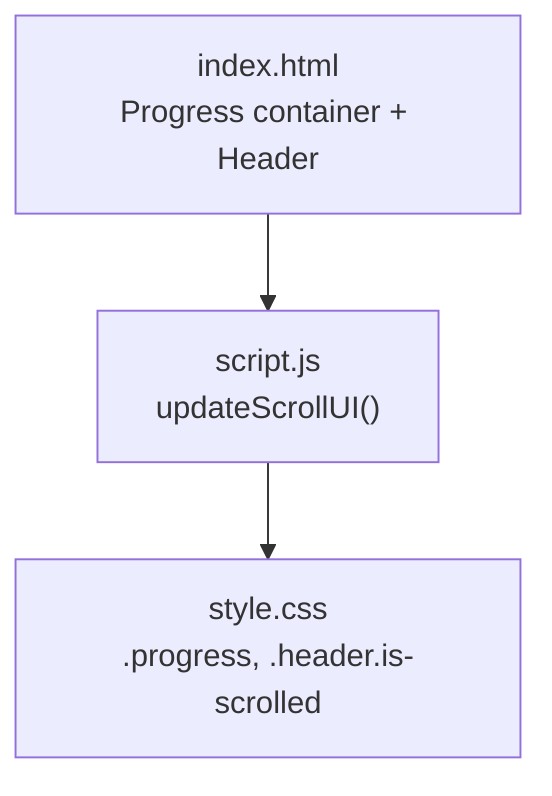
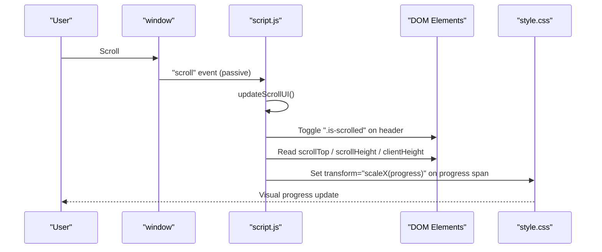
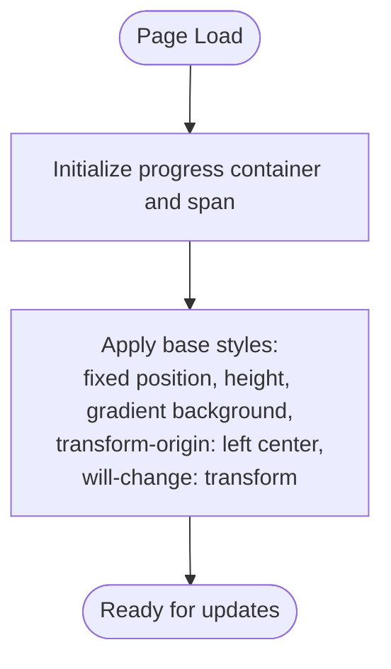
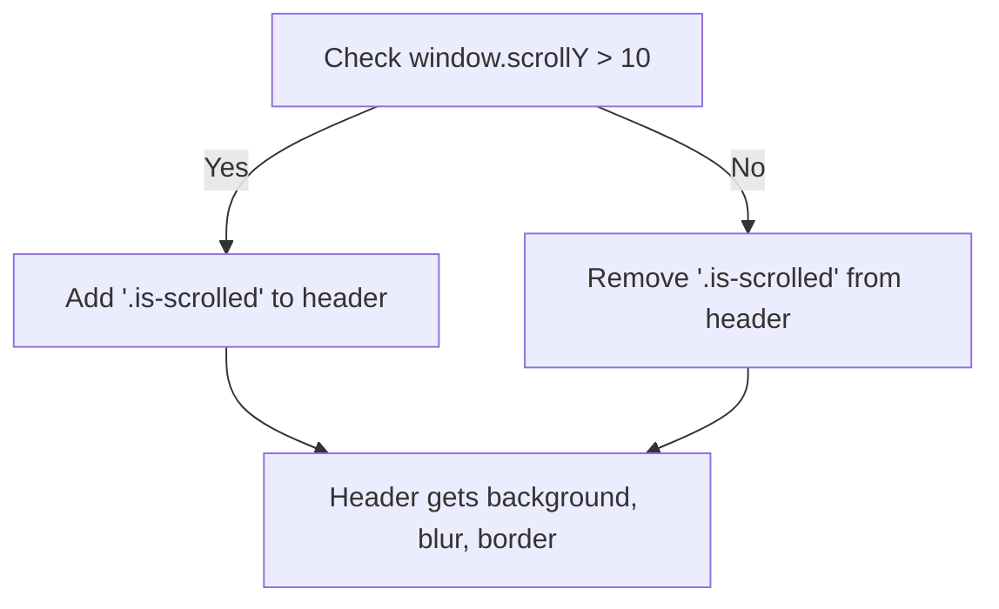
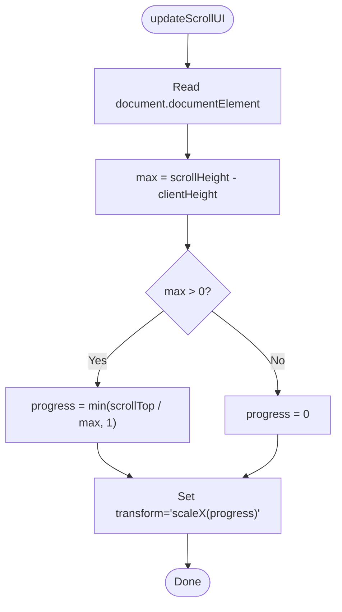
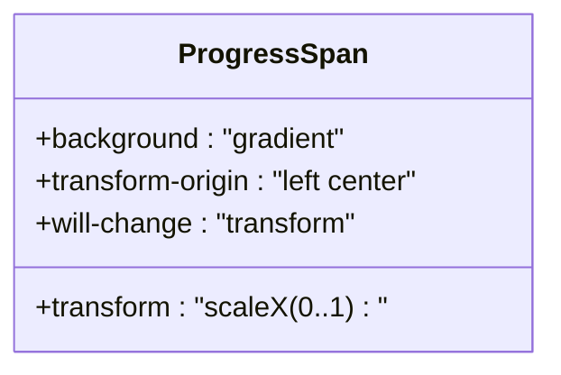
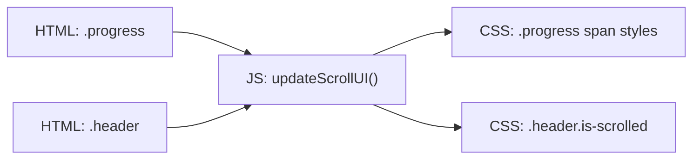

# Scroll Progress Indicator

<cite>
**Referenced Files in This Document**
- [script.js](file://script.js)
- [style.css](file://style.css)
- [index.html](file://index.html)
</cite>

## Table of Contents
1. [Introduction](#introduction)
2. [Project Structure](#project-structure)
3. [Core Components](#core-components)
4. [Architecture Overview](#architecture-overview)
5. [Detailed Component Analysis](#detailed-component-analysis)
6. [Dependency Analysis](#dependency-analysis)
7. [Performance Considerations](#performance-considerations)
8. [Troubleshooting Guide](#troubleshooting-guide)
9. [Conclusion](#conclusion)

## Introduction
This document explains the scroll progress indicator that displays reading progress at the top of the page. It covers how the progress bar updates based on scroll position, how the header state changes when scrolled, and how the CSS transform scaling technique animates the progress bar width. It also includes troubleshooting guidance for common issues like incorrect progress calculations and performance optimization tips for scroll event handling.

## Project Structure
The scroll progress feature spans three files:
- HTML defines the progress container and header structure.
- CSS styles the progress bar and header states.
- JavaScript listens to scroll events and updates both the header class and the progress bar width.

**Diagram sources**
- [index.html:144-173](file://index.html#L144-L173)
- [script.js:8-22](file://script.js#L8-L22)
- [style.css:255-285](file://style.css#L255-L285)

**Section sources**
- [index.html:144-173](file://index.html#L144-L173)
- [script.js:8-22](file://script.js#L8-L22)
- [style.css:255-285](file://style.css#L255-L285)

## Core Components
- Progress container and span: The HTML provides a fixed progress bar container with an inner span that is animated.
- Header element: The header toggles a class when the user scrolls past a small threshold.
- updateScrollUI function: Calculates scroll percentage and applies a scaleX transform to the progress span.

Key responsibilities:
- Update header state based on scroll position.
- Calculate scroll percentage using document properties.
- Apply CSS transform to animate the progress bar width.

**Section sources**
- [index.html:144-173](file://index.html#L144-L173)
- [script.js:8-22](file://script.js#L8-L22)
- [style.css:255-285](file://style.css#L255-L285)

## Architecture Overview
The scroll progress system follows a simple event-driven flow:
- A passive scroll listener triggers updateScrollUI on every scroll event.
- updateScrollUI toggles the header’s is-scrolled class and computes the scroll percentage.
- The computed percentage is applied as a CSS transform scale to the progress span.

**Diagram sources**
- [script.js:12-22](file://script.js#L12-L22)
- [style.css:255-285](file://style.css#L255-L285)

## Detailed Component Analysis

### Progress Bar Markup and Styling
- The progress bar is a fixed container positioned at the top of the viewport.
- The inner span is styled with a gradient background and initially scaled to zero width.
- Transform origin is set to the left center so scaling expands from the left edge.
- will-change hints the browser to optimize rendering for frequent transform updates.

**Diagram sources**
- [index.html:144-144](file://index.html#L144-L144)
- [style.css:255-270](file://style.css#L255-L270)

**Section sources**
- [index.html:144-144](file://index.html#L144-L144)
- [style.css:255-270](file://style.css#L255-L270)

### Header State Changes on Scroll
- When the user scrolls more than a small threshold, the header receives the is-scrolled class.
- The is-scrolled state adds a semi-transparent background, backdrop blur, and a subtle border.
- The header inner container shrinks slightly to save vertical space.

**Diagram sources**
- [script.js:12-13](file://script.js#L12-L13)
- [style.css:272-299](file://style.css#L272-L299)

**Section sources**
- [script.js:12-13](file://script.js#L12-L13)
- [style.css:272-299](file://style.css#L272-L299)

### Progress Calculation Logic
- The function reads the document’s scroll position and total scrollable height.
- It calculates the maximum scrollable distance by subtracting the viewport height from the document height.
- The progress percentage is computed as scrollTop divided by max, clamped between 0 and 1.
- The result is applied as a scaleX transform to the progress span.

**Diagram sources**
- [script.js:14-18](file://script.js#L14-L18)

**Section sources**
- [script.js:14-18](file://script.js#L14-L18)

### CSS Transform Scaling Technique
- The progress span uses transform: scaleX(value) to animate width without layout thrashing.
- transform-origin: left center ensures scaling starts from the left edge.
- will-change: transform signals the browser to optimize compositing for frequent updates.
- The gradient background gives the progress bar its visual appearance.

**Diagram sources**
- [style.css:263-270](file://style.css#L263-L270)

**Section sources**
- [style.css:263-270](file://style.css#L263-L270)

## Dependency Analysis
The progress indicator depends on:
- HTML elements: progress container and header.
- CSS classes: .progress, .progress span, .header, .header.is-scrolled.
- JavaScript logic: updateScrollUI and scroll event listener.

**Diagram sources**
- [index.html:144-173](file://index.html#L144-L173)
- [script.js:12-22](file://script.js#L12-L22)
- [style.css:255-299](file://style.css#L255-L299)

**Section sources**
- [index.html:144-173](file://index.html#L144-L173)
- [script.js:12-22](file://script.js#L12-L22)
- [style.css:255-299](file://style.css#L255-L299)

## Performance Considerations
- Passive scroll listener: The scroll event uses a passive listener to avoid blocking scrolling.
- Transform-based animation: Using transform instead of width avoids layout recalculations.
- will-change hint: Declaring will-change: transform helps the browser optimize rendering.
- Minimal DOM reads/writes: updateScrollUI performs minimal operations per frame.

Recommendations:
- Keep the scroll handler lightweight; avoid heavy computations inside it.
- Prefer transform and opacity for animations to leverage GPU acceleration.
- Debounce or throttle only if additional heavy work is added to the scroll handler.

[No sources needed since this section provides general guidance]

## Troubleshooting Guide

Common issues and resolutions:
- Progress bar does not move:
  - Verify the progress container and span exist in the DOM.
  - Ensure the script runs after the DOM is ready.
  - Confirm the CSS transform-origin is set correctly.

- Incorrect progress values:
  - Check that document.scrollHeight and document.clientHeight are available.
  - Validate that scrollTop is being read from the document element.
  - Ensure max is greater than zero before dividing.

- Header state not updating:
  - Confirm the header element exists and has the correct class names.
  - Check that the scroll threshold condition is met.

- Performance jank during fast scrolling:
  - Ensure the scroll listener is passive.
  - Avoid expensive operations in the scroll handler.
  - Use transform and will-change for smooth updates.

**Section sources**
- [script.js:12-22](file://script.js#L12-L22)
- [style.css:255-299](file://style.css#L255-L299)

## Conclusion
The scroll progress indicator is implemented with a simple, performant approach:
- A passive scroll listener triggers a lightweight update function.
- The function toggles header state and calculates scroll percentage.
- CSS transform scaling animates the progress bar smoothly.
Following the guidelines in this document should help you maintain and troubleshoot the feature effectively.

[No sources needed since this section summarizes without analyzing specific files]