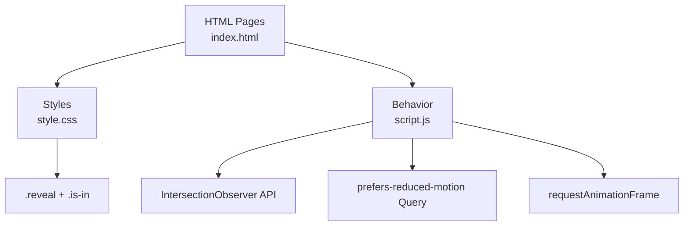
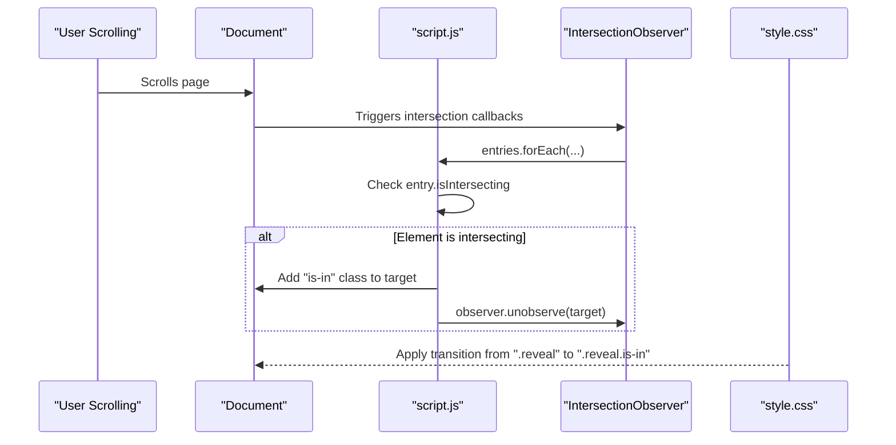
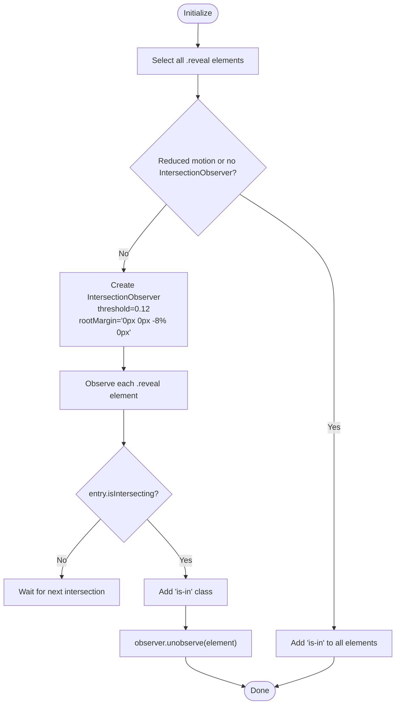
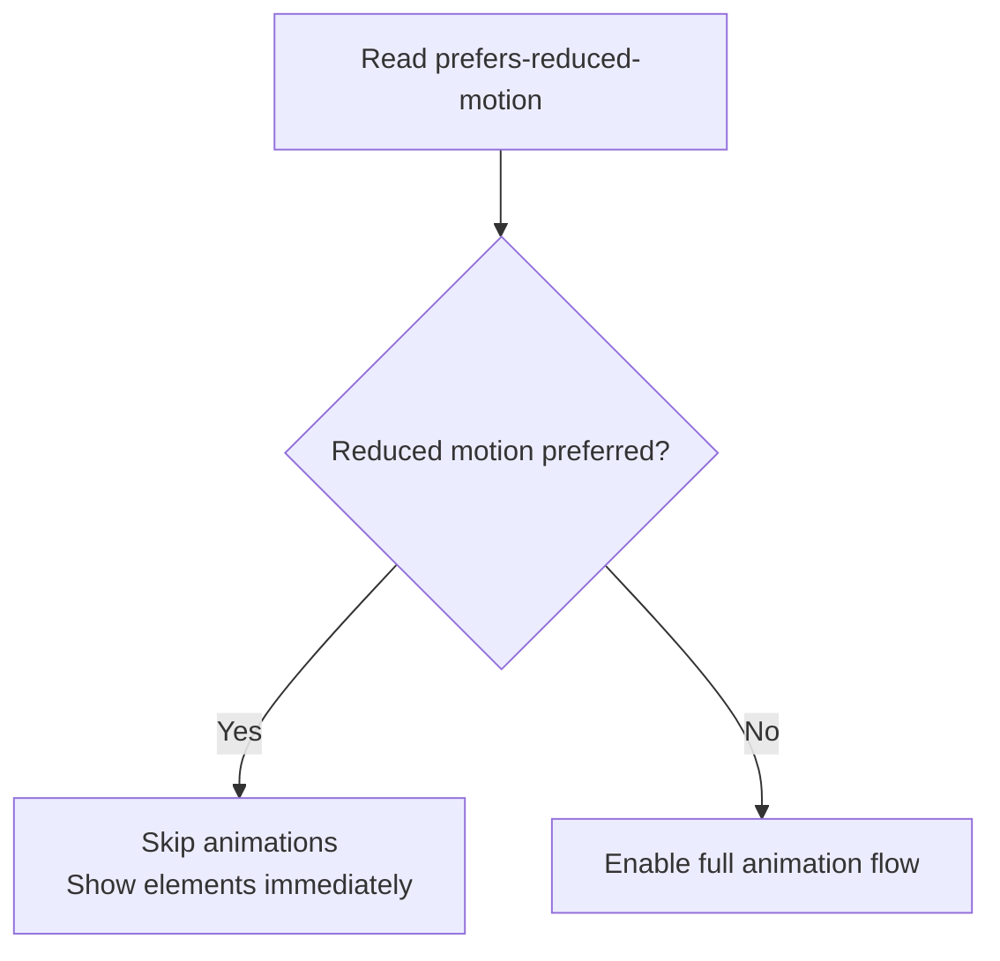
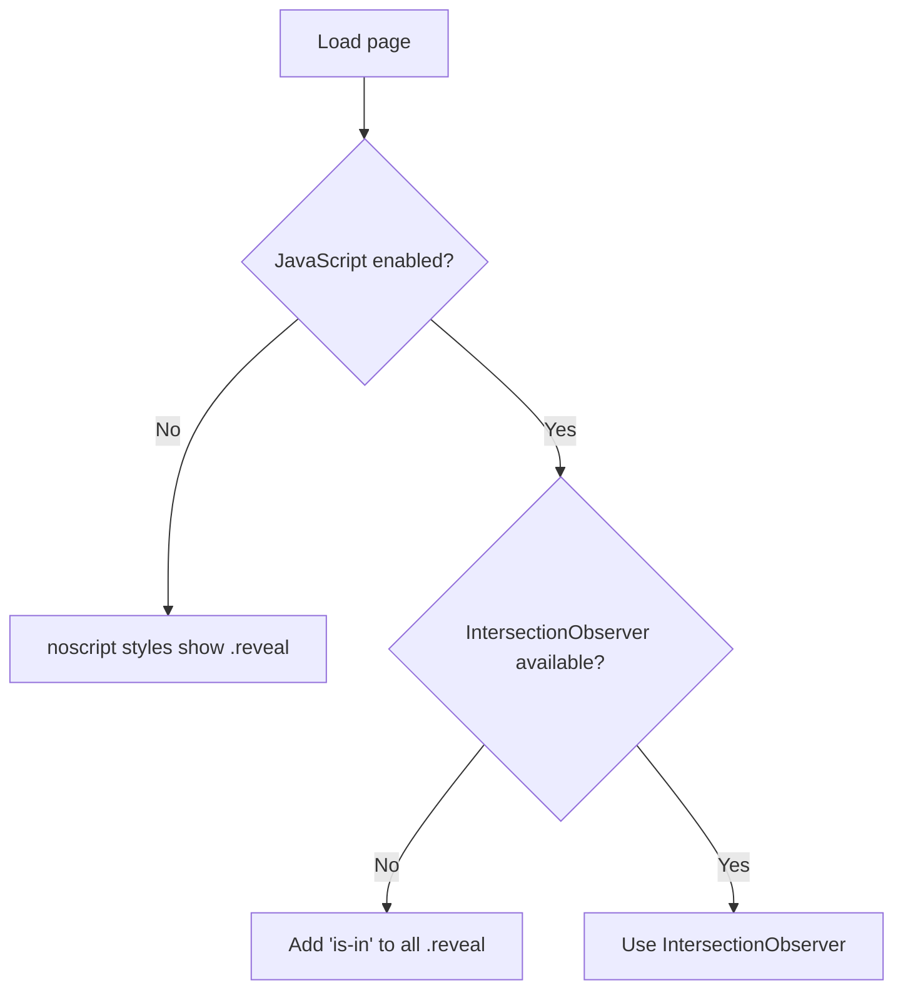
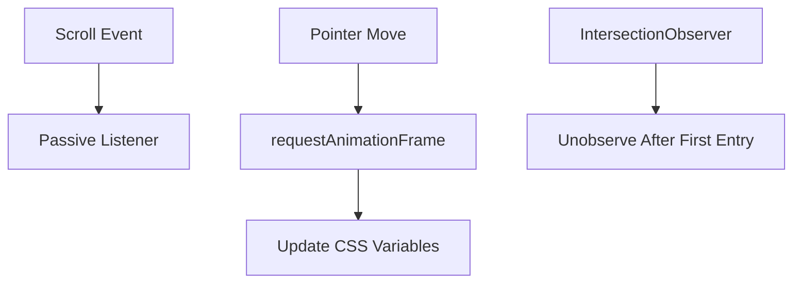
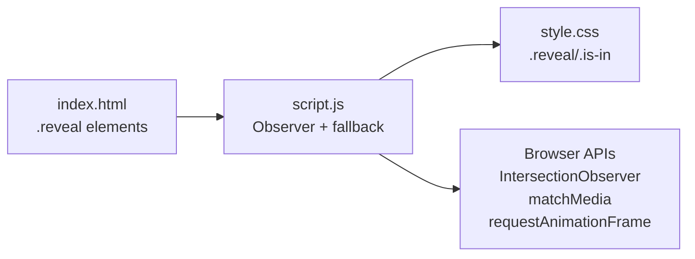

# Scroll-triggered Animations

<cite>
**Referenced Files in This Document**
- [script.js](file://script.js)
- [style.css](file://style.css)
- [index.html](file://index.html)
</cite>

## Table of Contents
1. [Introduction](#introduction)
2. [Project Structure](#project-structure)
3. [Core Components](#core-components)
4. [Architecture Overview](#architecture-overview)
5. [Detailed Component Analysis](#detailed-component-analysis)
6. [Dependency Analysis](#dependency-analysis)
7. [Performance Considerations](#performance-considerations)
8. [Troubleshooting Guide](#troubleshooting-guide)
9. [Conclusion](#conclusion)
10. [Appendices](#appendices)

## Introduction
This document explains the scroll-triggered reveal animation system used across the site. Elements with a specific class are animated when they enter the viewport using Intersection Observer. The implementation includes performance optimizations such as passive event listeners and requestAnimationFrame, accessibility support via prefers-reduced-motion, and fallback behavior for older browsers or when JavaScript is disabled. It also provides guidance on adding new animated elements and customizing timing and effects.

## Project Structure
The animation logic is implemented in a single script file, while styles define the initial hidden state and the visible state that triggers the animation. HTML pages mark which elements should animate by adding a dedicated class to them.

**Diagram sources**
- [script.js:51-69](file://script.js#L51-L69)
- [style.css:1-2397](file://style.css#L1-L2397)
- [index.html:42-49](file://index.html#L42-L49)

**Section sources**
- [script.js:1-233](file://script.js#L1-L233)
- [style.css:1-2397](file://style.css#L1-L2397)
- [index.html:1-484](file://index.html#L1-L484)

## Core Components
- Intersection Observer setup: Detects when elements become visible and adds a class to trigger CSS animations.
- Accessibility integration: Disables animations when the user prefers reduced motion.
- Fallback behavior: If Intersection Observer is unavailable or motion is reduced, elements are immediately shown without animation.
- Performance optimizations: Uses passive scroll listeners and throttles pointer movement updates through requestAnimationFrame.

Key behaviors:
- Elements with the reveal class start hidden and animate into view when observed.
- Once an element becomes intersecting, it receives the is-in class and is unobserved to avoid unnecessary work.
- A small threshold and negative root margin ensure animations trigger slightly before the element fully enters the viewport.

**Section sources**
- [script.js:51-69](file://script.js#L51-L69)
- [index.html:42-49](file://index.html#L42-L49)

## Architecture Overview
The animation pipeline connects HTML markup, CSS states, and JavaScript observation logic.

**Diagram sources**
- [script.js:51-69](file://script.js#L51-L69)
- [style.css:1-2397](file://style.css#L1-L2397)

## Detailed Component Analysis

### Intersection Observer Implementation
- Selection: All elements with the reveal class are collected at initialization.
- Capability check: If prefers-reduced-motion is enabled or IntersectionObserver is not available, all elements receive the is-in class immediately (no animation).
- Observer configuration:
  - threshold: 0.12
  - rootMargin: "0px 0px -8% 0px"
- Callback behavior:
  - For each entry, if it is intersecting, add the is-in class and unobserve the element to stop further checks.

**Diagram sources**
- [script.js:51-69](file://script.js#L51-L69)

**Section sources**
- [script.js:51-69](file://script.js#L51-L69)

### CSS Animation States
- Initial state: Elements with the reveal class are styled to be invisible and offset.
- Animated state: When the is-in class is added, transitions apply opacity and transform changes to produce the reveal effect.
- Timing and easing: Use CSS variables for consistent timing and easing across animations.

Practical notes:
- To customize animation duration per element, use a CSS variable on the element.
- To adjust staggered delays, set a delay variable on individual elements.

**Section sources**
- [style.css:1-2397](file://style.css#L1-L2397)

### Accessibility Integration: prefers-reduced-motion
- The script reads the prefers-reduced-motion media query at startup.
- If the user prefers reduced motion, animations are skipped and elements are shown immediately.
- Additional pointer-based effects are also disabled under reduced motion.

**Diagram sources**
- [script.js:6](file://script.js#L6)
- [script.js:51-69](file://script.js#L51-L69)
- [script.js:72-96](file://script.js#L72-L96)

**Section sources**
- [script.js:6](file://script.js#L6)
- [script.js:51-69](file://script.js#L51-L69)
- [script.js:72-96](file://script.js#L72-L96)

### Fallback Behavior for Older Browsers and No-JS
- No IntersectionObserver: The code detects missing IntersectionObserver and applies the is-in class directly to all reveal elements.
- No JavaScript: A noscript block sets reveal elements to be visible and removes transforms so content remains accessible even without scripts.

**Diagram sources**
- [script.js:51-69](file://script.js#L51-L69)
- [index.html:42-49](file://index.html#L42-L49)

**Section sources**
- [script.js:51-69](file://script.js#L51-L69)
- [index.html:42-49](file://index.html#L42-L49)

### Performance Optimizations
- Passive scroll listener: The scroll handler for header and progress bar uses { passive: true } to improve scrolling performance.
- Pointer move throttling: Pointer movement updates are wrapped in requestAnimationFrame to batch DOM writes and reduce layout thrashing.
- Efficient observation: Each element is unobserved after it animates once, preventing repeated callbacks.

**Diagram sources**
- [script.js:21](file://script.js#L21)
- [script.js:76-87](file://script.js#L76-L87)
- [script.js:57-67](file://script.js#L57-L67)

**Section sources**
- [script.js:21](file://script.js#L21)
- [script.js:76-87](file://script.js#L76-L87)
- [script.js:57-67](file://script.js#L57-L67)

### Adding New Animated Elements
To make any element animate on scroll:
- Add the reveal class to the element in your HTML.
- Optionally, set a CSS variable for staggered delay to control timing relative to siblings.
- Ensure the element has appropriate content and semantics; the animation is purely visual.

Example pattern:
- Wrap content in a container and add the reveal class.
- Use inline style variables to control delay and duration if needed.

Guidance:
- Keep animations subtle and purposeful.
- Avoid animating heavy content initially; let the reveal only change opacity and transform.

**Section sources**
- [index.html:180-219](file://index.html#L180-L219)
- [index.html:273-335](file://index.html#L273-L335)
- [index.html:342-378](file://index.html#L342-L378)
- [index.html:385-431](file://index.html#L385-L431)
- [index.html:438-465](file://index.html#L385-L465)

### Customizing Animation Timing and Effects
- Duration: Adjust the CSS variable controlling animation duration on the element or globally in styles.
- Delay: Set a delay variable on the element to stagger animations within a group.
- Easing: Modify the global easing variable to change the feel of transitions.
- Threshold and margin: If you need different trigger points, update the IntersectionObserver options in the script.

Recommendations:
- Prefer small, fast animations for better perceived performance.
- Use staggered delays sparingly to guide attention without overwhelming users.

**Section sources**
- [script.js:57-67](file://script.js#L57-L67)
- [style.css:1-2397](file://style.css#L1-L2397)

## Dependency Analysis
The animation system depends on:
- HTML structure: Elements must include the reveal class.
- CSS classes: reveal and is-in drive the visual states.
- Browser APIs: IntersectionObserver, matchMedia, requestAnimationFrame.

**Diagram sources**
- [index.html:42-49](file://index.html#L42-L49)
- [script.js:51-69](file://script.js#L51-L69)
- [style.css:1-2397](file://style.css#L1-L2397)

**Section sources**
- [index.html:42-49](file://index.html#L42-L49)
- [script.js:51-69](file://script.js#L51-L69)
- [style.css:1-2397](file://style.css#L1-L2397)

## Performance Considerations
- Use passive event listeners for frequent events like scroll and pointermove to avoid blocking the main thread.
- Batch DOM writes with requestAnimationFrame to minimize layout recalculations.
- Unobserve elements after their first animation to prevent redundant callbacks.
- Keep animations lightweight by animating transform and opacity where possible.
- Respect user preferences for reduced motion to avoid unnecessary work and improve accessibility.

[No sources needed since this section provides general guidance]

## Troubleshooting Guide
Common issues and resolutions:
- Elements do not animate:
  - Verify the element has the reveal class.
  - Confirm the is-in class is applied when scrolled into view.
  - Check browser console for errors related to IntersectionObserver availability.
- Animations run even when reduced motion is preferred:
  - Ensure the prefers-reduced-motion check is evaluated at startup.
  - Confirm that the fallback path adds the is-in class immediately.
- Animations feel too slow or too fast:
  - Adjust the CSS variables for duration and delay.
  - Tune the IntersectionObserver threshold and rootMargin to change trigger timing.
- Staggered animations not working:
  - Ensure each element has its own delay variable set correctly.
  - Verify CSS is reading the variable and applying the delay.

**Section sources**
- [script.js:51-69](file://script.js#L51-L69)
- [script.js:72-96](file://script.js#L72-L96)
- [index.html:42-49](file://index.html#L42-L49)

## Conclusion
The scroll-triggered animation system combines Intersection Observer, CSS state transitions, and accessibility-aware defaults to deliver smooth, performant reveals. By following the patterns outlined here—adding the reveal class, respecting reduced motion, and leveraging CSS variables—you can extend animations consistently across the site while maintaining performance and inclusivity.

[No sources needed since this section summarizes without analyzing specific files]

## Appendices

### Quick Reference: Observer Configuration
- threshold: 0.12
- rootMargin: "0px 0px -8% 0px"

These values determine how early the animation triggers relative to the viewport edge.

**Section sources**
- [script.js:57-67](file://script.js#L57-L67)