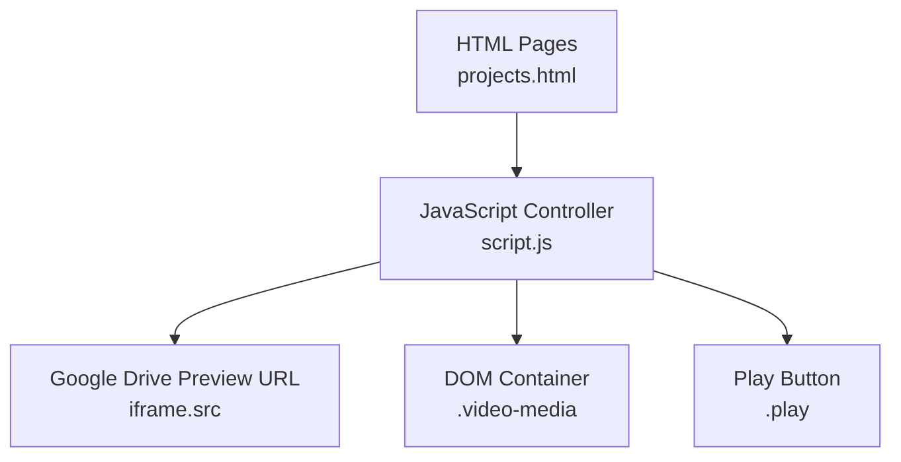
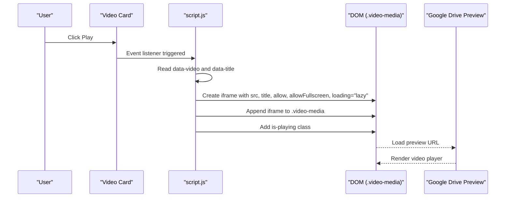
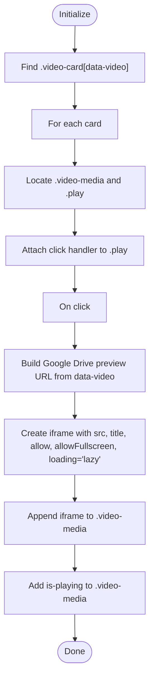

# Video Player Integration

<cite>
**Referenced Files in This Document**
- [script.js](file://script.js)
- [projects.html](file://projects.html)
- [index.html](file://index.html)
</cite>

## Table of Contents
1. [Introduction](#introduction)
2. [Project Structure](#project-structure)
3. [Core Components](#core-components)
4. [Architecture Overview](#architecture-overview)
5. [Detailed Component Analysis](#detailed-component-analysis)
6. [Data Attributes and Video Format Handling](#data-attributes-and-video-format-handling)
7. [Integration Guide](#integration-guide)
8. [Performance Considerations](#performance-considerations)
9. [Troubleshooting Guide](#troubleshooting-guide)
10. [Conclusion](#conclusion)

## Introduction
This document explains the Google Drive video player integration that uses lazy loading to optimize initial page performance. Instead of embedding heavy iframe players on page load, the implementation waits for user interaction: a video card dynamically creates an iframe only when the user clicks Play. This approach reduces bandwidth usage, improves time-to-interactive, and keeps the interface lightweight until playback is requested.

The system relies on simple HTML data attributes and a small JavaScript routine that injects an iframe into the page at runtime. It also manages an is-playing class to visually indicate active playback and supports autoplay and fullscreen permissions through iframe attributes.

## Project Structure
The video player integration spans two primary files:
- The HTML structure defines video cards with metadata and a placeholder area where the iframe will be injected.
- The JavaScript initializes event listeners and performs dynamic iframe creation.

**Diagram sources**
- [projects.html:154-256](file://projects.html#L154-L256)
- [script.js:120-137](file://script.js#L120-L137)

**Section sources**
- [projects.html:154-256](file://projects.html#L154-L256)
- [script.js:120-137](file://script.js#L120-L137)

## Core Components
- Video Card Element: Each video is represented by a card containing:
  - A container for the media (where the iframe will be inserted).
  - A play button that triggers the lazy load.
  - Data attributes storing the Google Drive file ID and title.
- JavaScript Initialization: On page load, the script finds all eligible video cards and attaches click handlers to their play buttons.
- Dynamic Iframe Injection: When clicked, the script constructs a Google Drive preview URL from the card’s data attributes, creates an iframe, configures permissions, and appends it to the media container.
- State Management: After injection, the media container receives an is-playing class to reflect the active state.

Key responsibilities:
- Avoiding upfront iframe creation.
- Building the correct Google Drive preview URL.
- Enabling autoplay and fullscreen via iframe attributes.
- Updating UI state with is-playing.

**Section sources**
- [script.js:120-137](file://script.js#L120-L137)
- [projects.html:154-256](file://projects.html#L154-L256)

## Architecture Overview
The integration follows a straightforward event-driven pattern:
- Page Load: Script scans the DOM for video cards with the required data attributes.
- User Interaction: Clicking the play button triggers the lazy loader.
- Runtime Construction: An iframe is created and configured with autoplay and fullscreen permissions.
- UI Update: The media container switches to an active state using is-playing.

**Diagram sources**
- [script.js:120-137](file://script.js#L120-L137)
- [projects.html:154-256](file://projects.html#L154-L256)

## Detailed Component Analysis

### Lazy Loader Logic
The lazy loader is implemented as a compact initialization block that:
- Selects all video cards with a data-video attribute.
- Locates the media container and play button within each card.
- Attaches a click handler to create and insert the iframe only when needed.

Behavior highlights:
- Uses the card’s data-video value to build the Google Drive preview URL.
- Sets the iframe title from data-title or a fallback label.
- Enables autoplay and fullscreen via iframe.allow and iframe.allowFullscreen.
- Applies loading="lazy" to defer resource loading.
- Clears existing content in the media container before appending the iframe.
- Adds is-playing to the media container to signal active playback.

**Diagram sources**
- [script.js:120-137](file://script.js#L120-L137)

**Section sources**
- [script.js:120-137](file://script.js#L120-L137)

### HTML Structure and Data Attributes
Each video card includes:
- data-video: The Google Drive file ID used to construct the preview URL.
- data-title: The accessible title for the iframe; if missing, a default title is used.
- .video-media: The container where the iframe is injected.
- .play: The button that triggers the lazy load.

Example patterns across multiple cards demonstrate consistent use of these attributes and classes.

**Section sources**
- [projects.html:154-256](file://projects.html#L154-L256)

### Autoplay and Fullscreen Permissions
The iframe is configured with:
- allow="autoplay; fullscreen": Allows the embedded player to autoplay and enter fullscreen mode.
- allowFullscreen = true: Ensures the browser permits fullscreen behavior.
- loading="lazy": Defers iframe loading until the element is visible or interacted with.

These settings are applied during iframe creation, ensuring that once the user initiates playback, the player can operate without additional permission prompts.

**Section sources**
- [script.js:120-137](file://script.js#L120-L137)

### is-playing Class Management
After injecting the iframe, the script adds the is-playing class to the media container. This class can be used by CSS to:
- Change visual states (e.g., hide overlay elements).
- Indicate that playback has started.
- Adjust layout or styling while the player is active.

Note: The current implementation does not remove is-playing when playback ends; this can be extended if needed.

**Section sources**
- [script.js:120-137](file://script.js#L120-L137)

## Data Attributes and Video Format Handling
- data-video: Holds the Google Drive file ID. The script builds a preview URL using this ID.
- data-title: Provides an accessible title for the iframe. If omitted, a generic title is used.

Supported formats:
- The integration targets Google Drive-hosted videos by constructing a preview URL. Google Drive handles format decoding and playback internally.
- Thumbnails may be loaded separately for previews; they do not affect the iframe-based player.

Important considerations:
- Ensure the Google Drive file is publicly accessible or shared appropriately so the preview URL loads successfully.
- The preview endpoint is used rather than direct file URLs to enable in-page playback.

**Section sources**
- [script.js:120-137](file://script.js#L120-L137)
- [projects.html:154-256](file://projects.html#L154-L256)

## Integration Guide
To add a new Google Drive video:
1. Upload the video to Google Drive and ensure it is shareable.
2. Copy the file ID from the Google Drive link.
3. Add a new video card in projects.html with:
   - data-video set to the file ID.
   - data-title set to a descriptive name.
   - A .video-media container.
   - A .play button inside the media container.
4. Optionally include a thumbnail image in .video-media for the cover.
5. Verify that the script is included on the page and that the card structure matches the expected selectors.

Best practices:
- Keep data-title concise and descriptive for accessibility.
- Use meaningful alt text for thumbnails.
- Provide a fallback link to open the video in Google Drive if the player fails to load.

**Section sources**
- [projects.html:154-256](file://projects.html#L154-L256)
- [script.js:120-137](file://script.js#L120-L137)

## Performance Considerations
- Lazy Loading: Iframes are created only on demand, reducing initial payload and improving first paint.
- Thumbnail Previews: Lightweight images serve as placeholders until playback begins.
- Deferred Scripts: The main script is loaded with defer to avoid blocking rendering.
- Reduced Motion: The site respects prefers-reduced-motion for animations, though this primarily affects non-video features.

Recommendations:
- Monitor network requests to confirm iframes are not preloaded.
- Use responsive images for thumbnails to minimize bandwidth.
- Consider adding error handling to gracefully handle failed iframe loads.

[No sources needed since this section provides general guidance]

## Troubleshooting Guide
Common issues and resolutions:
- Blank or failing player:
  - Check that data-video contains a valid Google Drive file ID.
  - Confirm the file sharing settings allow viewing by anyone or the intended audience.
  - Validate that the preview URL resolves correctly in a browser.
- Autoplay blocked:
  - Some browsers restrict autoplay without user gesture. Since the iframe is created after a click, autoplay should generally work, but policies vary by device and browser.
- Fullscreen not working:
  - Ensure allow and allowFullscreen are set on the iframe.
  - Verify that the parent page allows fullscreen context.
- Accessibility concerns:
  - Always provide a meaningful data-title for the iframe.
  - Include descriptive alt text for thumbnails and aria-labels for play buttons.

If you need to extend behavior:
- Remove is-playing when playback ends by listening to player events (requires a more advanced player API).
- Add retry logic or error messages when the iframe fails to load.

**Section sources**
- [script.js:120-137](file://script.js#L120-L137)
- [projects.html:154-256](file://projects.html#L154-L256)

## Conclusion
This integration delivers a performant, accessible way to embed Google Drive videos by deferring heavy iframe creation until users explicitly request playback. By leveraging simple data attributes and a minimal JavaScript controller, the solution maintains clean separation between markup and behavior while optimizing initial load performance. With proper sharing settings and thoughtful accessibility practices, it provides a reliable and user-friendly video experience across devices.

[No sources needed since this section summarizes without analyzing specific files]