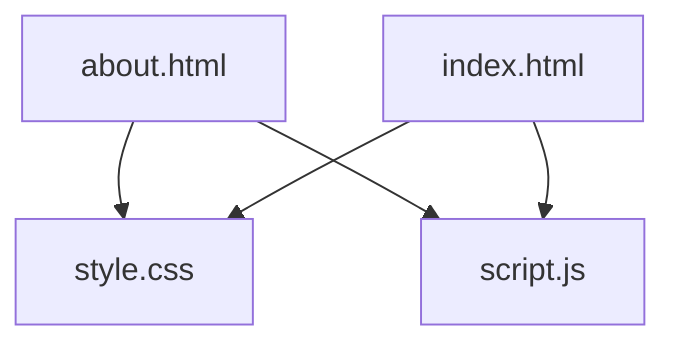
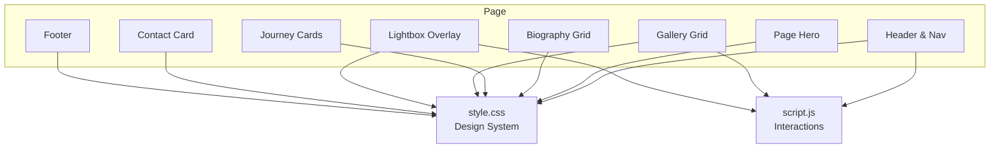
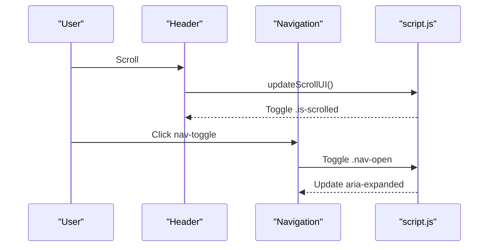
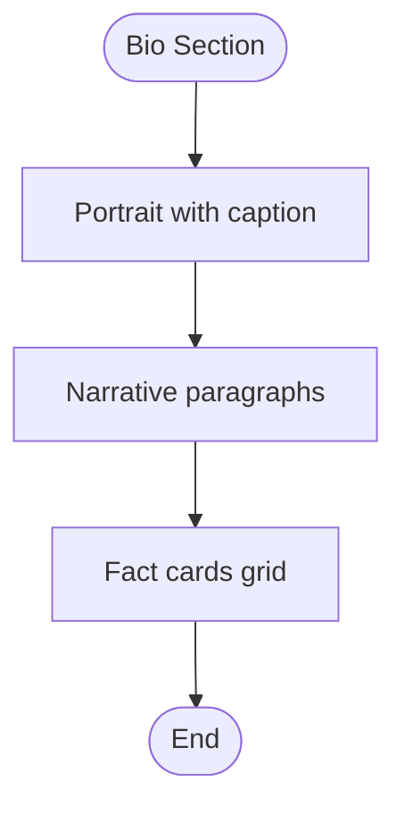
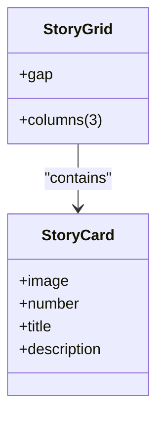
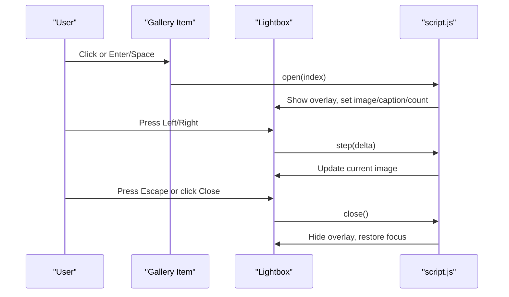
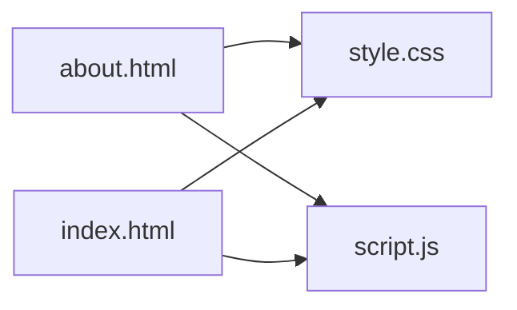

# About Page (about.html)

<cite>
**Referenced Files in This Document**   
- [about.html](file://about.html)
- [style.css](file://style.css)
- [script.js](file://script.js)
- [index.html](file://index.html)
</cite>

## Table of Contents
1. [Introduction](#introduction)
2. [Project Structure](#project-structure)
3. [Core Components](#core-components)
4. [Architecture Overview](#architecture-overview)
5. [Detailed Component Analysis](#detailed-component-analysis)
6. [Dependency Analysis](#dependency-analysis)
7. [Performance Considerations](#performance-considerations)
8. [Troubleshooting Guide](#troubleshooting-guide)
9. [Conclusion](#conclusion)

## Introduction
The About page presents a personal narrative and visual portfolio for Jeric Mark Caño. It combines a biography section, a timeline-style journey grid, and an accessible photo gallery with lightbox functionality. The page follows the same design system as the rest of the portfolio: dark theme, gradient accents, consistent navigation, responsive layout, and shared accessibility patterns.

## Project Structure
The About page is a standalone HTML document that shares global styles and behavior with the rest of the site:
- `about.html` defines the page structure, content, and semantic markup.
- `style.css` provides the design system, including typography, spacing, layout grids, and component styles.
- `script.js` implements interactive behaviors such as scroll progress, reveal animations, mobile navigation, and the accessible lightbox.
- `index.html` demonstrates the shared header, footer, and navigation pattern used across pages.

**Diagram sources**
- [about.html:1-428](file://about.html#L1-L428)
- [style.css:1-2397](file://style.css#L1-L2397)
- [script.js:1-233](file://script.js#L1-L233)
- [index.html:1-484](file://index.html#L1-L484)

**Section sources**
- [about.html:1-428](file://about.html#L1-L428)
- [style.css:1-2397](file://style.css#L1-L2397)
- [script.js:1-233](file://script.js#L1-L233)
- [index.html:1-484](file://index.html#L1-L484)

## Core Components
- Shared header and navigation with current-page indicator and resume download link.
- Page hero introducing the personal mission statement.
- Biography section with portrait, narrative paragraphs, and fact cards.
- Journey section presenting three milestone stories with images and captions.
- Gallery section using CSS columns for a masonry-like layout.
- Accessible lightbox overlay for full-screen viewing with keyboard and touch support.
- Contact card with social links and resume download.
- Footer with back-to-top control and dynamic year.

Key implementation highlights:
- Semantic HTML with landmarks (`header`, `main`, `section`, `footer`) and ARIA attributes for accessibility.
- Consistent use of `.reveal` elements animated by IntersectionObserver.
- Responsive design via CSS variables, clamp(), and flexible grids.
- Image optimization through lazy loading and explicit dimensions.

**Section sources**
- [about.html:104-125](file://about.html#L104-L125)
- [about.html:129-140](file://about.html#L129-L140)
- [about.html:142-196](file://about.html#L142-L196)
- [about.html:198-257](file://about.html#L198-L257)
- [about.html:259-356](file://about.html#L259-L356)
- [about.html:358-390](file://about.html#L358-L390)
- [about.html:394-402](file://about.html#L394-L402)
- [about.html:404-423](file://about.html#L404-L423)

## Architecture Overview
The About page integrates structural markup, styling, and interactivity into a cohesive experience:
- Markup defines sections and components.
- Styles provide layout, visuals, and responsive behavior.
- Script wires up interactions and accessibility features.

**Diagram sources**
- [about.html:104-423](file://about.html#L104-L423)
- [style.css:251-1600](file://style.css#L251-L1600)
- [script.js:8-227](file://script.js#L8-L227)

## Detailed Component Analysis

### Header and Navigation
- Fixed header with blur effect on scroll and a top progress bar.
- Primary navigation includes Home, About (current), Projects, Contact, and a Resume button.
- Mobile menu toggles with aria-expanded and Escape key support.
- Current page is indicated visually and semantically.

**Diagram sources**
- [about.html:104-125](file://about.html#L104-L125)
- [script.js:8-49](file://script.js#L8-L49)

**Section sources**
- [about.html:104-125](file://about.html#L104-L125)
- [script.js:8-49](file://script.js#L8-L49)
- [style.css:251-421](file://style.css#L251-L421)

### Page Hero
- Eyebrow label, headline with gradient text, and lede paragraph.
- Uses `.reveal` for entrance animation.

**Section sources**
- [about.html:129-140](file://about.html#L129-L140)
- [style.css:1184-1209](file://style.css#L1184-L1209)

### Biography Section
Structure:
- Two-column grid with sticky portrait and copy area.
- Narrative paragraphs describing education, leadership, certifications, and goals.
- Fact cards summarizing Education, Certifications, Leadership, and Experience.

Accessibility and performance:
- Portrait image uses descriptive alt text, explicit width/height, and lazy loading.
- Content is structured with headings and paragraphs for screen readers.

**Diagram sources**
- [about.html:142-196](file://about.html#L142-L196)

**Section sources**
- [about.html:142-196](file://about.html#L142-L196)
- [style.css:1211-1301](file://style.css#L1211-L1301)

### Journey Timeline Component
Layout:
- Three-column story grid with numbered cards.
- Each card contains an image and a short description.

Behavior:
- Hover effects lift the card and zoom the image slightly.
- Numbers are overlaid with frosted glass style.

**Diagram sources**
- [about.html:198-257](file://about.html#L198-L257)
- [style.css:1303-1383](file://style.css#L1303-L1383)

**Section sources**
- [about.html:198-257](file://about.html#L198-L257)
- [style.css:1303-1383](file://style.css#L1303-L1383)

### Photo Gallery and Lightbox
Gallery:
- Masonry-like layout using CSS columns.
- Each item is focusable and acts as a button to open the lightbox.
- Captions and zoom icon appear on hover/focus.

Lightbox:
- Full-screen overlay with backdrop blur.
- Keyboard navigation: Arrow keys to navigate, Escape to close.
- Touch gestures: Swipe left/right to change images.
- ARIA roles and labels for dialog, buttons, and live region for count.

**Diagram sources**
- [about.html:259-423](file://about.html#L259-L423)
- [script.js:139-227](file://script.js#L139-L227)
- [style.css:1385-1600](file://style.css#L1385-L1600)

**Section sources**
- [about.html:259-423](file://about.html#L259-L423)
- [script.js:139-227](file://script.js#L139-L227)
- [style.css:1385-1600](file://style.css#L1385-L1600)

### Contact Card
- Provides quick links to LinkedIn, GitHub, Facebook, and Résumé.
- Uses shared button styles and SVG icons from the sprite.

**Section sources**
- [about.html:358-390](file://about.html#L358-L390)
- [style.css:427-474](file://style.css#L427-L474)

### Footer
- Displays copyright year dynamically via script.
- Includes Back to top anchor.

**Section sources**
- [about.html:394-402](file://about.html#L394-L402)
- [script.js:229-232](file://script.js#L229-L232)

## Dependency Analysis
- about.html depends on style.css for all visual presentation and layout.
- about.html depends on script.js for interactions (scroll progress, reveal animations, mobile nav, lightbox).
- index.html demonstrates the shared header/footer/navigation pattern and confirms consistency across pages.

**Diagram sources**
- [about.html:1-428](file://about.html#L1-L428)
- [index.html:1-484](file://index.html#L1-L484)
- [style.css:1-2397](file://style.css#L1-L2397)
- [script.js:1-233](file://script.js#L1-L233)

**Section sources**
- [about.html:1-428](file://about.html#L1-L428)
- [index.html:1-484](file://index.html#L1-L484)
- [style.css:1-2397](file://style.css#L1-L2397)
- [script.js:1-233](file://script.js#L1-L233)

## Performance Considerations
- Lazy loading: All gallery and story images include `loading="lazy"` to defer offscreen resources.
- Explicit dimensions: Images specify width and height to prevent layout shifts and improve CLS.
- Optimized assets: Images are stored under `img/opt/`, indicating optimized versions are used.
- Reduced motion: Reveal animations respect `prefers-reduced-motion`.
- Passive listeners: Scroll and pointer events use passive listeners where appropriate.
- Deferred scripts: Main script is loaded with `defer` to avoid render blocking.

[No sources needed since this section provides general guidance]

## Troubleshooting Guide
Common issues and resolutions:
- Lightbox not opening:
  - Ensure gallery items have `data-full` attributes and are present in the DOM.
  - Verify script.js is loaded and not blocked; check console for errors.
- Keyboard navigation not working:
  - Confirm lightbox has focus management and event listeners for ArrowLeft/ArrowRight and Escape.
- Touch gestures not responding:
  - Check that touchstart/touchend listeners are attached to the lightbox container.
- Images not loading:
  - Validate paths under `img/opt/` and ensure files exist.
  - Confirm alt text and dimensions are set correctly.
- Mobile menu not closing:
  - Verify nav-toggle click handler updates `aria-expanded` and closes on outside clicks or Escape.

**Section sources**
- [script.js:139-227](file://script.js#L139-L227)
- [script.js:24-49](file://script.js#L24-L49)
- [about.html:259-423](file://about.html#L259-L423)

## Conclusion
The About page delivers a clear, accessible, and visually consistent personal narrative. It leverages a robust design system, semantic markup, and thoughtful interactivity to present biography, milestones, and imagery effectively. The lightbox enhances engagement while maintaining strong accessibility and performance standards aligned with the rest of the portfolio.

[No sources needed since this section summarizes without analyzing specific files]