# Home Page (index.html)

<cite>
**Referenced Files in This Document**
- [index.html](file://index.html)
- [style.css](file://style.css)
- [script.js](file://script.js)
</cite>

## Table of Contents
1. [Introduction](#introduction)
2. [Project Structure](#project-structure)
3. [Core Components](#core-components)
4. [Architecture Overview](#architecture-overview)
5. [Detailed Component Analysis](#detailed-component-analysis)
6. [Dependency Analysis](#dependency-analysis)
7. [Performance Considerations](#performance-considerations)
8. [Troubleshooting Guide](#troubleshooting-guide)
9. [Conclusion](#conclusion)

## Introduction
This document explains the architecture and implementation of the Home page for a personal portfolio site. It covers the hero section with typed role animation, skill marquee, service cards grid, about preview split layout, selected work showcase, contact section, SVG sprite system, semantic HTML structure, accessibility attributes, schema.org structured data, responsive design patterns, CSS custom properties, and JavaScript interactions such as scroll animations and mobile navigation.

The goal is to make the page both visually compelling and accessible, while keeping performance and maintainability in mind.

## Project Structure
The Home page is implemented across three primary files:
- `index.html` defines the markup, sections, semantic elements, ARIA labels, social links, resume download links, and embedded SVG sprite definitions.
- `style.css` provides the design system, including CSS custom properties, layout grids, typography, animations, and responsive rules.
- `script.js` handles runtime behavior such as header state, scroll progress, reveal-on-scroll animations, mobile navigation, pointer spotlight effects, typed role animation, and lazy video loading.

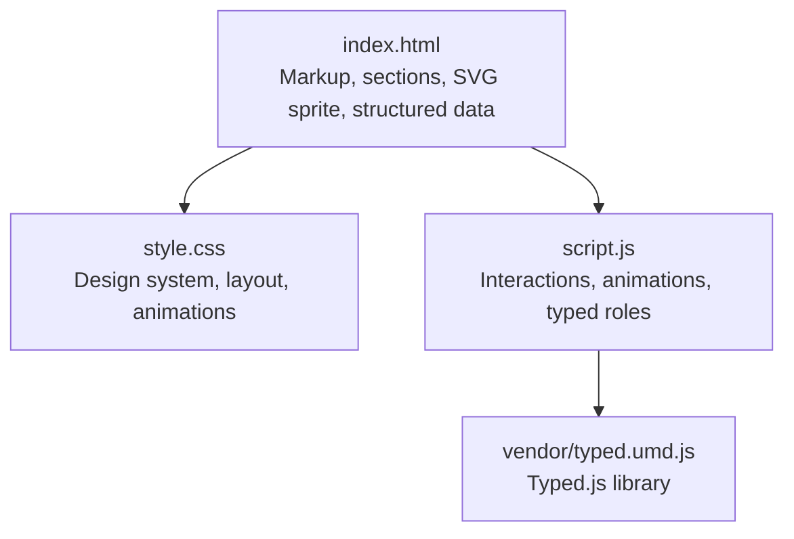

**Diagram sources**
- [index.html:1-50](file://index.html#L1-L50)
- [style.css:1-26](file://style.css#L1-L26)
- [script.js:1-10](file://script.js#L1-L10)

**Section sources**
- [index.html:1-50](file://index.html#L1-L50)
- [style.css:1-26](file://style.css#L1-L26)
- [script.js:1-10](file://script.js#L1-L10)

## Core Components
- Hero section with typed role animation, portrait visual, floating credential cards, social links, and call-to-action buttons.
- Skill marquee showcasing competencies like video editing, photography, graphic design, web development, Cisco networking, leadership, and community service.
- Services grid presenting video editing, photography, graphic design, and web development cards with icons and descriptions.
- About preview split layout featuring biography content, credentials badge, and chip tags.
- Selected work showcase with video thumbnails and project links.
- Contact section with social media integration and resume download functionality.
- SVG sprite system for icon management.
- Semantic HTML structure with proper heading hierarchy.
- ARIA labels for accessibility.
- Schema.org structured data for SEO optimization.
- Responsive design patterns using CSS Grid, Flexbox, clamp(), and viewport units.
- CSS custom properties for colors, fonts, spacing, and gradients.
- JavaScript interactions including scroll animations, mobile navigation, pointer spotlight, and typed roles.

**Section sources**
- [index.html:177-467](file://index.html#L177-L467)
- [style.css:522-800](file://style.css#L522-L800)
- [script.js:98-118](file://script.js#L98-L118)

## Architecture Overview
The Home page follows a layered architecture:
- Markup layer (`index.html`) organizes content into semantic sections and embeds an SVG sprite for consistent icon usage.
- Styling layer (`style.css`) defines a cohesive design system through CSS custom properties, utility classes, and component styles.
- Behavior layer (`script.js`) adds interactivity and progressive enhancement, respecting user preferences like reduced motion.

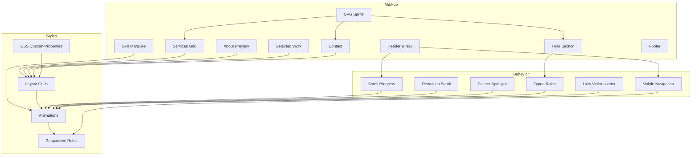

**Diagram sources**
- [index.html:152-479](file://index.html#L152-L479)
- [style.css:6-26](file://style.css#L6-L26)
- [script.js:8-118](file://script.js#L8-L118)

## Detailed Component Analysis

### Hero Section
The hero introduces the creator, highlights key roles via typed animation, and provides quick actions to view projects or download the résumé. It also includes social links and location information.

Key aspects:
- Typed role animation uses a target element and a library script loaded with defer.
- Portrait image uses high priority loading and aspect-ratio styling.
- Floating credential cards emphasize skills and certifications.
- Social links use SVG icons from the sprite and include ARIA labels.
- Call-to-action buttons link to projects and résumé.

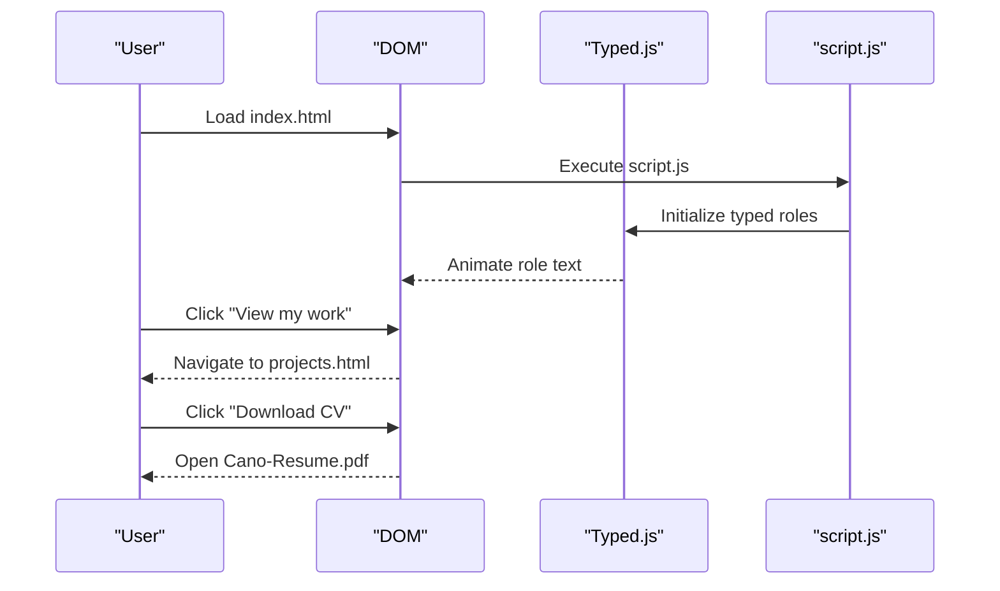

**Diagram sources**
- [index.html:177-244](file://index.html#L177-L244)
- [script.js:98-118](file://script.js#L98-L118)

**Section sources**
- [index.html:177-244](file://index.html#L177-L244)
- [style.css:522-773](file://style.css#L522-L773)
- [script.js:98-118](file://script.js#L98-L118)

### Skill Marquee
The marquee displays a continuous horizontal list of competencies. It uses duplicated groups to create a seamless loop effect.

Key aspects:
- The marquee container hides overflow and applies gradient fades at edges.
- Two identical groups ensure smooth looping without gaps.
- Decorative borders and background gradients enhance visual rhythm.

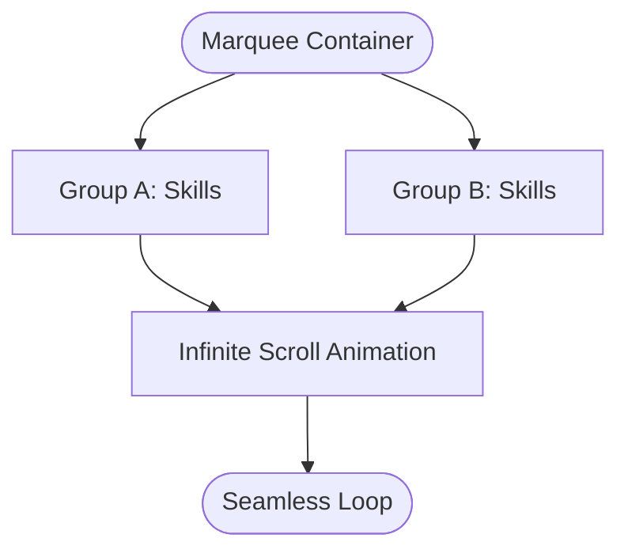

**Diagram sources**
- [index.html:246-268](file://index.html#L246-L268)
- [style.css:775-800](file://style.css#L775-L800)

**Section sources**
- [index.html:246-268](file://index.html#L246-L268)
- [style.css:775-800](file://style.css#L775-L800)

### Services Grid
The services section presents four cards: video editing, photography, graphic design, and web development. Each card includes an icon, title, and description.

Key aspects:
- Grid layout adapts to screen size using CSS Grid.
- Icons are sourced from the SVG sprite.
- Cards reveal on scroll with staggered delays.
- Credential strip below highlights certifications.

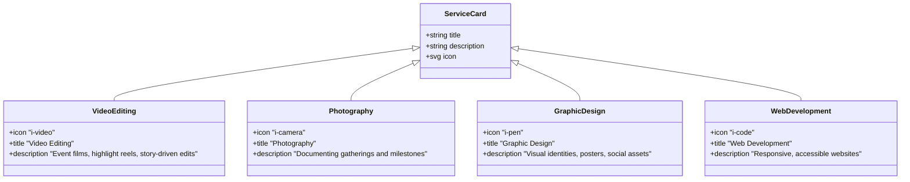

**Diagram sources**
- [index.html:282-311](file://index.html#L282-L311)

**Section sources**
- [index.html:270-337](file://index.html#L270-L337)
- [style.css:522-800](file://style.css#L522-L800)

### About Preview
The about preview uses a split layout with a photo frame and biography content. A credentials badge highlights educational achievements.

Key aspects:
- Split layout aligns image and copy side by side on larger screens.
- Badge overlays the image to emphasize qualifications.
- Chip row lists relevant skills and experiences.
- Link to full about page encourages deeper exploration.

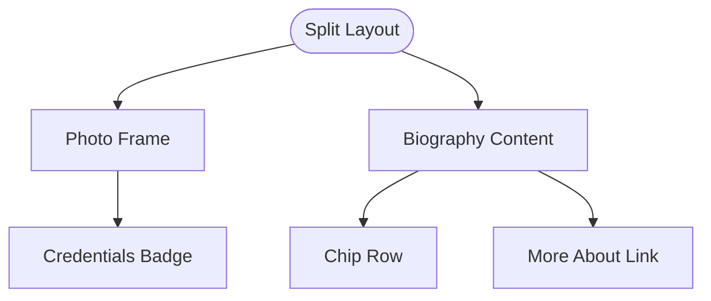

**Diagram sources**
- [index.html:339-380](file://index.html#L339-L380)

**Section sources**
- [index.html:339-380](file://index.html#L339-L380)

### Selected Work Showcase
The selected work section showcases recent video edits with thumbnails and play indicators. Each item links to the projects page.

Key aspects:
- Work cards include ghost numbering, play overlay, and label text.
- Thumbnails may load external images with fallback handling.
- Links direct users to the full projects page.

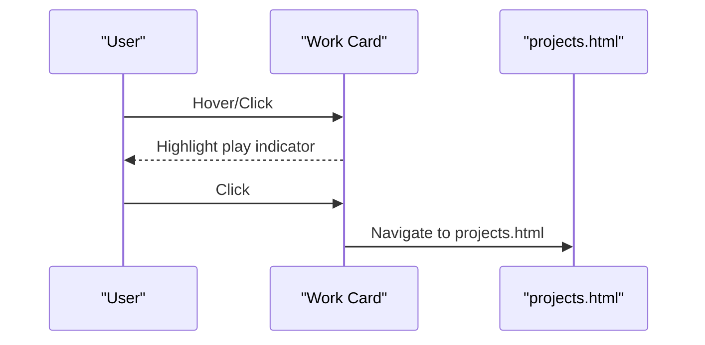

**Diagram sources**
- [index.html:382-433](file://index.html#L382-L433)

**Section sources**
- [index.html:382-433](file://index.html#L382-L433)

### Contact Section
The contact section provides social media links and résumé download options.

Key aspects:
- Buttons integrate SVG icons from the sprite.
- External links open in new tabs with security attributes.
- Résumé download links point to a PDF file.

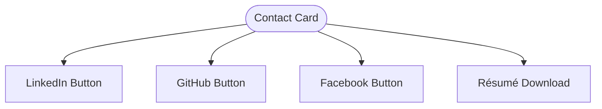

**Diagram sources**
- [index.html:435-467](file://index.html#L435-L467)

**Section sources**
- [index.html:435-467](file://index.html#L435-L467)

### SVG Sprite System
Icons are defined once in an SVG sprite and reused throughout the page via `<use>` references.

Key aspects:
- Sprite contains symbols for social platforms, actions, and domain-specific icons.
- Icons are styled via CSS color inheritance.
- Accessibility attributes hide decorative SVGs from assistive technologies.

```mermaid
graph TB
Sprite["SVG Sprite Symbols"]
Use1["Use: i-linkedin"]
Use2["Use: i-github"]
Use3["Use: i-facebook"]
Use4["Use: i-download"]
Use5["Use: i-play"]
Use6["Use: i-video"]
Use7["Use: i-camera"]
Use8["Use: i-pen"]
Use9["Use: i-code"]
Use10["Use: i-arrow-right"]
Use11["Use: i-arrow-up"]
Use12["Use: i-award"]
Use13["Use: i-pin"]
Use14["Use: i-external"]
Use15["Use: i-monitor"]
Use16["Use: i-shield"]
Use17["Use: i-users"]
Sprite --> Use1
Sprite --> Use2
Sprite --> Use3
Sprite --> Use4
Sprite --> Use5
Sprite --> Use6
Sprite --> Use7
Sprite --> Use8
Sprite --> Use9
Sprite --> Use10
Sprite --> Use11
Sprite --> Use12
Sprite --> Use13
Sprite --> Use14
Sprite --> Use15
Sprite --> Use16
Sprite --> Use17
```

**Diagram sources**
- [index.html:54-141](file://index.html#L54-L141)

**Section sources**
- [index.html:54-141](file://index.html#L54-L141)

### Semantic HTML Structure and Heading Hierarchy
The page uses semantic elements like `<header>`, `<main>`, `<section>`, `<article>`, and `<footer>`. Headings follow a logical hierarchy from `h1` to `h3`.

Key aspects:
- Single `h1` per page for the main headline.
- Section headings provide clear structure.
- Skip link improves keyboard navigation.
- ARIA labels clarify interactive elements.

**Section sources**
- [index.html:152-479](file://index.html#L152-L479)

### ARIA Labels and Accessibility
Accessibility features include skip links, ARIA labels, focus management, and reduced motion support.

Key aspects:
- Skip link targets the main content area.
- Navigation toggle updates ARIA attributes dynamically.
- Images and decorative SVGs use appropriate attributes.
- Reduced motion preference disables animations when requested.

**Section sources**
- [index.html:143-173](file://index.html#L143-L173)
- [script.js:24-49](file://script.js#L24-L49)
- [script.js:51-69](file://script.js#L51-L69)

### Schema.org Structured Data
Structured data describes the person behind the portfolio, including name, job title, description, URL, and social profiles.

Key aspects:
- JSON-LD format used for machine readability.
- SameAs links connect to social profiles.
- Improves SEO and search engine understanding.

**Section sources**
- [index.html:27-41](file://index.html#L27-L41)

### Responsive Design Patterns
Responsive behavior is achieved through CSS Grid, Flexbox, clamp(), and viewport units.

Key aspects:
- Hero grid adjusts columns based on available space.
- Typography scales fluidly using clamp().
- Container width adapts to viewport constraints.
- Mobile navigation toggles visibility and transforms.

**Section sources**
- [style.css:187-199](file://style.css#L187-L199)
- [style.css:536-541](file://style.css#L536-L541)
- [style.css:378-421](file://style.css#L378-L421)

### CSS Custom Properties Usage
Custom properties define colors, fonts, spacing, and gradients consistently across the page.

Key aspects:
- Color palette variables for backgrounds, surfaces, lines, and text.
- Gradient variable for accents and highlights.
- Font variables for body and display text.
- Spacing and radius variables for consistent layout.

**Section sources**
- [style.css:6-26](file://style.css#L6-L26)

### JavaScript Interactions
JavaScript enhances the user experience with scroll animations, mobile navigation, pointer spotlight effects, typed roles, and lazy video loading.

Key aspects:
- Header state changes on scroll with backdrop blur.
- Scroll progress bar reflects page position.
- Reveal-on-scroll uses IntersectionObserver with reduced motion fallback.
- Pointer spotlight updates CSS variables for hover effects.
- Typed roles animate role descriptions on the hero.
- Lazy video loader creates iframes only when requested.

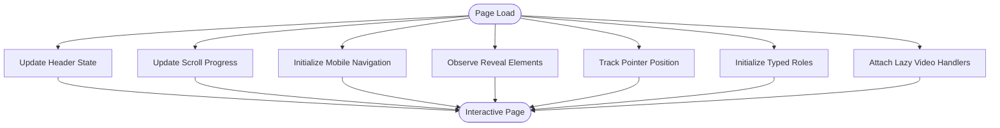

**Diagram sources**
- [script.js:8-118](file://script.js#L8-L118)

**Section sources**
- [script.js:8-118](file://script.js#L8-L118)

## Dependency Analysis
The Home page depends on:
- `style.css` for all visual styling and layout.
- `script.js` for runtime interactions.
- `vendor/typed.umd.js` for typed role animation.
- External Google Fonts for typography.
- External social platform URLs for profile links.
- Local PDF file for résumé downloads.

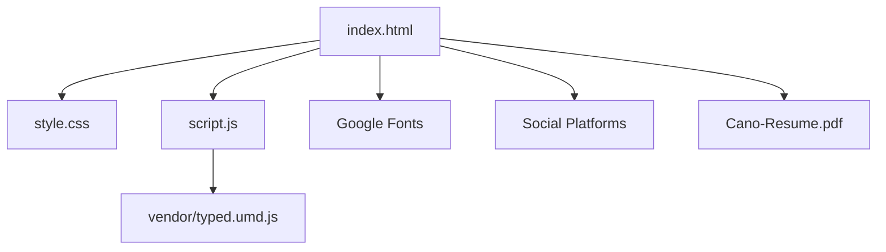

**Diagram sources**
- [index.html:19-26](file://index.html#L19-L26)
- [index.html:163-167](file://index.html#L163-L167)
- [index.html:193-196](file://index.html#L193-L196)
- [index.html:446-463](file://index.html#L446-L463)

**Section sources**
- [index.html:19-26](file://index.html#L19-L26)
- [index.html:163-167](file://index.html#L163-L167)
- [index.html:193-196](file://index.html#L193-L196)
- [index.html:446-463](file://index.html#L446-L463)

## Performance Considerations
- Defer non-critical scripts to avoid blocking rendering.
- Use `fetchpriority="high"` for above-the-fold images.
- Apply `loading="lazy"` for off-screen images.
- Respect `prefers-reduced-motion` to disable animations when requested.
- Use CSS containment and will-change judiciously for animations.
- Avoid heavy computations in scroll handlers; use passive listeners where possible.

[No sources needed since this section provides general guidance]

## Troubleshooting Guide
Common issues and resolutions:
- Typed roles not animating: Ensure `vendor/typed.umd.js` loads before `script.js` initializes typed roles.
- Mobile menu not closing: Verify event listeners for nav links, clicks outside the menu, and Escape key.
- Reveal animations not triggering: Check IntersectionObserver support and reduced motion settings.
- Icons missing: Confirm SVG sprite symbols exist and `<use>` references match symbol IDs.
- Résumé download failing: Verify PDF path and server availability.

**Section sources**
- [script.js:98-118](file://script.js#L98-L118)
- [script.js:24-49](file://script.js#L24-L49)
- [script.js:51-69](file://script.js#L51-L69)
- [index.html:54-141](file://index.html#L54-L141)

## Conclusion
The Home page combines semantic markup, a robust design system, and thoughtful JavaScript interactions to deliver an engaging and accessible portfolio experience. The hero section captures attention with typed roles and social proof, while the services and selected work sections showcase capabilities clearly. The SVG sprite system ensures consistent iconography, and structured data supports SEO. Responsive patterns and CSS custom properties maintain visual coherence across devices. With careful attention to accessibility and performance, the page provides a strong foundation for future enhancements.

[No sources needed since this section summarizes without analyzing specific files]