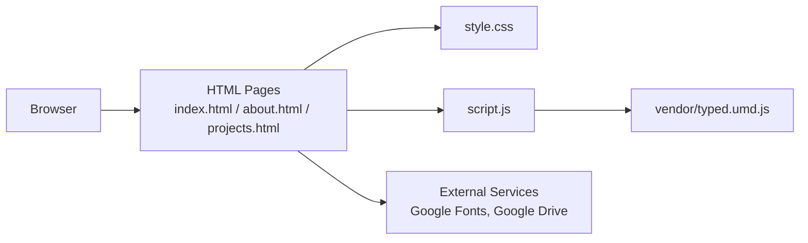
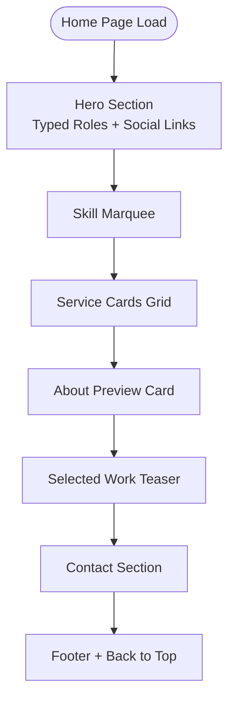
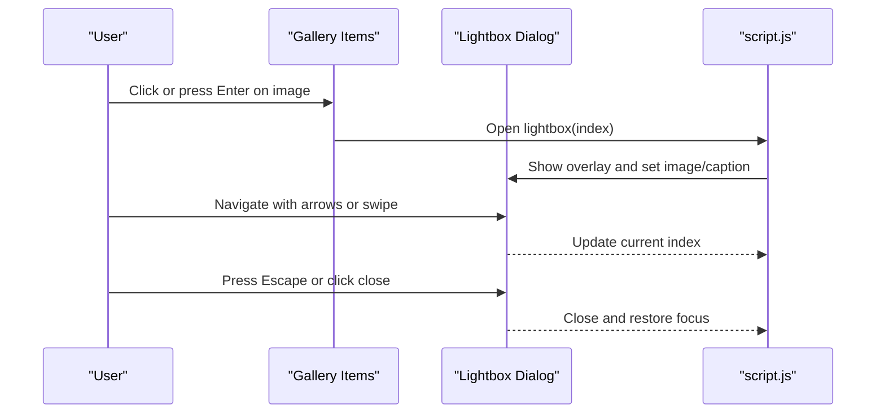
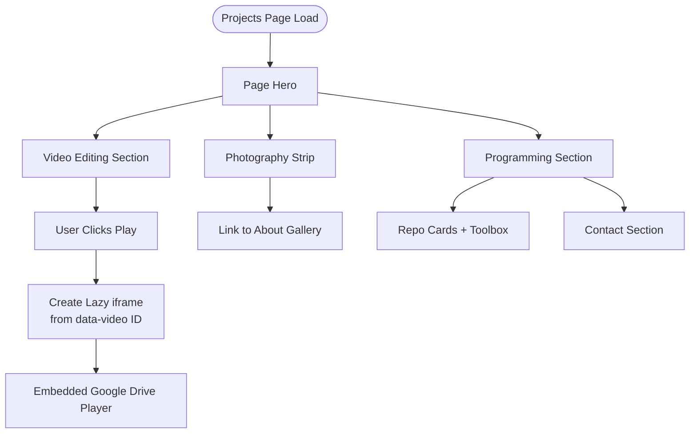
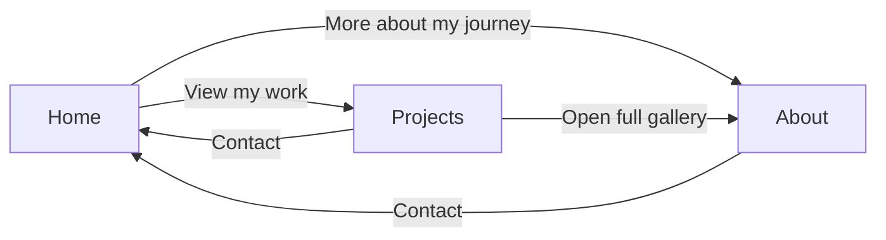

# Page Architecture

<cite>
**Referenced Files in This Document**   
- [index.html](file://index.html)
- [about.html](file://about.html)
- [projects.html](file://projects.html)
- [script.js](file://script.js)
- [style.css](file://style.css)
</cite>

## Table of Contents
1. [Introduction](#introduction)
2. [Project Structure](#project-structure)
3. [Core Components](#core-components)
4. [Architecture Overview](#architecture-overview)
5. [Detailed Component Analysis](#detailed-component-analysis)
6. [Dependency Analysis](#dependency-analysis)
7. [Performance Considerations](#performance-considerations)
8. [Troubleshooting Guide](#troubleshooting-guide)
9. [Conclusion](#conclusion)

## Introduction
This document explains the three-page portfolio architecture: Home, About, and Projects. It covers semantic structure, shared components, accessibility, SEO, responsive design, and how content flows between pages while maintaining visual consistency. The site uses a dark premium design system, an SVG sprite for icons, consistent navigation, scroll-driven reveal animations, and a keyboard-friendly lightbox.

## Project Structure
The project is a small static site with three HTML pages, one stylesheet, and one JavaScript file. Assets such as images and PDFs are referenced from sibling directories.

```mermaid
graph TB
root["Repository Root"]
index["index.html"]
about["about.html"]
projects["projects.html"]
style["style.css"]
script["script.js"]
img["img/"]
files["files/"]
root --> index
root --> about
root --> projects
root --> style
root --> script
root --> img
root --> files
index --> style
index --> script
about --> style
about --> script
projects --> style
projects --> script
```

**Diagram sources**
- [index.html:1-50](file://index.html#L1-L50)
- [about.html:1-35](file://about.html#L1-L35)
- [projects.html:1-35](file://projects.html#L1-L35)
- [style.css:1-26](file://style.css#L1-L26)
- [script.js:1-6](file://script.js#L1-L6)

**Section sources**
- [index.html:1-50](file://index.html#L1-L50)
- [about.html:1-35](file://about.html#L1-L35)
- [projects.html:1-35](file://projects.html#L1-L35)

## Core Components
Across all pages, the following shared components provide consistency:

- Semantic layout: skip link, header with primary navigation, main content sections, and footer.
- SVG sprite: centralized icon definitions reused via `<use>`.
- Navigation pattern: logo, links, active page indicator, mobile toggle, and resume download.
- Background atmosphere: fixed grid and animated blobs.
- Scroll progress bar and sticky header behavior.
- Reveal-on-scroll animation using IntersectionObserver with reduced-motion fallback.
- Pointer spotlight effect on cards.
- Consistent typography, color tokens, spacing, and card styles.
- Accessible lightbox for gallery viewing.

**Section sources**
- [index.html:52-173](file://index.html#L52-L173)
- [about.html:35-125](file://about.html#L35-L125)
- [projects.html:35-126](file://projects.html#L35-L126)
- [style.css:128-231](file://style.css#L128-L231)
- [style.css:255-421](file://style.css#L255-L421)
- [style.css:887-951](file://style.css#L887-L951)
- [script.js:8-49](file://script.js#L8-L49)
- [script.js:51-96](file://script.js#L51-L96)
- [script.js:139-227](file://script.js#L139-L227)

## Architecture Overview
The site follows a simple client-side architecture:

- HTML pages define semantic sections and embed the shared SVG sprite.
- CSS defines the design system, layout grids, and animations.
- JS handles interactivity: navigation toggling, scroll progress, reveal animations, pointer effects, typed roles, video player loading, and accessible lightbox.



**Diagram sources**
- [index.html:17-26](file://index.html#L17-L26)
- [about.html:16-24](file://about.html#L16-L24)
- [projects.html:16-24](file://projects.html#L16-L24)
- [script.js:98-118](file://script.js#L98-L118)
- [script.js:120-137](file://script.js#L120-L137)

## Detailed Component Analysis

### Home Page (index.html)
The Home page introduces the author, highlights skills, showcases services, previews work, and provides contact actions.

Key sections:
- Hero section with typed role animation and social links.
- Skill marquee displaying capabilities.
- Service cards describing core offerings.
- About preview linking to the full biography.
- Selected work teaser linking to the Projects page.
- Contact section with call-to-action buttons.

Accessibility and SEO:
- ARIA labels on navigation, social links, and decorative elements.
- Schema.org Person metadata for search engines.
- Skip link and focus management.



**Diagram sources**
- [index.html:177-244](file://index.html#L177-L244)
- [index.html:246-268](file://index.html#L246-L268)
- [index.html:270-337](file://index.html#L270-L337)
- [index.html:339-380](file://index.html#L339-L380)
- [index.html:382-433](file://index.html#L382-L433)
- [index.html:435-467](file://index.html#L435-L467)

**Section sources**
- [index.html:1-50](file://index.html#L1-L50)
- [index.html:177-244](file://index.html#L177-L244)
- [index.html:246-268](file://index.html#L246-L268)
- [index.html:270-337](file://index.html#L270-L337)
- [index.html:339-380](file://index.html#L339-L380)
- [index.html:382-433](file://index.html#L382-L433)
- [index.html:435-467](file://index.html#L435-L467)

### About Page (about.html)
The About page presents biography content, a journey timeline, and a photo gallery with an accessible lightbox.

Key sections:
- Page hero introducing the author’s mission.
- Biography grid with photo and facts.
- Journey timeline cards highlighting community, leadership, and mission experiences.
- Gallery with masonry-style columns and lightbox controls.
- Contact section consistent with other pages.

Accessibility and SEO:
- ARIA attributes for gallery items and lightbox dialog.
- Keyboard navigation for gallery and lightbox.
- Descriptive alt text and captions.



**Diagram sources**
- [about.html:259-356](file://about.html#L259-L356)
- [about.html:404-423](file://about.html#L404-L423)
- [script.js:139-227](file://script.js#L139-L227)

**Section sources**
- [about.html:1-35](file://about.html#L1-L35)
- [about.html:129-140](file://about.html#L129-L140)
- [about.html:142-196](file://about.html#L142-L196)
- [about.html:198-257](file://about.html#L198-L257)
- [about.html:259-356](file://about.html#L259-L356)
- [about.html:358-390](file://about.html#L358-L390)
- [about.html:404-423](file://about.html#L404-L423)

### Projects Page (projects.html)
The Projects page showcases video projects, photography collection, and programming work.

Key sections:
- Page hero summarizing the portfolio scope.
- Video editing section with lazy-loaded Google Drive players.
- Photography section linking to the full gallery on the About page.
- Programming section with repository cards and skill panel.
- Contact section consistent across pages.

Interactions:
- Video cards load an iframe only when the user clicks play.
- External links open in new tabs with security attributes.



**Diagram sources**
- [projects.html:130-140](file://projects.html#L130-L140)
- [projects.html:142-258](file://projects.html#L142-L258)
- [projects.html:260-307](file://projects.html#L260-L307)
- [projects.html:309-411](file://projects.html#L309-L411)
- [projects.html:413-445](file://projects.html#L413-L445)
- [script.js:120-137](file://script.js#L120-L137)

**Section sources**
- [projects.html:1-35](file://projects.html#L1-L35)
- [projects.html:130-140](file://projects.html#L130-L140)
- [projects.html:142-258](file://projects.html#L142-L258)
- [projects.html:260-307](file://projects.html#L260-L307)
- [projects.html:309-411](file://projects.html#L309-L411)
- [projects.html:413-445](file://projects.html#L413-L445)

### Shared Components

#### SVG Sprite System
All pages include an inline SVG sprite containing reusable icons. Icons are inserted via `<use href="#i-...">`, reducing duplication and improving maintainability.

Common icons include social platforms, navigation arrows, media symbols, and UI indicators.

**Section sources**
- [index.html:54-141](file://index.html#L54-L141)
- [about.html:37-93](file://about.html#L37-L93)
- [projects.html:37-94](file://projects.html#L37-L94)

#### Navigation Pattern
Each page shares:
- Logo linking to Home.
- Primary navigation with active state via `aria-current="page"`.
- Mobile menu toggle with ARIA attributes and keyboard support.
- Resume download button.

Behavior:
- Toggle adds/removes `nav-open` class on body.
- Clicking outside closes the menu.
- Escape key closes the menu.

**Section sources**
- [index.html:152-173](file://index.html#L152-L173)
- [about.html:104-125](file://about.html#L104-L125)
- [projects.html:105-126](file://projects.html#L105-L126)
- [script.js:24-49](file://script.js#L24-L49)

#### Responsive Design Approach
- Fluid container widths and clamp-based spacing.
- CSS Grid layouts for services, stories, and galleries.
- Media queries and viewport units ensure readability on small screens.
- Touch-friendly interactions for lightbox navigation.

**Section sources**
- [style.css:187-199](file://style.css#L187-L199)
- [style.css:881-885](file://style.css#L881-L885)
- [style.css:1389-1392](file://style.css#L1389-L1392)

#### Semantic HTML and Accessibility
- Skip link for keyboard users.
- Proper heading hierarchy and landmarks (`header`, `main`, `footer`).
- ARIA labels on interactive elements and decorative icons marked `aria-hidden`.
- Focus-visible outlines and keyboard navigation for gallery and lightbox.
- Reduced motion preference respected for animations.

**Section sources**
- [index.html:143-144](file://index.html#L143-L144)
- [style.css:233-249](file://style.css#L233-L249)
- [style.css:99-103](file://style.css#L99-L103)
- [script.js:6](file://script.js#L6)
- [script.js:51-69](file://script.js#L51-L69)
- [script.js:186-207](file://script.js#L186-L207)

#### SEO Optimization
- Unique titles and descriptions per page.
- Open Graph and Twitter Card meta tags.
- Schema.org JSON-LD Person markup on Home.
- Descriptive alt text for images.

**Section sources**
- [index.html:4-41](file://index.html#L4-L41)
- [about.html:4-33](file://about.html#L4-L33)
- [projects.html:4-33](file://projects.html#L4-L33)

### Content Flow Between Pages
- Home links to Projects for detailed work and to About for deeper biography.
- Projects links back to About’s gallery for full photography collection.
- All pages share a consistent contact section and footer.



**Diagram sources**
- [index.html:188-197](file://index.html#L188-L197)
- [index.html:374-377](file://index.html#L374-L377)
- [projects.html:268-271](file://projects.html#L268-L271)

## Dependency Analysis
The pages depend on shared CSS and JS assets. The Home page additionally loads the Typed library for role animation.

```mermaid
graph TB
index["index.html"]
about["about.html"]
projects["projects.html"]
style["style.css"]
script["script.js"]
typed["vendor/typed.umd.js"]
index --> style
index --> script
index --> typed
about --> style
about --> script
projects --> style
projects --> script
```

**Diagram sources**
- [index.html:21-26](file://index.html#L21-L26)
- [about.html:20-24](file://about.html#L20-L24)
- [projects.html:20-24](file://projects.html#L20-L24)

**Section sources**
- [index.html:21-26](file://index.html#L21-L26)
- [about.html:20-24](file://about.html#L20-L24)
- [projects.html:20-24](file://projects.html#L20-L24)

## Performance Considerations
- Deferred scripts reduce render-blocking.
- Images use lazy loading where appropriate.
- Video iframes are created only on user interaction to avoid unnecessary network requests.
- IntersectionObserver reveals elements efficiently and falls back gracefully when disabled.
- Prefers-reduced-motion disables heavy animations for sensitive users.

[No sources needed since this section provides general guidance]

## Troubleshooting Guide
Common issues and resolutions:

- Typed roles not appearing:
  - Ensure vendor/typed.umd.js is loaded before script.js initializes the typed target.
  - Verify the `.typed` element exists on the Home page.

- Lightbox not opening:
  - Confirm gallery items have `data-full` attributes and that the lightbox DOM exists.
  - Check keyboard event listeners and touch handlers in script.js.

- Navigation not closing on mobile:
  - Ensure the nav toggle has correct ARIA attributes and that body class toggles correctly.

- Animations not triggering:
  - Check IntersectionObserver availability and prefers-reduced-motion setting.

**Section sources**
- [script.js:98-118](file://script.js#L98-L118)
- [script.js:139-227](file://script.js#L139-L227)
- [script.js:24-49](file://script.js#L24-L49)
- [script.js:51-69](file://script.js#L51-L69)

## Conclusion
The portfolio website delivers a cohesive, accessible, and performant experience across three pages. Shared components like the SVG sprite, navigation, and design tokens ensure visual consistency. Semantic HTML, ARIA attributes, and SEO metadata improve usability and discoverability. Interactive features such as typed roles, lazy video playback, and an accessible lightbox enhance engagement without compromising performance or accessibility.

[No sources needed since this section summarizes without analyzing specific files]