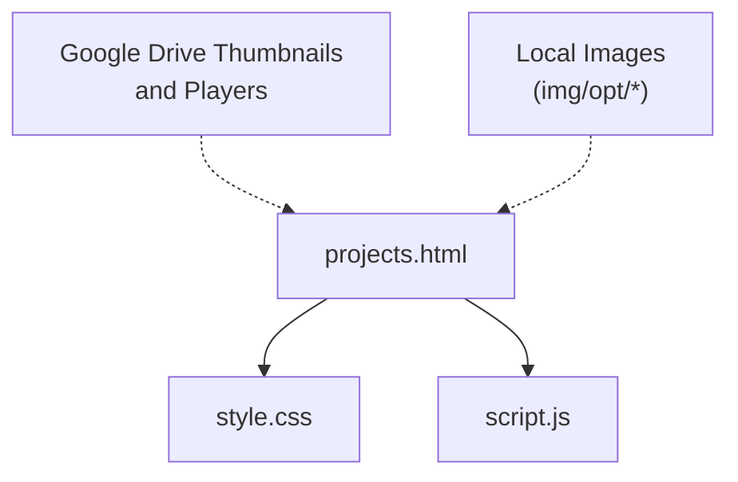
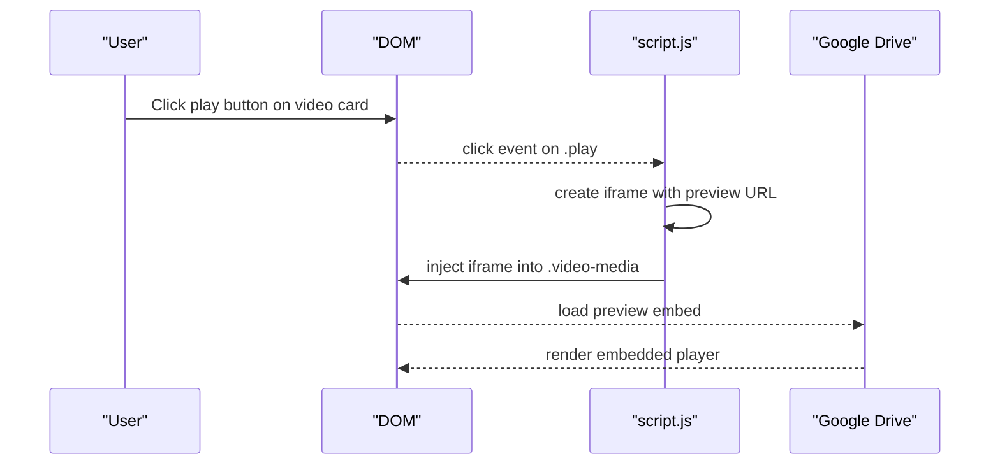
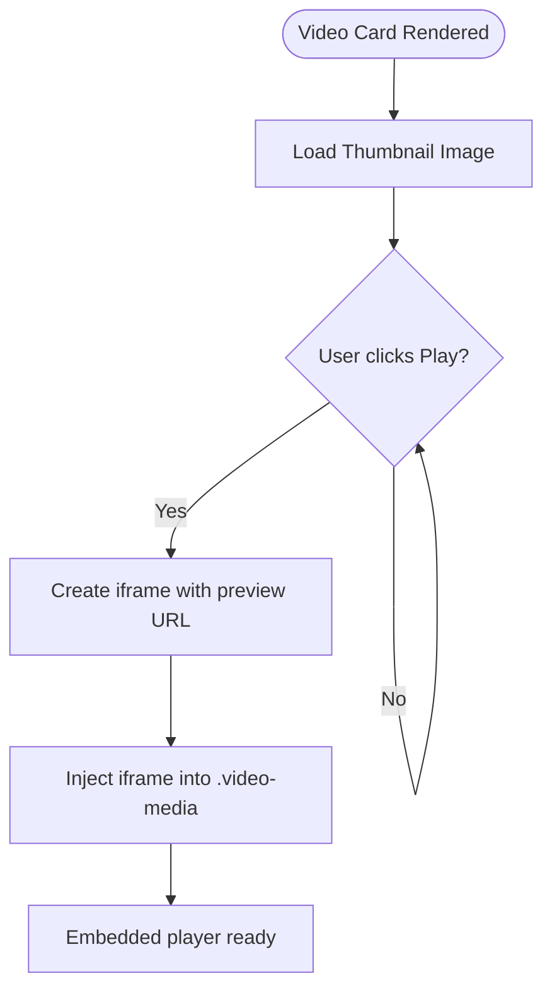
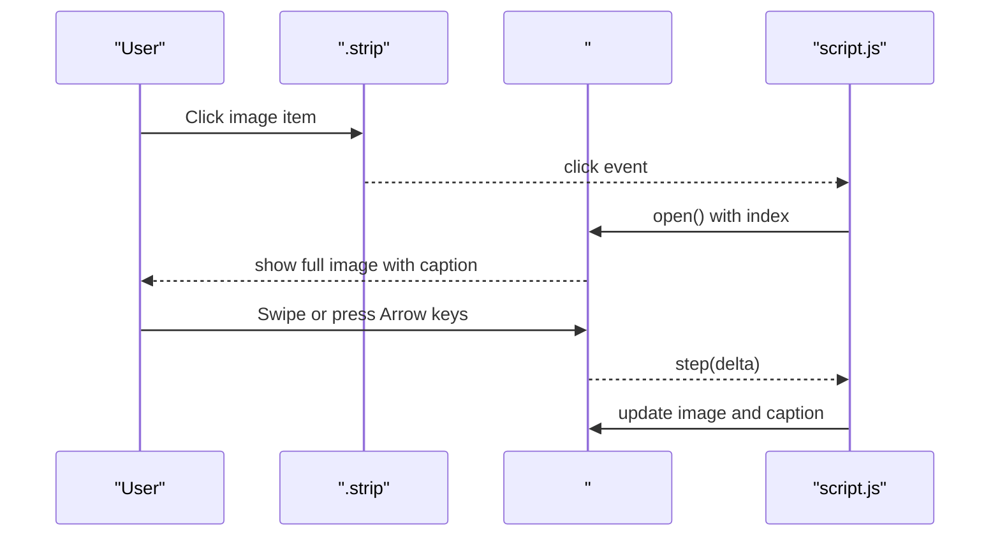
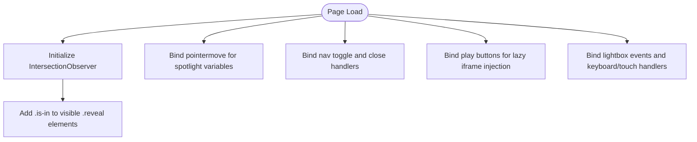
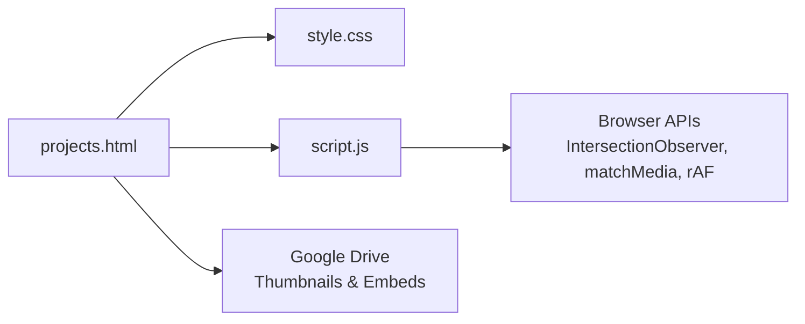

# Projects Page (projects.html)

<cite>
**Referenced Files in This Document**
- [projects.html](file://projects.html)
- [script.js](file://script.js)
- [style.css](file://style.css)
</cite>

## Table of Contents
1. [Introduction](#introduction)
2. [Project Structure](#project-structure)
3. [Core Components](#core-components)
4. [Architecture Overview](#architecture-overview)
5. [Detailed Component Analysis](#detailed-component-analysis)
6. [Dependency Analysis](#dependency-analysis)
7. [Performance Considerations](#performance-considerations)
8. [Troubleshooting Guide](#troubleshooting-guide)
9. [Conclusion](#conclusion)

## Introduction
This document explains the architecture and user experience of the Projects page, focusing on:
- Video projects section with Google Drive integration and lazy-loaded playback
- Photography collection grid with responsive layout, hover effects, and lightbox viewer
- Programming section showcasing technical skills and code samples
- Interactive features including accessible lightbox navigation, touch gestures, and smooth scrolling
- Performance optimization strategies for heavy media content
- Progressive enhancement for reduced motion scenarios
- Cross-browser compatibility considerations
- Integration with shared components and consistent UX across devices

The Projects page is a single-page showcase that uses semantic HTML, modern CSS, and vanilla JavaScript to deliver an accessible, performant, and visually cohesive experience.

## Project Structure
The Projects page is composed of three primary files:
- `projects.html`: Semantic markup for sections, cards, and interactive elements
- `style.css`: Design system, layout grids, animations, and responsive rules
- `script.js`: Behavior for lazy video loading, scroll reveals, pointer spotlight, and accessible lightbox

**Diagram sources**
- [projects.html:1-462](file://projects.html#L1-L462)
- [style.css:1-2397](file://style.css#L1-L2397)
- [script.js:1-233](file://script.js#L1-L233)

**Section sources**
- [projects.html:1-462](file://projects.html#L1-L462)
- [style.css:1-2397](file://style.css#L1-L2397)
- [script.js:1-233](file://script.js#L1-L233)

## Core Components
- Header and navigation with mobile menu toggle and scroll progress indicator
- Page hero introducing the Projects page
- Video projects grid with Google Drive thumbnails and lazy iframe players
- Photography strip with horizontal scroll and captions
- Programming section with repository cards and skill panel
- Contact card and footer with back-to-top link
- Global accessibility helpers: skip link, focus styles, aria attributes

Key implementation highlights:
- Lazy video player injection via data attributes
- IntersectionObserver-based reveal animations
- Pointer-driven spotlight effect on cards
- Accessible lightbox with keyboard and touch support
- Responsive design using CSS Grid and fluid typography

**Section sources**
- [projects.html:96-126](file://projects.html#L96-L126)
- [projects.html:130-140](file://projects.html#L130-L140)
- [projects.html:142-258](file://projects.html#L142-L258)
- [projects.html:260-307](file://projects.html#L260-L307)
- [projects.html:309-411](file://projects.html#L309-L411)
- [projects.html:413-457](file://projects.html#L413-L457)
- [script.js:8-22](file://script.js#L8-L22)
- [script.js:24-49](file://script.js#L24-L49)
- [script.js:51-69](file://script.js#L51-L69)
- [script.js:71-96](file://script.js#L71-L96)
- [script.js:120-137](file://script.js#L120-L137)
- [script.js:139-227](file://script.js#L139-L227)

## Architecture Overview
The page follows a simple client-side architecture:
- HTML defines structure and metadata
- CSS provides design tokens, layout, and responsive behavior
- JS wires up interactions without frameworks

**Diagram sources**
- [projects.html:154-175](file://projects.html#L154-L175)
- [script.js:120-137](file://script.js#L120-L137)

**Section sources**
- [projects.html:1-462](file://projects.html#L1-L462)
- [script.js:1-233](file://script.js#L1-L233)

## Detailed Component Analysis

### Video Projects Section
Purpose:
- Showcase video edits hosted on Google Drive
- Provide lightweight thumbnails and lazy-loaded embedded players
- Offer direct links to view videos in Google Drive

Implementation details:
- Each video card includes:
  - `data-video` attribute containing the Google Drive file ID
  - `data-title` attribute for accessible player title
  - Thumbnail image from Google Drive thumbnail endpoint
  - Play button that triggers lazy iframe injection
  - External link to open the video in Google Drive

Behavior:
- On play click, script creates an iframe pointing to the Google Drive preview URL
- The iframe is inserted into the card’s media container
- The player supports autoplay and fullscreen via allow attributes

Accessibility:
- Play buttons have descriptive aria-labels
- Iframe has a title derived from the card’s data-title
- External links use rel="noopener" for security

**Diagram sources**
- [projects.html:154-175](file://projects.html#L154-L175)
- [script.js:120-137](file://script.js#L120-L137)

**Section sources**
- [projects.html:142-258](file://projects.html#L142-L258)
- [script.js:120-137](file://script.js#L120-L137)
- [style.css:1607-1783](file://style.css#L1607-L1783)

### Photography Collection Grid
Purpose:
- Present a curated set of images with captions
- Provide a responsive horizontal strip with snap scrolling
- Link to the full gallery on the About page

Layout and interaction:
- Horizontal scrollable strip with scroll-snap
- Hover effects scale images and reveal captions
- Links to the full gallery are provided via a button

Lightbox integration:
- The lightbox component is defined in the global stylesheet and wired by script.js
- It expects gallery items with data-full and data-caption attributes
- Keyboard navigation (ArrowLeft/ArrowRight), Escape to close, and touch swipe are supported

**Diagram sources**
- [projects.html:260-307](file://projects.html#L260-L307)
- [script.js:139-227](file://script.js#L139-L227)
- [style.css:1475-1600](file://style.css#L1475-L1600)

**Section sources**
- [projects.html:260-307](file://projects.html#L260-L307)
- [script.js:139-227](file://script.js#L139-L227)
- [style.css:1785-1833](file://style.css#L1785-L1833)
- [style.css:1475-1600](file://style.css#L1475-L1600)

### Programming Section
Purpose:
- Highlight current portfolio project and GitHub profile
- Display technical skills grouped by domain

Structure:
- Repository cards with icons, descriptions, and technology chips
- Skill panel organized into Frontend, Networking, Security, and Media categories
- Links to external repositories and profiles

Styling:
- Two-column grid layout on larger screens, stacking on smaller screens
- Consistent card styling with hover lift and glow effects

**Section sources**
- [projects.html:309-411](file://projects.html#L309-L411)
- [style.css:1835-1913](file://style.css#L1835-L1913)
- [style.css:887-951](file://style.css#L887-L951)

### Interactive Features
- Scroll progress bar updates based on scroll position
- Mobile navigation toggles with aria-expanded state management
- Reveal-on-scroll animations using IntersectionObserver with fallback for reduced motion
- Pointer spotlight effect for fine-pointer devices
- Accessible lightbox with:
  - Keyboard navigation (Enter/Space to open, Arrow keys to navigate, Escape to close)
  - Touch swipe gestures for next/previous
  - Focus management when opening/closing

**Diagram sources**
- [script.js:8-22](file://script.js#L8-L22)
- [script.js:24-49](file://script.js#L24-L49)
- [script.js:51-69](file://script.js#L51-L69)
- [script.js:71-96](file://script.js#L71-L96)
- [script.js:120-137](file://script.js#L120-L137)
- [script.js:139-227](file://script.js#L139-L227)

**Section sources**
- [script.js:8-22](file://script.js#L8-L22)
- [script.js:24-49](file://script.js#L24-L49)
- [script.js:51-69](file://script.js#L51-L69)
- [script.js:71-96](file://script.js#L71-L96)
- [script.js:120-137](file://script.js#L120-L137)
- [script.js:139-227](file://script.js#L139-L227)

## Dependency Analysis
- HTML depends on CSS for layout, visual design, and responsive behavior
- HTML depends on JS for interactivity and progressive enhancement
- JS depends on browser APIs:
  - IntersectionObserver for reveal animations
  - matchMedia for prefers-reduced-motion and pointer capabilities
  - requestAnimationFrame for efficient pointer tracking
- External dependencies:
  - Google Drive thumbnails and embedded players
  - System fonts and Google Fonts preconnect hints

**Diagram sources**
- [projects.html:1-462](file://projects.html#L1-L462)
- [style.css:1-2397](file://style.css#L1-L2397)
- [script.js:1-233](file://script.js#L1-L233)

**Section sources**
- [projects.html:1-462](file://projects.html#L1-L462)
- [script.js:1-233](file://script.js#L1-L233)
- [style.css:1-2397](file://style.css#L1-L2397)

## Performance Considerations
- Lazy loading of video players:
  - Iframes are created only when users click play, reducing initial payload
- Image optimization:
  - Local images use optimized paths under img/opt
  - Google Drive thumbnails are used for video covers
- Scroll performance:
  - Passive event listeners for scroll and pointer events
  - requestAnimationFrame throttling for pointer spotlight updates
- Reduced motion:
  - Animations and transitions are disabled when prefers-reduced-motion is enabled
  - Reveal animations are bypassed and elements are shown immediately
- Smooth scrolling:
  - Enabled globally but disabled for reduced motion preferences

Optimization recommendations:
- Preload critical fonts and assets where appropriate
- Use responsive images with srcset for photography if expanding the gallery
- Defer non-critical scripts further or split them by feature
- Monitor third-party embeds (Google Drive) for performance impact

**Section sources**
- [script.js:6-7](file://script.js#L6-L7)
- [script.js:21-22](file://script.js#L21-L22)
- [script.js:51-69](file://script.js#L51-L69)
- [script.js:71-96](file://script.js#L71-L96)
- [script.js:120-137](file://script.js#L120-L137)
- [style.css:2379-2396](file://style.css#L2379-L2396)

## Troubleshooting Guide
Common issues and resolutions:
- Video thumbnails fail to load:
  - Ensure Google Drive file IDs are correct and publicly accessible
  - Verify network access to Google domains
- Embedded player does not appear:
  - Confirm play button click handler is attached
  - Check console for errors related to iframe creation
- Lightbox not responding to keyboard:
  - Ensure lightbox element exists and is not hidden prematurely
  - Validate keydown listeners are bound to the document
- Animations not appearing:
  - Check prefers-reduced-motion settings
  - Verify IntersectionObserver availability and thresholds
- Mobile menu not closing:
  - Confirm body class toggling and aria-expanded updates
  - Ensure click-outside and Escape key handlers are active

Accessibility checks:
- All interactive elements should be reachable via keyboard
- Focus indicators must be visible
- ARIA labels and roles should be present on dynamic content

**Section sources**
- [script.js:120-137](file://script.js#L120-L137)
- [script.js:139-227](file://script.js#L139-L227)
- [script.js:24-49](file://script.js#L24-L49)
- [style.css:99-103](file://style.css#L99-L103)

## Conclusion
The Projects page delivers a polished, accessible, and performant showcase of video, photography, and programming work. Its architecture emphasizes:
- Lazy loading of heavy media to improve initial load times
- Semantic HTML and robust CSS for maintainability and responsiveness
- Vanilla JavaScript for lightweight, framework-free interactivity
- Accessibility-first interactions including keyboard navigation and reduced motion support
- Consistent design tokens and components across sections

By integrating Google Drive thumbnails and embedded players, providing a responsive photography strip, and offering clear pathways to external repositories, the page maintains a cohesive user experience across devices while adhering to best practices for performance and accessibility.