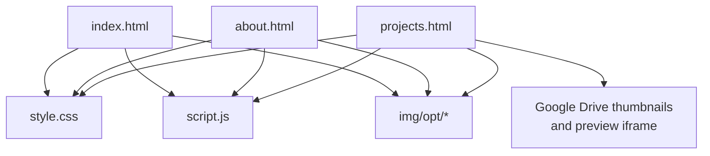
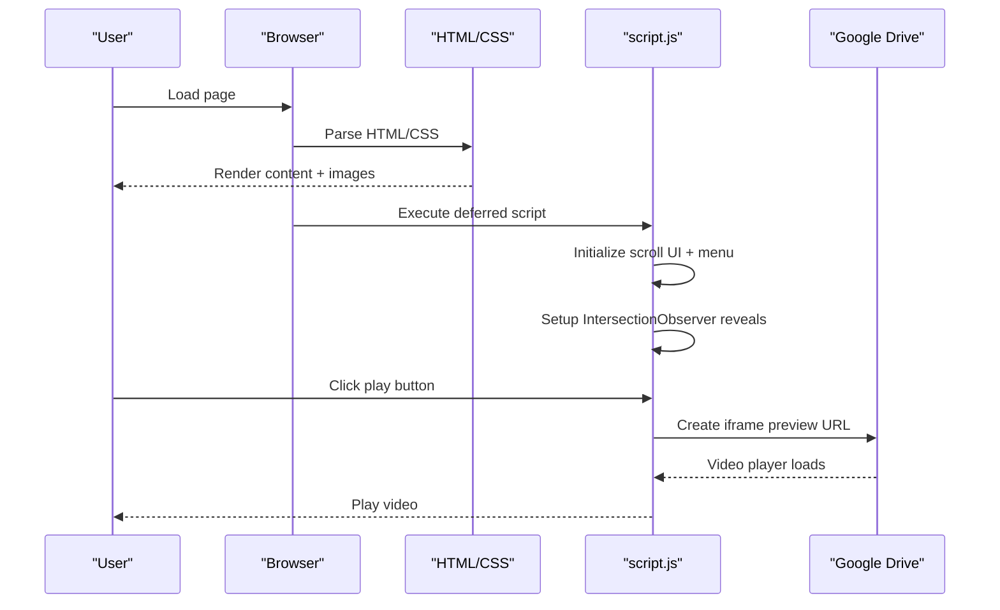
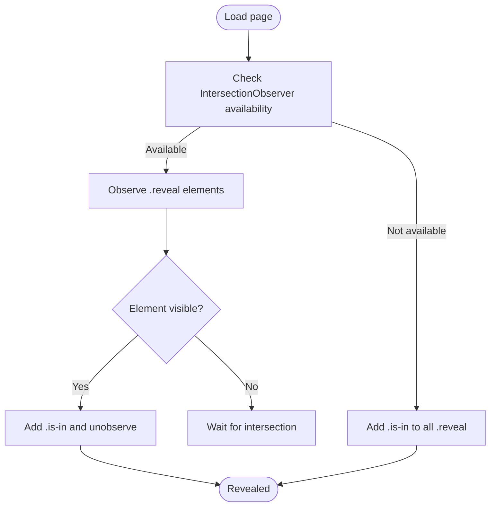
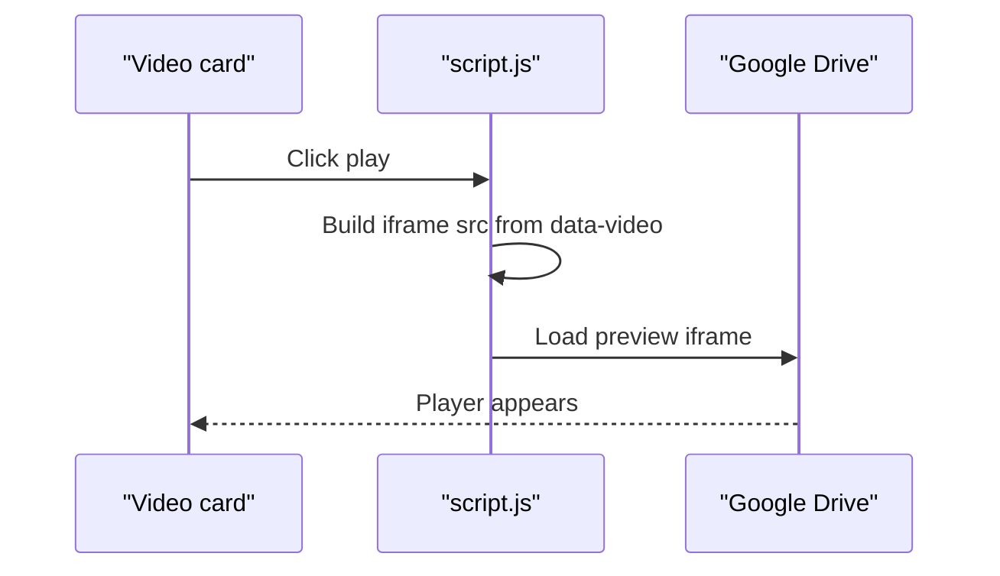
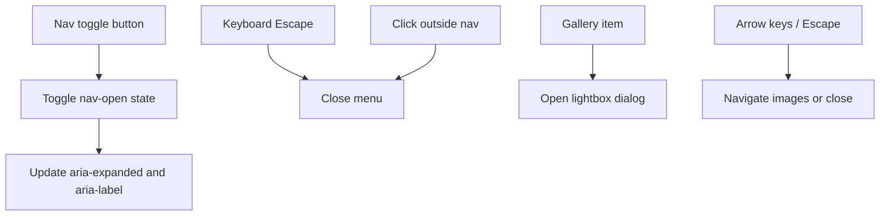
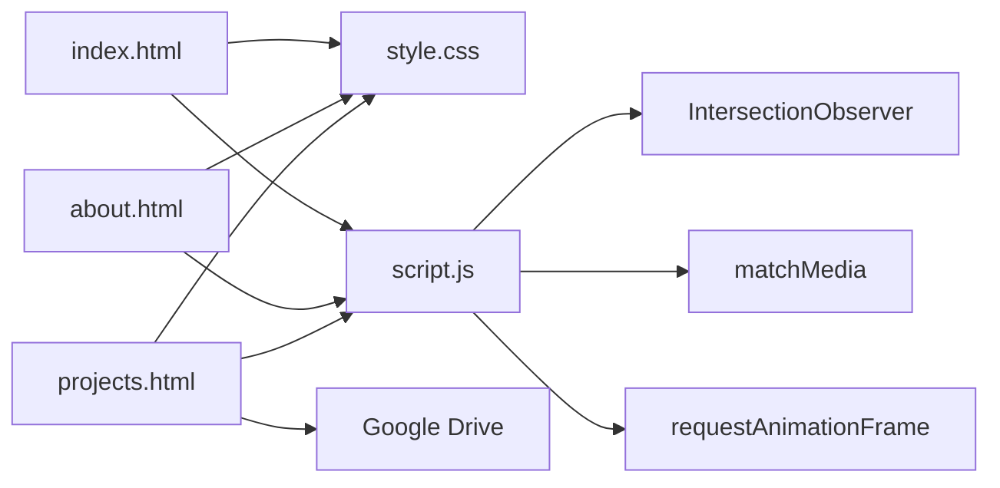

# Performance & Accessibility

<cite>
**Referenced Files in This Document**   
- [index.html](file://index.html)
- [about.html](file://about.html)
- [projects.html](file://projects.html)
- [script.js](file://script.js)
- [style.css](file://style.css)
</cite>

## Table of Contents
1. [Introduction](#introduction)
2. [Project Structure](#project-structure)
3. [Core Components](#core-components)
4. [Architecture Overview](#architecture-overview)
5. [Detailed Component Analysis](#detailed-component-analysis)
6. [Dependency Analysis](#dependency-analysis)
7. [Performance Considerations](#performance-considerations)
8. [Troubleshooting Guide](#troubleshooting-guide)
9. [Conclusion](#conclusion)
10. [Appendices](#appendices)

## Introduction
This document explains the performance optimization and accessibility features implemented across the portfolio website. It focuses on:
- Lazy loading for images and videos, including an Intersection Observer–based reveal system and Google Drive integration.
- Image optimization through the `img/opt` directory structure and proper image attributes.
- Accessibility practices such as semantic HTML, ARIA labels and roles, keyboard navigation, and screen reader compatibility.
- Reduced motion support for users with motion sensitivity preferences.
- Guidance for testing performance metrics, optimizing load times, ensuring WCAG compliance, handling cross-browser compatibility, and applying progressive enhancement.

## Project Structure
The site is a small static portfolio with three main pages and shared assets:
- Pages:
  - Home page: `index.html`
  - About page: `about.html`
  - Projects page: `projects.html`
- Shared resources:
  - Styles: `style.css`
  - Behavior: `script.js`
  - Optimized images: `img/opt/...`
  - External fonts via Google Fonts
  - Optional typed text library: `vendor/typed.umd.js`

**Diagram sources**
- [index.html:1-484](file://index.html#L1-L484)
- [about.html:1-428](file://about.html#L1-L428)
- [projects.html:1-462](file://projects.html#L1-L462)
- [style.css:1-800](file://style.css#L1-L800)
- [script.js:1-233](file://script.js#L1-L233)

**Section sources**
- [index.html:1-484](file://index.html#L1-L484)
- [about.html:1-428](file://about.html#L1-L428)
- [projects.html:1-462](file://projects.html#L1-L462)
- [style.css:1-800](file://style.css#L1-L800)
- [script.js:1-233](file://script.js#L1-L233)

## Core Components
Key performance and accessibility components include:
- Semantic HTML structure with skip links, landmarks, headings, lists, figures, and captions.
- ARIA labeling and roles for interactive elements, menus, lightbox, and decorative SVGs.
- Keyboard navigation for mobile menu, gallery items, and lightbox controls.
- Intersection Observer–based reveal animations with reduced-motion fallback.
- Native lazy loading for images and deferred video player initialization.
- Google Drive thumbnail previews and on-demand video playback.
- Progressive enhancement via `<noscript>` styles and graceful degradation.

**Section sources**
- [index.html:143-484](file://index.html#L143-L484)
- [about.html:95-428](file://about.html#L95-L428)
- [projects.html:96-462](file://projects.html#L96-L462)
- [script.js:1-233](file://script.js#L1-L233)
- [style.css:233-249](file://style.css#L233-L249)

## Architecture Overview
The site follows a lightweight, progressive-enhancement architecture:
- HTML provides semantic structure and accessible markup.
- CSS defines layout, focus states, reduced motion behavior, and visual polish.
- JavaScript adds interactivity (menu toggle, scroll progress, reveal animations, typed text, video facades, lightbox).
- Media assets are optimized locally; external media uses Google Drive thumbnails and on-demand iframes.

**Diagram sources**
- [script.js:8-22](file://script.js#L8-L22)
- [script.js:51-69](file://script.js#L51-L69)
- [script.js:120-137](file://script.js#L120-L137)
- [projects.html:154-256](file://projects.html#L154-L256)

## Detailed Component Analysis

### Lazy Loading Strategy for Images and Videos
- Native lazy loading:
  - Many images use `loading="lazy"` to defer offscreen image loading.
  - The hero portrait uses `fetchpriority="high"` to prioritize the most important image.
- Intersection Observer reveal:
  - Elements with class `reveal` are animated into view when they enter the viewport.
  - If `prefers-reduced-motion` is set or `IntersectionObserver` is unavailable, elements are immediately shown without animation.
- Video facade pattern:
  - Video cards display a thumbnail and a play button.
  - The actual Google Drive player iframe is created only when the user clicks play, reducing initial load cost.

**Diagram sources**
- [script.js:51-69](file://script.js#L51-L69)

**Section sources**
- [index.html:221-222](file://index.html#L221-L222)
- [index.html:344-345](file://index.html#L344-L345)
- [projects.html:158-159](file://projects.html#L158-L159)
- [projects.html:276-303](file://projects.html#L276-L303)
- [about.html:147-147](file://about.html#L147-L147)
- [about.html:214-244](file://about.html#L214-L244)
- [about.html:275-347](file://about.html#L275-L347)
- [script.js:51-69](file://script.js#L51-L69)

### Google Drive Integration
- Thumbnails:
  - Some project cards use Google Drive thumbnail URLs to show previews without hosting large files locally.
- On-demand playback:
  - When a user clicks the play button, JavaScript creates an iframe pointing to the Google Drive preview URL.
  - The iframe is configured with `loading="lazy"`, autoplay and fullscreen permissions, and a descriptive title.

**Diagram sources**
- [projects.html:155-174](file://projects.html#L155-L174)
- [projects.html:177-194](file://projects.html#L177-L194)
- [projects.html:197-214](file://projects.html#L197-L214)
- [projects.html:217-234](file://projects.html#L217-L234)
- [projects.html:237-254](file://projects.html#L237-L254)
- [script.js:120-137](file://script.js#L120-L137)

**Section sources**
- [projects.html:154-256](file://projects.html#L154-L256)
- [script.js:120-137](file://script.js#L120-L137)

### Image Optimization Techniques
- Directory structure:
  - All optimized images are stored under `img/opt`.
- Attributes:
  - Explicit `width` and `height` prevent layout shifts.
  - Descriptive `alt` text improves accessibility and SEO.
  - `loading="lazy"` defers non-critical images.
  - `fetchpriority="high"` prioritizes critical images like the hero portrait.
- External thumbnails:
  - Google Drive thumbnails are used where appropriate to avoid heavy local assets.

**Section sources**
- [index.html:221-222](file://index.html#L221-L222)
- [index.html:344-345](file://index.html#L344-L345)
- [projects.html:158-159](file://projects.html#L158-L159)
- [projects.html:276-303](file://projects.html#L276-L303)
- [about.html:147-147](file://about.html#L147-L147)
- [about.html:214-244](file://about.html#L214-L244)
- [about.html:275-347](file://about.html#L275-L347)

### Accessibility Features
- Semantic HTML:
  - Proper use of `header`, `nav`, `main`, `section`, `article`, `figure`, `figcaption`, and headings.
- Skip link:
  - A visible skip-to-content link improves keyboard navigation.
- ARIA labels and roles:
  - Navigation has `aria-label`, current page indicators use `aria-current="page"`.
  - Decorative SVGs use `aria-hidden="true"` and `focusable="false"`.
  - Gallery items use `role="button"`, `tabindex="0"`, and descriptive `aria-label`.
  - Lightbox uses `role="dialog"`, `aria-modal="true"`, and `aria-live="polite"` for announcements.
- Keyboard navigation:
  - Mobile menu closes on Escape and when clicking outside.
  - Lightbox supports ArrowLeft/ArrowRight, Escape, Enter/Space activation, and touch swipe.
- Screen reader compatibility:
  - Descriptive alt texts, live regions, and meaningful labels ensure content is understandable.

**Diagram sources**
- [script.js:24-49](file://script.js#L24-L49)
- [script.js:186-207](file://script.js#L186-L207)
- [about.html:271-353](file://about.html#L271-L353)
- [about.html:405-423](file://about.html#L405-L423)

**Section sources**
- [index.html:143-216](file://index.html#L143-L216)
- [about.html:95-124](file://about.html#L95-L124)
- [about.html:271-353](file://about.html#L271-L353)
- [about.html:405-423](file://about.html#L405-L423)
- [projects.html:96-125](file://projects.html#L96-L125)
- [script.js:24-49](file://script.js#L24-L49)
- [script.js:186-207](file://script.js#L186-L207)

### Reduced Motion Support
- The script checks `prefers-reduced-motion: reduce` and disables pointer spotlight effects and Intersection Observer animations accordingly.
- When reduced motion is preferred or IntersectionObserver is not supported, `.reveal` elements are immediately revealed without animation.
- CSS also sets smooth scrolling and avoids excessive motion where possible.

**Section sources**
- [script.js:6](file://script.js#L6)
- [script.js:51-69](file://script.js#L51-L69)
- [script.js:71-96](file://script.js#L71-L96)
- [style.css:36-41](file://style.css#L36-L41)

### Progressive Enhancement and Cross-Browser Compatibility
- Progressive enhancement:
  - `<noscript>` blocks ensure reveal animations degrade gracefully by showing content immediately.
  - Deferred scripts (`defer`) improve initial render performance.
  - External libraries (e.g., Typed.js) are optional and guarded by feature checks.
- Cross-browser considerations:
  - Uses widely supported APIs: IntersectionObserver, matchMedia, requestAnimationFrame.
  - Graceful fallbacks for unsupported environments (e.g., immediate reveal without observer).
  - Focus-visible outlines and standard ARIA attributes for broad assistive technology support.

**Section sources**
- [index.html:42-49](file://index.html#L42-L49)
- [index.html:25-26](file://index.html#L25-L26)
- [about.html:25-32](file://about.html#L25-L32)
- [projects.html:25-32](file://projects.html#L25-L32)
- [script.js:51-69](file://script.js#L51-L69)
- [script.js:98-118](file://script.js#L98-L118)

## Dependency Analysis
High-level dependencies:
- Pages depend on shared CSS and JS.
- JS depends on browser APIs and optional third-party libraries.
- Media assets are either local (`img/opt`) or remote (Google Drive).

**Diagram sources**
- [index.html:1-484](file://index.html#L1-L484)
- [about.html:1-428](file://about.html#L1-L428)
- [projects.html:1-462](file://projects.html#L1-L462)
- [style.css:1-800](file://style.css#L1-L800)
- [script.js:1-233](file://script.js#L1-L233)

**Section sources**
- [index.html:1-484](file://index.html#L1-L484)
- [about.html:1-428](file://about.html#L1-L428)
- [projects.html:1-462](file://projects.html#L1-L462)
- [style.css:1-800](file://style.css#L1-L800)
- [script.js:1-233](file://script.js#L1-L233)

## Performance Considerations
- Prioritize critical resources:
  - Use `fetchpriority="high"` for above-the-fold images.
  - Defer non-critical scripts and libraries.
- Reduce network requests:
  - Prefer local optimized images over large remote assets.
  - Use thumbnails for previews and load full players on demand.
- Avoid layout shifts:
  - Always specify `width` and `height` for images.
  - Reserve space for dynamic content like lightboxes and video players.
- Minimize reflows and repaints:
  - Use CSS transforms and opacity for animations.
  - Debounce or throttle expensive events; use passive listeners where appropriate.
- Respect user preferences:
  - Honor `prefers-reduced-motion` to avoid unnecessary animations.
- Optimize external integrations:
  - Ensure Google Drive links are secure and use `rel="noopener"` for external targets.

[No sources needed since this section provides general guidance]

## Troubleshooting Guide
Common issues and resolutions:
- Images do not appear:
  - Verify `src` paths and that images exist under `img/opt`.
  - For Google Drive thumbnails, check file IDs and ensure public sharing settings allow access.
- Videos fail to load:
  - Confirm the `data-video` ID matches the Google Drive file ID.
  - Ensure the preview URL format is correct and the file is publicly accessible.
- Animations not triggering:
  - Check whether `IntersectionObserver` is supported and whether `prefers-reduced-motion` is enabled.
  - Inspect whether `.reveal` elements have the expected classes and styles.
- Keyboard navigation problems:
  - Ensure interactive elements have `tabindex="0"` and appropriate ARIA attributes.
  - Verify event listeners for Escape, Enter, Space, and arrow keys are attached.
- Screen readers not announcing changes:
  - Confirm `aria-live` regions are present for dynamic updates (e.g., lightbox counter).
  - Validate that `alt` texts and `aria-label`s describe content accurately.

**Section sources**
- [projects.html:158-159](file://projects.html#L158-L159)
- [script.js:51-69](file://script.js#L51-L69)
- [script.js:186-207](file://script.js#L186-L207)
- [about.html:405-423](file://about.html#L405-L423)

## Conclusion
The portfolio website implements a thoughtful balance of performance and accessibility:
- Lazy loading and on-demand video playback reduce initial load costs.
- Semantic HTML, ARIA attributes, and keyboard navigation enhance usability for all users.
- Reduced motion support and progressive enhancement ensure robust behavior across devices and capabilities.
- Ongoing monitoring of performance metrics and WCAG compliance will help maintain a high-quality user experience.

[No sources needed since this section summarizes without analyzing specific files]

## Appendices

### Testing Performance Metrics
- Use browser DevTools:
  - Network panel to inspect resource loading order and sizes.
  - Lighthouse for performance, accessibility, and best practices audits.
- Measure key metrics:
  - First Contentful Paint (FCP), Largest Contentful Paint (LCP), Time to Interactive (TTI), Cumulative Layout Shift (CLS).
- Validate accessibility:
  - Automated tools (axe, Lighthouse) plus manual keyboard and screen reader testing.

[No sources needed since this section provides general guidance]

### WCAG Compliance Checklist
- Perceivable:
  - Provide alt text for informative images; mark decorative SVGs appropriately.
  - Ensure sufficient color contrast and readable typography.
- Operable:
  - Full keyboard navigation and visible focus indicators.
  - No keyboard traps; Escape closes overlays.
- Understandable:
  - Clear headings, labels, and instructions.
  - Consistent navigation and predictable interactions.
- Robust:
  - Valid HTML and ARIA usage.
  - Graceful degradation when JavaScript is disabled.

**Section sources**
- [index.html:143-216](file://index.html#L143-L216)
- [about.html:271-353](file://about.html#L271-L353)
- [about.html:405-423](file://about.html#L405-L423)
- [script.js:24-49](file://script.js#L24-L49)
- [script.js:186-207](file://script.js#L186-L207)