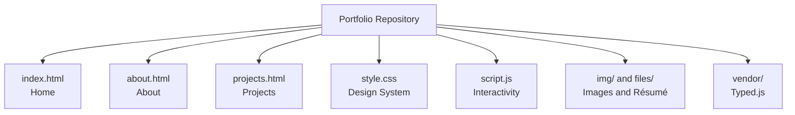
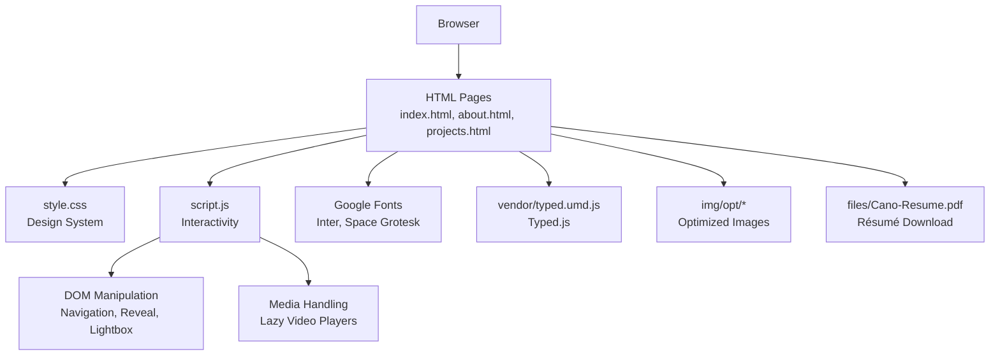
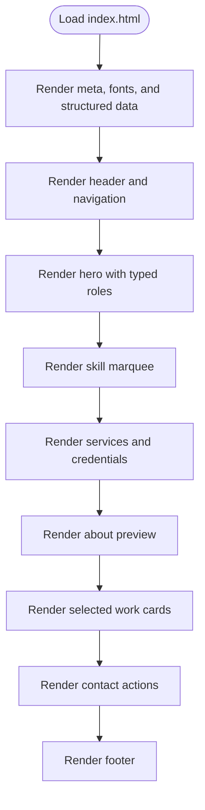
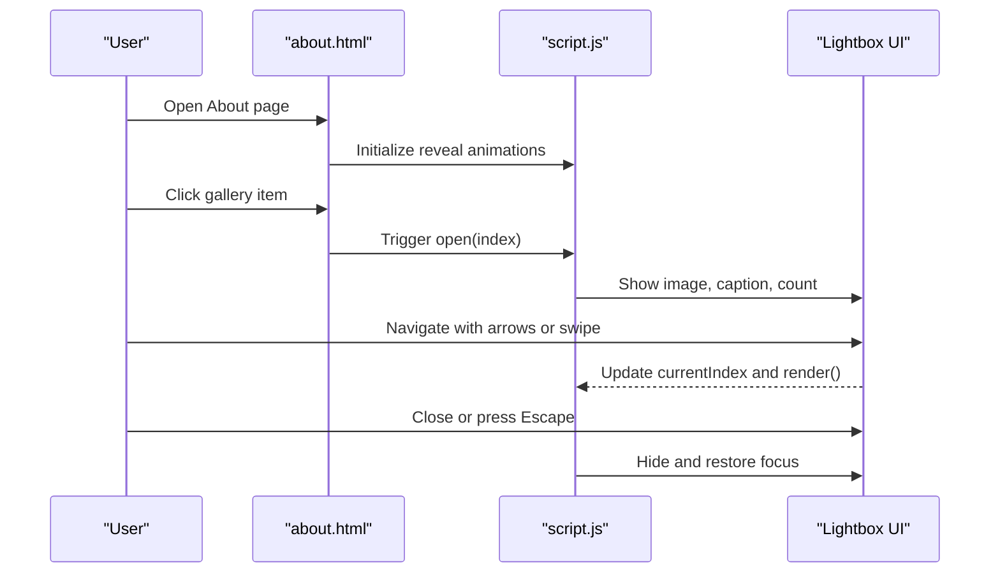
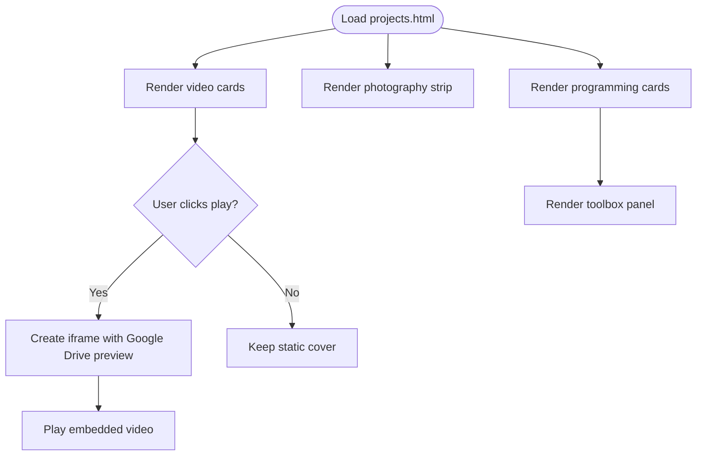
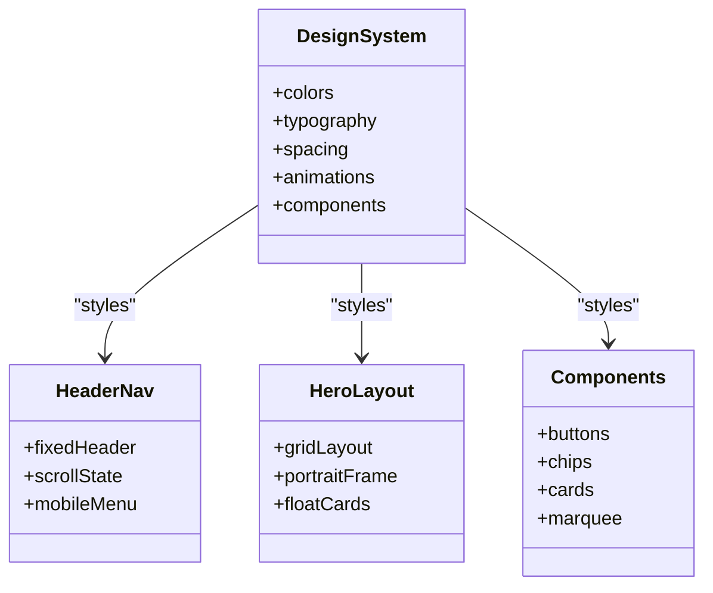
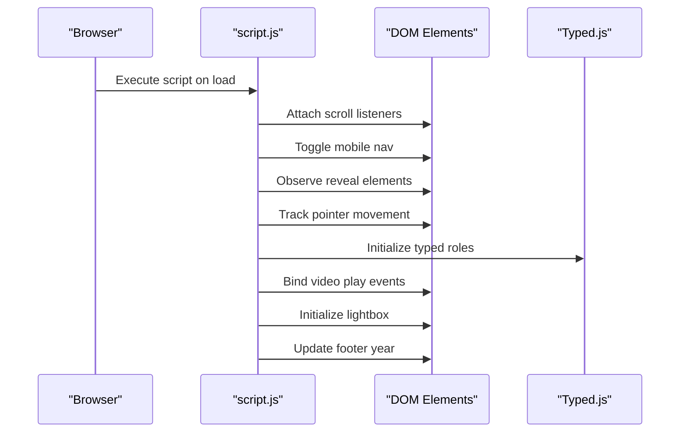
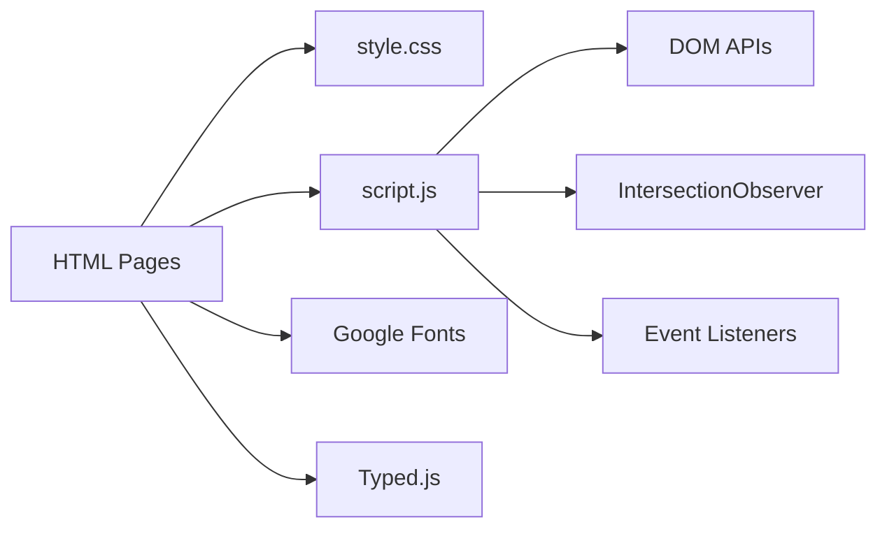

# Project Overview

<cite>
**Referenced Files in This Document**
- [index.html](file://index.html)
- [about.html](file://about.html)
- [projects.html](file://projects.html)
- [style.css](file://style.css)
- [script.js](file://script.js)
</cite>

## Table of Contents
1. [Introduction](#introduction)
2. [Project Structure](#project-structure)
3. [Core Components](#core-components)
4. [Architecture Overview](#architecture-overview)
5. [Detailed Component Analysis](#detailed-component-analysis)
6. [Dependency Analysis](#dependency-analysis)
7. [Performance Considerations](#performance-considerations)
8. [Troubleshooting Guide](#troubleshooting-guide)
9. [Conclusion](#conclusion)

## Introduction
This portfolio website is the personal showcase of Jeric Mark Caño, an IT professional and multimedia storyteller based in Iloilo, Philippines. The site presents a cohesive narrative that blends technical expertise with creative production across video editing, photography, graphic design, and web development. It is designed to attract potential employers, clients, and collaborators who are looking for reliable, mission-driven work in technology and media.

The project is intentionally simple: a static site built with semantic HTML5, modern CSS3, and vanilla JavaScript. There is no backend or framework dependency. The site demonstrates both technical skills and creative capabilities through responsive layouts, accessible interactions, scroll animations, and interactive features such as a typed role carousel, lazy-loaded video players, and a keyboard-friendly image lightbox.

Target audience:
- Employers seeking IT support, networking, cybersecurity, or web development talent
- Clients needing video editing, photography, graphic design, or web development services
- Collaborators interested in community-driven, church-related, or mission-focused projects

Technology stack summary:
- Google Fonts integration for Inter and Space Grotesk typography
- Typed.js library for animated role text on the home page
- GitHub Pages deployment via a public repository
- Vanilla JavaScript for interactivity without frameworks
- Modern CSS variables, gradients, grid, and animation utilities

## Project Structure
The project follows a flat, content-first structure with three main pages and shared assets:

- index.html: Home page with hero, skills marquee, service overview, about preview, selected work highlights, and contact links
- about.html: Personal biography, journey highlights, and gallery with lightbox
- projects.html: Video editing showcase, photography section, programming projects, and toolbox
- style.css: Shared design system, layout, typography, components, and animations
- script.js: Shared interactivity including navigation, scroll effects, reveal animations, typed roles, video facades, and lightbox

**Diagram sources**
- [index.html:1-50](file://index.html#L1-L50)
- [about.html:1-35](file://about.html#L1-L35)
- [projects.html:1-35](file://projects.html#L1-L35)
- [style.css:1-26](file://style.css#L1-L26)
- [script.js:1-10](file://script.js#L1-L10)

**Section sources**
- [index.html:1-50](file://index.html#L1-L50)
- [about.html:1-35](file://about.html#L1-L35)
- [projects.html:1-35](file://projects.html#L1-L35)
- [style.css:1-26](file://style.css#L1-L26)
- [script.js:1-10](file://script.js#L1-L10)

## Core Components
This portfolio is composed of several core components that work together to deliver a polished, accessible experience:

- Header and Navigation
  - Fixed header with logo, primary navigation, resume link, and mobile menu toggle
  - Scroll-aware background blur and progress bar indicating reading position
  - Accessible skip-to-content link and ARIA attributes for screen readers

- Hero Section
  - Strong headline and role carousel powered by Typed.js
  - Social links and location badge
  - Portrait image with floating credential cards

- Services and Skills Marquee
  - Animated skill ticker showcasing video editing, photography, graphic design, web development, Cisco networking, leadership, and community service
  - Service cards describing each capability

- About Preview and Full About Page
  - Split layout with photo and copy
  - Detailed biography, education, certifications, leadership, and experience
  - Journey timeline with images and captions
  - Gallery with accessible lightbox

- Projects Showcase
  - Video editing cards with lazy-loaded Google Drive players
  - Photography strip linking to full gallery
  - Programming section highlighting this portfolio and GitHub profile
  - Toolbox panel listing frontend, networking, security, and media skills

- Contact Section
  - Clear call-to-action with LinkedIn, GitHub, Facebook, and résumé download

- Design System
  - Dark theme with teal/cyan/indigo accents
  - CSS custom properties for colors, typography, spacing, and easing
  - Responsive grids, buttons, chips, and component styles

**Section sources**
- [index.html:152-244](file://index.html#L152-L244)
- [index.html:246-337](file://index.html#L246-L337)
- [index.html:339-433](file://index.html#L339-L433)
- [index.html:435-467](file://index.html#L435-L467)
- [about.html:104-140](file://about.html#L104-L140)
- [about.html:142-196](file://about.html#L142-L196)
- [about.html:198-257](file://about.html#L198-L257)
- [about.html:259-356](file://about.html#L259-L356)
- [about.html:358-390](file://about.html#L358-L390)
- [projects.html:105-140](file://projects.html#L105-L140)
- [projects.html:142-258](file://projects.html#L142-L258)
- [projects.html:260-307](file://projects.html#L260-L307)
- [projects.html:309-411](file://projects.html#L309-L411)
- [projects.html:413-445](file://projects.html#L413-L445)
- [style.css:6-26](file://style.css#L6-L26)
- [style.css:255-399](file://style.css#L255-L399)
- [style.css:427-520](file://style.css#L427-L520)
- [style.css:522-773](file://style.css#L522-L773)

## Architecture Overview
The site uses a straightforward static architecture:

- HTML pages define content and structure
- CSS defines the visual design system and responsive behavior
- JavaScript adds interactivity and progressive enhancement
- External resources include Google Fonts and Typed.js
- Deployment is handled by GitHub Pages

**Diagram sources**
- [index.html:19-26](file://index.html#L19-L26)
- [about.html:18-24](file://about.html#L18-L24)
- [projects.html:18-24](file://projects.html#L18-L24)
- [style.css:1-26](file://style.css#L1-L26)
- [script.js:98-137](file://script.js#L98-L137)
- [script.js:139-227](file://script.js#L139-L227)

## Detailed Component Analysis

### Home Page (index.html)
The home page introduces Jeric Mark’s identity, skills, and services. It includes:
- SEO metadata and Open Graph tags for social sharing
- Structured data for person schema
- SVG sprite for icons
- Header with navigation and resume link
- Hero with typed roles and social links
- Skill marquee and service cards
- About preview and selected work highlights
- Contact section with external links

**Diagram sources**
- [index.html:1-50](file://index.html#L1-L50)
- [index.html:152-244](file://index.html#L152-L244)
- [index.html:246-337](file://index.html#L246-L337)
- [index.html:339-433](file://index.html#L339-L433)
- [index.html:435-467](file://index.html#L435-L467)

**Section sources**
- [index.html:1-50](file://index.html#L1-L50)
- [index.html:152-244](file://index.html#L152-L244)
- [index.html:246-337](file://index.html#L246-L337)
- [index.html:339-433](file://index.html#L339-L433)
- [index.html:435-467](file://index.html#L435-L467)

### About Page (about.html)
The about page provides a deeper narrative:
- Page hero with mission-oriented messaging
- Biography with education, certifications, leadership, and experience
- Journey timeline with images and stories
- Gallery with accessible lightbox for full-screen viewing
- Contact section consistent with other pages

**Diagram sources**
- [about.html:127-140](file://about.html#L127-L140)
- [about.html:142-196](file://about.html#L142-L196)
- [about.html:198-257](file://about.html#L198-L257)
- [about.html:259-356](file://about.html#L259-L356)
- [script.js:139-227](file://script.js#L139-L227)

**Section sources**
- [about.html:104-140](file://about.html#L104-L140)
- [about.html:142-196](file://about.html#L142-L196)
- [about.html:198-257](file://about.html#L198-L257)
- [about.html:259-356](file://about.html#L259-L356)
- [about.html:358-390](file://about.html#L358-L390)
- [script.js:139-227](file://script.js#L139-L227)

### Projects Page (projects.html)
The projects page showcases practical work:
- Video editing section with cards that lazily load Google Drive players
- Photography section linking to the full gallery
- Programming section highlighting this portfolio and GitHub profile
- Toolbox panel summarizing skills across frontend, networking, security, and media

**Diagram sources**
- [projects.html:142-258](file://projects.html#L142-L258)
- [projects.html:260-307](file://projects.html#L260-L307)
- [projects.html:309-411](file://projects.html#L309-L411)
- [script.js:120-137](file://script.js#L120-L137)

**Section sources**
- [projects.html:105-140](file://projects.html#L105-L140)
- [projects.html:142-258](file://projects.html#L142-L258)
- [projects.html:260-307](file://projects.html#L260-L307)
- [projects.html:309-411](file://projects.html#L309-L411)
- [projects.html:413-445](file://projects.html#L413-L445)
- [script.js:120-137](file://script.js#L120-L137)

### Design System (style.css)
The design system establishes a dark premium aesthetic with:
- CSS custom properties for colors, typography, spacing, and easing
- Background atmosphere with subtle grid and animated blobs
- Utility classes for containers, sections, and text treatments
- Header and navigation styles with scroll-aware states
- Buttons, chips, and link styles
- Hero layout, portrait styling, and floating credential cards
- Marquee and card glow effects
- Accessibility features like focus-visible outlines and skip-link

**Diagram sources**
- [style.css:6-26](file://style.css#L6-L26)
- [style.css:128-181](file://style.css#L128-L181)
- [style.css:255-399](file://style.css#L255-L399)
- [style.css:427-520](file://style.css#L427-L520)
- [style.css:522-773](file://style.css#L522-L773)

**Section sources**
- [style.css:1-26](file://style.css#L1-L26)
- [style.css:128-181](file://style.css#L128-L181)
- [style.css:255-399](file://style.css#L255-L399)
- [style.css:427-520](file://style.css#L427-L520)
- [style.css:522-773](file://style.css#L522-L773)

### Interactivity (script.js)
JavaScript provides progressive enhancement and accessibility:
- Scroll-aware header and progress bar
- Mobile navigation toggle with ARIA state management
- IntersectionObserver-based reveal animations with reduced-motion fallback
- Pointer spotlight and card glow effects
- Typed.js initialization for role carousel
- Lazy loading of Google Drive video players
- Accessible gallery lightbox with keyboard and touch support
- Dynamic footer year update

**Diagram sources**
- [script.js:8-22](file://script.js#L8-L22)
- [script.js:24-49](file://script.js#L24-L49)
- [script.js:51-69](file://script.js#L51-L69)
- [script.js:71-96](file://script.js#L71-L96)
- [script.js:98-118](file://script.js#L98-L118)
- [script.js:120-137](file://script.js#L120-L137)
- [script.js:139-227](file://script.js#L139-L227)
- [script.js:229-232](file://script.js#L229-L232)

**Section sources**
- [script.js:1-233](file://script.js#L1-L233)

## Dependency Analysis
The site has minimal dependencies:
- Google Fonts for typography
- Typed.js for animated role text
- Local assets for images and résumé PDF
- No build tools or frameworks

**Diagram sources**
- [index.html:19-26](file://index.html#L19-L26)
- [about.html:18-24](file://about.html#L18-L24)
- [projects.html:18-24](file://projects.html#L18-L24)
- [script.js:51-69](file://script.js#L51-L69)
- [script.js:98-118](file://script.js#L98-L118)

**Section sources**
- [index.html:19-26](file://index.html#L19-L26)
- [about.html:18-24](file://about.html#L18-L24)
- [projects.html:18-24](file://projects.html#L18-L24)
- [script.js:51-69](file://script.js#L51-L69)
- [script.js:98-118](file://script.js#L98-L118)

## Performance Considerations
- Static site architecture ensures fast initial loads
- Images use optimized paths and lazy loading where appropriate
- Typed.js runs only when available and targets a single element
- Video players are loaded lazily upon user interaction to avoid unnecessary bandwidth
- Animations respect prefers-reduced-motion and fine-pointer detection
- CSS uses efficient selectors and avoids heavy repaints
- JavaScript uses passive event listeners for scroll and pointer events

[No sources needed since this section provides general guidance]

## Troubleshooting Guide
Common issues and resolutions:
- Typed.js not initializing
  - Ensure vendor/typed.umd.js is present and loaded before script.js
  - Verify the .typed element exists on the page
- Video player not loading
  - Confirm Google Drive file IDs are correct
  - Check network permissions for embedding previews
- Lightbox not opening
  - Ensure gallery items have data-full attributes
  - Verify keyboard and touch event bindings
- Mobile menu not closing
  - Check body.nav-open class toggling and ARIA attributes
- Reduced motion preferences ignored
  - Confirm prefers-reduced-motion checks in script.js

**Section sources**
- [script.js:98-118](file://script.js#L98-L118)
- [script.js:120-137](file://script.js#L120-L137)
- [script.js:139-227](file://script.js#L139-L227)
- [script.js:24-49](file://script.js#L24-L49)

## Conclusion
Jeric Mark Caño’s portfolio is a thoughtfully crafted, accessible, and responsive static site that effectively communicates both technical competence and creative storytelling. Through clean HTML structure, a robust CSS design system, and purposeful JavaScript interactions, the site serves as a strong foundation for attracting employers, clients, and collaborators. Its simplicity ensures maintainability while its interactive features demonstrate modern front-end practices. Deployed via GitHub Pages, it offers a fast, reliable, and visually compelling showcase of multimedia and IT capabilities.

[No sources needed since this section summarizes without analyzing specific files]