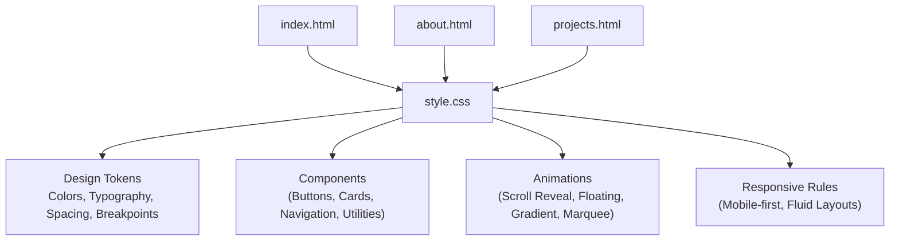
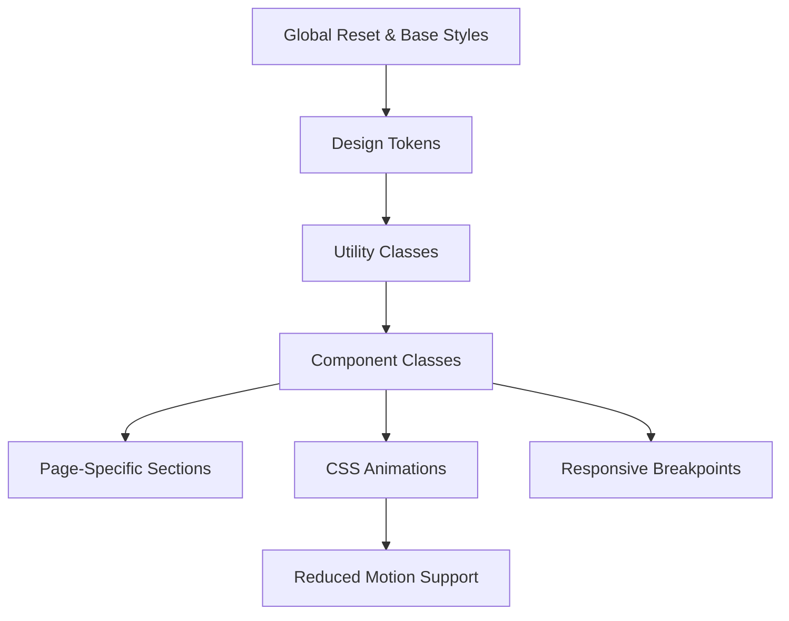
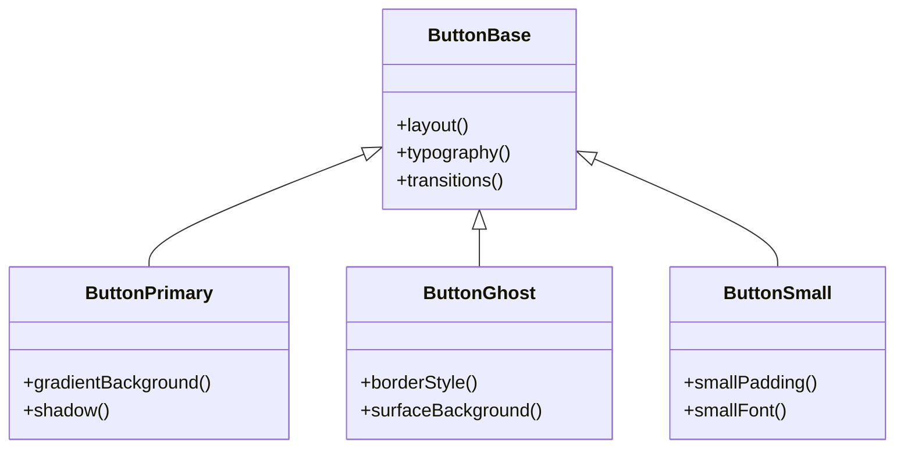
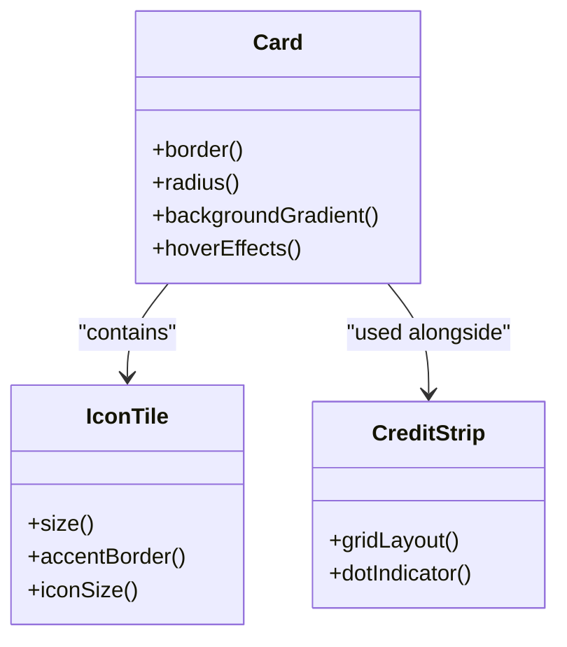
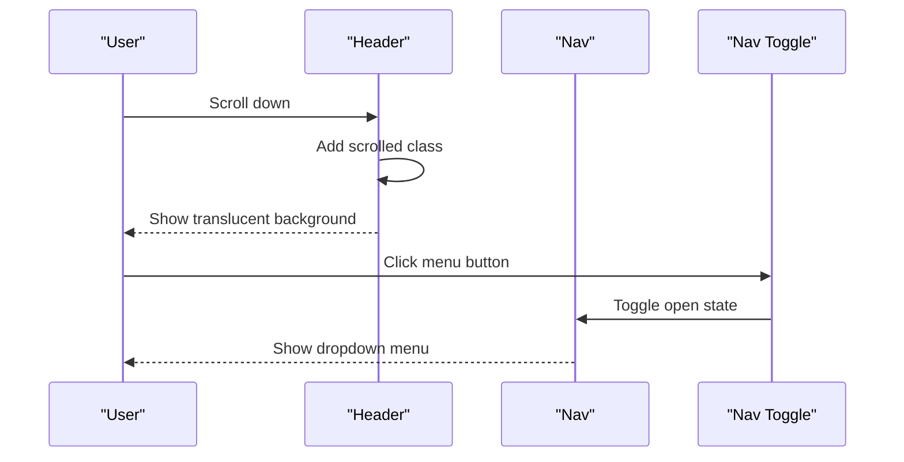
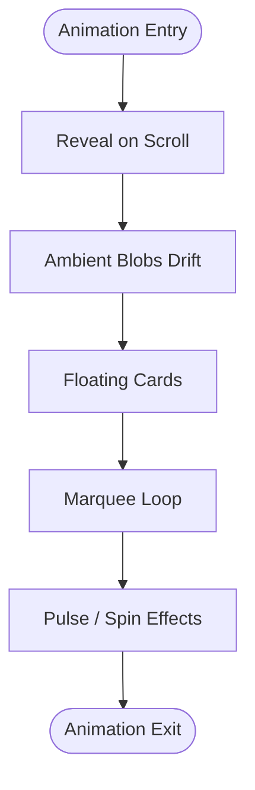
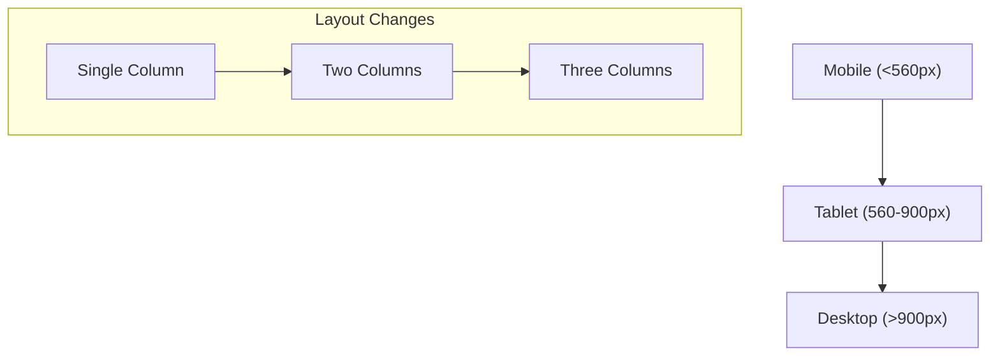
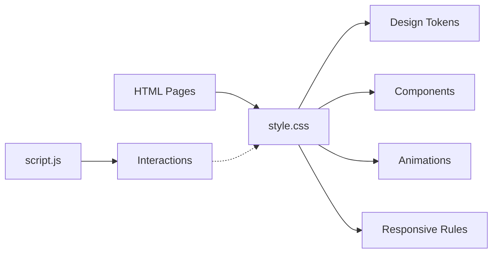

# Styling System

<cite>
**Referenced Files in This Document**
- [style.css](file://style.css)
- [index.html](file://index.html)
- [about.html](file://about.html)
- [projects.html](file://projects.html)
</cite>

## Table of Contents
1. [Introduction](#introduction)
2. [Project Structure](#project-structure)
3. [Core Components](#core-components)
4. [Architecture Overview](#architecture-overview)
5. [Detailed Component Analysis](#detailed-component-analysis)
6. [Dependency Analysis](#dependency-analysis)
7. [Performance Considerations](#performance-considerations)
8. [Troubleshooting Guide](#troubleshooting-guide)
9. [Conclusion](#conclusion)
10. [Appendices](#appendices)

## Introduction
This document explains the CSS styling system used across the portfolio website. It covers design tokens, component classes, animations, responsive strategy, and guidance for customization and performance. The site uses a dark premium theme with modern CSS features such as custom properties, fluid typography, grid-based layouts, backdrop filters, and CSS animations. JavaScript is used only for interactive behavior; all visual structure and motion are handled by CSS.

## Project Structure
The styling system lives primarily in one stylesheet and is applied consistently across three HTML pages:
- index.html: Home page with hero, marquee, services, about preview, selected work, contact, and footer.
- about.html: About page with page hero, bio, journey cards, gallery, lightbox, contact, and footer.
- projects.html: Projects page with video grid, photo strip, programming section, toolbox panel, contact, and footer.

**Diagram sources**
- [style.css:6-26](file://style.css#L6-L26)
- [style.css:187-206](file://style.css#L187-L206)
- [style.css:427-520](file://style.css#L427-L520)
- [style.css:779-846](file://style.css#L779-L846)
- [style.css:2029-2111](file://style.css#L2029-L2111)
- [style.css:2117-2397](file://style.css#L2117-L2397)

**Section sources**
- [index.html:1-484](file://index.html#L1-L484)
- [about.html:1-428](file://about.html#L1-L428)
- [projects.html:1-462](file://projects.html#L1-L462)
- [style.css:1-2397](file://style.css#L1-L2397)

## Core Components
This section documents the reusable UI components defined in the stylesheet and how they are used in the HTML.

### Design Tokens
Design tokens are centralized in the root scope and include colors, gradients, spacing, typography, easing, header height, and container width. They provide consistent theming and make customization straightforward.

Key token categories:
- Colors and surfaces: background, elevated background, surface layers, lines, text, muted text, accent colors (teal, cyan, indigo), and gradient definition.
- Typography: body font stack, display font stack, and global ease curve.
- Layout: header height and maximum container width.
- Radii: default and small border radius values.

How to customize:
- Change color tokens to re-theme the site.
- Adjust typography tokens to switch fonts or weights.
- Modify spacing tokens to change radii and layout rhythm.

**Section sources**
- [style.css:6-26](file://style.css#L6-L26)

### Utility Classes
Utilities provide common layout and presentation patterns:
- Container: centers content and constrains width.
- Section: provides vertical padding using fluid clamp values.
- Eyebrow: small uppercase label with an accent line.
- Grad-text: applies gradient text clipping.
- Skip-link: accessible skip-to-content link.
- SVG sprite: hidden symbol container for icons.

Usage examples:
- Sections use .section and .container to structure content.
- Headings often pair with .eyebrow for labels.
- Accent headings use .grad-text.

**Section sources**
- [style.css:187-206](file://style.css#L187-L206)
- [style.css:233-249](file://style.css#L233-L249)
- [index.html:178-244](file://index.html#L178-L244)
- [about.html:129-140](file://about.html#L129-L140)

### Buttons and Chips
Button system:
- Base button class provides shape, spacing, typography, and transitions.
- Variants:
  - Primary: gradient background with shadow.
  - Ghost: subtle border and surface background.
- Size modifier: small variant reduces padding and font size.
- Icons: buttons can embed inline SVGs.

Chips:
- Small pill-shaped tags for skills and tags.
- Hover state highlights the accent color.

Usage examples:
- Call-to-action buttons in hero and contact sections.
- Chip rows for skills and technology stacks.

**Section sources**
- [style.css:427-520](file://style.css#L427-L520)
- [index.html:188-197](file://index.html#L188-L197)
- [index.html:367-373](file://index.html#L367-L373)
- [projects.html:337-342](file://projects.html#L337-L342)

### Cards
Card system:
- Base card class includes border, rounded corners, subtle gradient background, hover lift, and glow effect.
- Icon tile: square icon container with accent border and background.
- Credit strip: compact credential tiles with gradient dot indicators.

Usage examples:
- Services grid uses cards with icon tiles.
- Cred strip shows certifications and learning badges.

**Section sources**
- [style.css:881-990](file://style.css#L881-L990)
- [index.html:282-335](file://index.html#L282-L335)

### Navigation
Navigation elements:
- Header: fixed top bar with scroll-aware background and border.
- Logo: brand mark and text with gradient emphasis.
- Nav links: styled anchor links with active indicator.
- Mobile menu: toggle button and collapsible menu controlled via a body class.

Behavior:
- On scroll, header gains a translucent background and border.
- On smaller screens, nav collapses into a dropdown toggled by a hamburger button.

Accessibility:
- Skip link for keyboard users.
- aria attributes on navigation and toggle button.

**Section sources**
- [style.css:255-421](file://style.css#L255-L421)
- [index.html:152-173](file://index.html#L152-L173)
- [about.html:104-125](file://about.html#L104-L125)
- [projects.html:105-126](file://projects.html#L105-L126)

### Hero and Visual Elements
Hero:
- Two-column grid layout with headline, role text, lede paragraph, actions, social links, and portrait visual.
- Typing animation placeholder and cursor blink.
- Scroll cue with animated line.

Floating cards:
- Glassmorphic floating badges around the portrait with gentle float animation.

Portrait:
- Rounded image frame with overlay gradient and decorative dashed ring animation.

**Section sources**
- [style.css:526-773](file://style.css#L526-L773)
- [index.html:178-244](file://index.html#L178-L244)

### Marquee
Marquee component:
- Horizontal scrolling banner with gradient fade edges.
- Pauses on hover.
- Uses duplicated groups for seamless looping.

Usage example:
- Skills marquee on the home page.

**Section sources**
- [style.css:779-846](file://style.css#L779-L846)
- [index.html:246-268](file://index.html#L246-L268)

### Section Headings
Section head pattern:
- Flexible layout for eyebrow, heading, and description.
- Fluid spacing and max-width constraints.

**Section sources**
- [style.css:852-875](file://style.css#L852-L875)
- [index.html:271-280](file://index.html#L271-L280)

### Work Teaser Cards
Work teaser:
- Grid of project thumbnails with gradient overlays and play button.
- Hover effects scale images and highlight play button.

**Section sources**
- [style.css:1086-1182](file://style.css#L1086-L1182)
- [index.html:395-431](file://index.html#L395-L431)

### Page Hero
Page hero:
- Large heading and lede for inner pages (About, Projects).
- Responsive sizing with clamp.

**Section sources**
- [style.css:1188-1209](file://style.css#L1188-L1209)
- [about.html:129-140](file://about.html#L129-L140)
- [projects.html:130-140](file://projects.html#L130-L140)

### About Page Components
About grid:
- Sticky photo with caption and two-column copy area.
- Facts grid for education, certifications, leadership, and experience.

Journey cards:
- Three-column story cards with media, number badge, and body text.

Gallery:
- Multi-column masonry-like layout with hover overlays and captions.

Lightbox:
- Fullscreen viewer with backdrop blur, controls, and counter.

**Section sources**
- [style.css:1215-1597](file://style.css#L1215-L1597)
- [about.html:142-423](file://about.html#L142-L423)

### Projects Page Components
Video grid:
- Two-column cards with media, tag, ghost number, play button, and metadata link.

Photo strip:
- Horizontally scrollable strip with snap points and captions.

Programming section:
- Repository cards and skill panel grouped in a two-column grid.

**Section sources**
- [style.css:1607-1912](file://style.css#L1607-L1912)
- [projects.html:142-410](file://projects.html#L142-L410)

### Contact and Footer
Contact card:
- Centered call-to-action with gradient background and decorative blurs.
- Action buttons arranged in a responsive flex row.

Footer:
- Minimal footer with copyright and back-to-top link.

**Section sources**
- [style.css:1918-2023](file://style.css#L1918-L2023)
- [index.html:435-479](file://index.html#L435-L479)
- [about.html:358-402](file://about.html#L358-L402)
- [projects.html:413-457](file://projects.html#L413-L457)

## Architecture Overview
The styling architecture follows a layered approach:
- Global reset and base styles establish defaults.
- Design tokens define the theme.
- Utilities provide building blocks.
- Components encapsulate reusable UI patterns.
- Animations define motion behaviors.
- Responsive rules adapt layouts at breakpoints.

**Diagram sources**
- [style.css:28-53](file://style.css#L28-L53)
- [style.css:6-26](file://style.css#L6-L26)
- [style.css:187-206](file://style.css#L187-L206)
- [style.css:427-520](file://style.css#L427-L520)
- [style.css:2029-2111](file://style.css#L2029-L2111)
- [style.css:2117-2397](file://style.css#L2117-L2397)

## Detailed Component Analysis

### Button System
The button system uses a base class plus variants and modifiers:
- Base class sets layout, typography, and transition behavior.
- Variants control color and interaction states.
- Modifier adjusts size.

**Diagram sources**
- [style.css:427-474](file://style.css#L427-L474)

**Section sources**
- [style.css:427-474](file://style.css#L427-L474)
- [index.html:188-197](file://index.html#L188-L197)

### Card System
Cards implement a consistent look with hover interactions:
- Base card includes border, rounded corners, gradient background, and hover lift.
- Icon tile provides a standardized icon container.
- Credit strip offers compact credential tiles.

**Diagram sources**
- [style.css:887-951](file://style.css#L887-L951)
- [style.css:953-990](file://style.css#L953-L990)

**Section sources**
- [style.css:887-990](file://style.css#L887-L990)
- [index.html:282-335](file://index.html#L282-L335)

### Navigation Flow
The navigation flow demonstrates header scroll behavior and mobile menu toggle:

**Diagram sources**
- [style.css:272-299](file://style.css#L272-L299)
- [style.css:378-421](file://style.css#L378-L421)
- [index.html:152-173](file://index.html#L152-L173)

**Section sources**
- [style.css:272-421](file://style.css#L272-L421)
- [index.html:152-173](file://index.html#L152-L173)

### Animation System
The animation system defines reusable keyframes and reveal behavior:
- Scroll reveal: elements start invisible and slide up when visible.
- Floating blobs: ambient background movement.
- Floating cards: gentle vertical oscillation.
- Gradient text: static gradient application.
- Marquee: continuous horizontal translation.
- Pulse and spin: decorative motion for play buttons and rings.

**Diagram sources**
- [style.css:2029-2111](file://style.css#L2029-L2111)
- [style.css:148-181](file://style.css#L148-L181)
- [style.css:696-745](file://style.css#L696-L745)
- [style.css:779-846](file://style.css#L779-L846)

**Section sources**
- [style.css:148-181](file://style.css#L148-L181)
- [style.css:696-745](file://style.css#L696-L745)
- [style.css:779-846](file://style.css#L779-L846)
- [style.css:2029-2111](file://style.css#L2029-L2111)

### Responsive Strategy
The site uses mobile-first principles:
- Default styles target small screens.
- Media queries progressively enhance layouts for larger screens.
- Fluid typography and spacing rely on clamp.
- Grids shift from single-column to multi-column layouts.

Breakpoints:
- 1060px: service grid becomes two columns; about and code grids become single column.
- 900px: mobile navigation appears; hero and split layouts stack; story and video grids collapse.
- 720px: credit strip and gallery adjust; lightbox controls resize.
- 560px: logo text hides; hero scales; service grid becomes single column; gallery columns reduce.
- 390px: gallery becomes single column; floating cards hide.

**Diagram sources**
- [style.css:2117-2397](file://style.css#L2117-L2397)

**Section sources**
- [style.css:2117-2397](file://style.css#L2117-L2397)

## Dependency Analysis
The CSS file depends on semantic HTML classes provided by the pages. There are no external CSS frameworks; fonts are loaded via Google Fonts. JavaScript files handle interactivity but do not alter core styles.

**Diagram sources**
- [style.css:6-26](file://style.css#L6-L26)
- [style.css:427-520](file://style.css#L427-L520)
- [style.css:2029-2111](file://style.css#L2029-L2111)
- [style.css:2117-2397](file://style.css#L2117-L2397)

**Section sources**
- [index.html:1-484](file://index.html#L1-L484)
- [about.html:1-428](file://about.html#L1-L428)
- [projects.html:1-462](file://projects.html#L1-L462)
- [style.css:1-2397](file://style.css#L1-L2397)

## Performance Considerations
- Prefer CSS animations over JavaScript where possible. The site uses CSS keyframes for ambient motion and marquee loops.
- Use will-change sparingly for elements that animate frequently (e.g., progress bar span).
- Avoid heavy filters like large blur on animated elements unless necessary.
- Keep animations short and use reduced-motion support for accessibility.
- Organize CSS by feature sections and utilities to maintain clarity and minimize overrides.
- Use fluid typography and spacing with clamp to reduce breakpoint complexity.
- Defer non-critical scripts and preload fonts only when needed.

[No sources needed since this section provides general guidance]

## Troubleshooting Guide
Common issues and resolutions:
- Animations not appearing:
  - Ensure elements have the reveal class and are observed by the script.
  - Check prefers-reduced-motion settings if animations seem disabled.
- Mobile menu not opening:
  - Verify the body class toggles correctly and the nav-open state is applied.
- Gradient text not showing:
  - Confirm the element uses the grad-text class and supports background-clip.
- Lightbox not displaying:
  - Ensure the lightbox container has the correct class and is not hidden.
- Scroll behavior inconsistent:
  - Check html scroll-behavior and any custom scroll offsets.

**Section sources**
- [style.css:2379-2396](file://style.css#L2379-L2396)
- [style.css:2167-2171](file://style.css#L2167-L2171)
- [style.css:2029-2039](file://style.css#L2029-L2039)
- [style.css:1479-1597](file://style.css#L1479-L1597)

## Conclusion
The styling system is a cohesive, token-driven design system built with modern CSS. It emphasizes consistency through design tokens, modularity through component classes, and accessibility through semantic markup and reduced-motion support. The responsive strategy ensures smooth adaptation across devices, while the animation system adds polish without compromising performance. Customization is straightforward by editing design tokens and extending component classes.

[No sources needed since this section summarizes without analyzing specific files]

## Appendices

### Customization Guide
- Color scheme:
  - Update color tokens in the root scope to redefine backgrounds, surfaces, accents, and gradients.
- Typography:
  - Replace font stacks and sizes in the root scope to adjust body and display fonts.
- Spacing and radii:
  - Modify radius tokens to change corner rounding globally.
- Extending components:
  - Create new button variants by copying existing variant classes and adjusting colors and shadows.
  - Extend card styles by adding new hover effects or backgrounds.
  - Add new utility classes following the existing naming conventions.

**Section sources**
- [style.css:6-26](file://style.css#L6-L26)
- [style.css:427-520](file://style.css#L427-L520)
- [style.css:887-990](file://style.css#L887-L990)